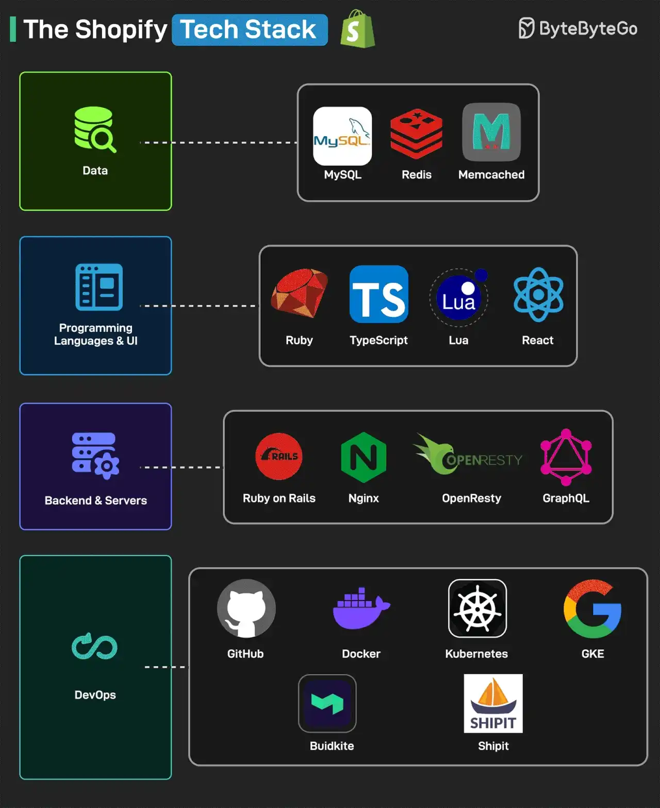

# 047 - Tech stack của Shopify

- Nguồn: ByteByteGo Big Archive System Design 2025
- Trang PDF: 98-99
- Ảnh minh họa: `../assets/047/figure-01.png`

## Hình minh họa

## Dịch sát

Shopify là một multi-channel commerce platform dành cho small và medium business. Nó cho phép merchant tạo shop và bán sản phẩm ở bất cứ nơi nào họ muốn.

Dưới đây là Shopify Tech Stack, vận hành hơn 600.000 merchant và phục vụ 80.000 request mỗi giây trong peak traffic.

1. Programming Languages & UI: họ dùng Ruby, Typescript, Lua và React.

2. Backend & Servers: họ dùng Ruby on Rails, Nginx, OpenResty và GraphQL.

3. Data: họ dùng MySQL, Redis và Memcached.

4. DevOps: họ dùng GitHub, Docker, Kubernetes, GKE, BuildKite và ShipIt. ShipIt cũng đã được open-source.

Reference: E-Commerce at Scale: Inside Shopify's Tech Stack.

## Dịch nội dung trong hình

- `Data`: MySQL, Redis và Memcached.
- `Programming Languages & UI`: Ruby, TypeScript, Lua và React.
- `Backend & Servers`: Ruby on Rails, Nginx, OpenResty và GraphQL.
- `DevOps`: GitHub, Docker, Kubernetes, GKE, Buildkite và ShipIt.

## Tóm tắt & giải thích dễ hiểu

Shopify là ví dụ cho thấy hệ thống rất lớn vẫn có thể dựa trên các công nghệ quen thuộc nếu được vận hành và tối ưu tốt. Ruby on Rails xử lý nhiều business logic commerce, MySQL lưu dữ liệu quan trọng, Redis/Memcached hỗ trợ cache, Nginx/OpenResty đứng ở lớp server/proxy, GraphQL hỗ trợ API query linh hoạt, Kubernetes/GKE giúp orchestration.

Điểm đáng học không phải là “copy stack Shopify”, mà là cách stack phục vụ domain. E-commerce cần correctness cho order/payment, cache cho traffic đọc nhiều, deploy pipeline chắc chắn, observability tốt và khả năng scale peak traffic.

## Ghi chú kỹ thuật - không nằm trong tài liệu gốc

Các con số như 600.000 merchant và 80.000 request/second là theo tài liệu gốc. Với công ty hiện đại, số liệu có thể thay đổi theo thời gian; khi dùng cho quyết định kinh doanh/kỹ thuật hiện tại, nên kiểm tra nguồn chính thức mới nhất.

## Ví dụ thực tế - không nằm trong tài liệu gốc

Một SaaS thương mại điện tử nhỏ không cần bắt đầu bằng Kubernetes ngay. Có thể bắt đầu bằng Rails/Laravel/Node monolith, PostgreSQL/MySQL, Redis cache và CI/CD đơn giản. Khi traffic tăng, mới tách worker, thêm queue, cache, read replica, CDN và orchestration.

## Thuật ngữ chính

- `Multi-channel commerce`: bán hàng qua nhiều kênh như web, social, marketplace, POS.
- `Merchant`: người bán/cửa hàng dùng nền tảng.
- `OpenResty`: nền tảng web dựa trên Nginx và LuaJIT.
- `GraphQL`: API query language cho phép client chọn dữ liệu cần lấy.
- `GKE`: Google Kubernetes Engine.
- `Buildkite`: CI/CD platform.
- `ShipIt`: tool deployment/release được Shopify open-source.
