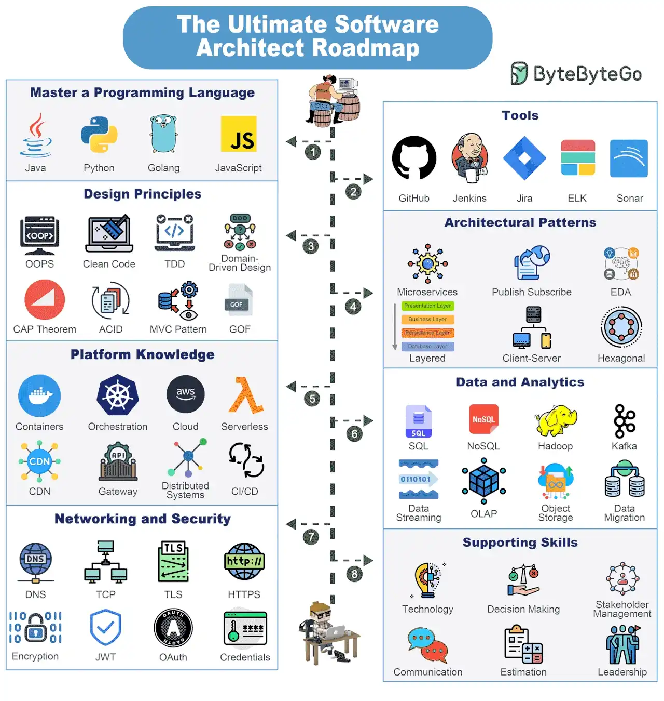

# 048 - Bản đồ kiến thức cho Software Architect

- Nguồn: ByteByteGo Big Archive System Design 2025
- Trang PDF: 100-101
- Ảnh minh họa: `../assets/048/figure-01.png`

## Hình minh họa

## Dịch sát

Trở thành Software Architect là một hành trình mà bạn luôn luôn học hỏi. Nhưng có một số thứ bạn chắc chắn phải cố gắng nắm vững.

1. Master a Programming Language

   Hãy cố gắng master 1-2 programming language như Java, Python, Golang, JavaScript, v.v.

2. Tools

   Xây dựng proficiency với các tool quan trọng như GitHub, Jenkins, Jira, ELK, Sonar, v.v.

3. Design Principles

   Học các design principle quan trọng như OOPS, Clean Code, TDD, DDD, CAP Theorem, MVC Pattern, ACID và GOF.

4. Architectural Principles

   Trở nên thành thạo nhiều architectural pattern như Microservices, Publish-Subscribe, Layered, Event-Driven, Client-Server, Hexagonal, v.v.

5. Platform Knowledge

   Tìm hiểu nhiều platform như container, orchestration, cloud, serverless, CDN, API Gateway, Distributed Systems và CI/CD.

6. Data Analytics

   Xây dựng kiến thức vững về data và analytics component như SQL và NoSQL database, data streaming solution với Kafka, object storage, data migration, OLAP, v.v.

7. Networking and Security

   Học các concept networking và security như DNS, TCP, TLS, HTTPS, Encryption, JWT, OAuth và Credential Management.

8. Supporting Skills

   Ngoài kỹ thuật, software architect cũng cần nhiều supporting skill như decision-making, technology knowledge, stakeholder management, communication, estimation, leadership, v.v.

Câu hỏi dành cho bạn: Bạn sẽ thêm gì khác vào roadmap?

## Dịch nội dung trong hình

- `Master a Programming Language`: Java, Python, Golang và JavaScript.
- `Design Principles`: OOPS, Clean Code, TDD, Domain-Driven Design, CAP Theorem, ACID, MVC Pattern và GOF.
- `Platform Knowledge`: containers, orchestration, cloud, serverless, CDN, API Gateway, distributed systems và CI/CD.
- `Networking and Security`: DNS, TCP, TLS, HTTPS, encryption, JWT, OAuth và credentials.
- `Tools`: GitHub, Jenkins, Jira, ELK và Sonar.
- `Architectural Patterns`: microservices, publish-subscribe, EDA, layered, client-server và hexagonal.
- `Data and Analytics`: SQL, NoSQL, Hadoop, Kafka, data streaming, OLAP, object storage và data migration.
- `Supporting Skills`: technology, decision making, stakeholder management, communication, estimation và leadership.

## Tóm tắt & giải thích dễ hiểu

Software Architect không chỉ là người biết vẽ diagram. Architect cần nền tảng code đủ sâu để hiểu implementation trade-off, biết tool delivery/quality, nắm design principle, hiểu architectural pattern, biết platform/cloud/distributed systems, hiểu data/network/security và có kỹ năng giao tiếp để ra quyết định cùng stakeholder.

Một architect tốt phải nối được business requirement với technical decision. Ví dụ yêu cầu “hệ thống không downtime” kéo theo HA, deployment strategy, database migration, observability và rollback. Yêu cầu “dữ liệu tài chính không sai” kéo theo transaction, consistency, audit log và permission.

## Ví dụ thực tế - không nằm trong tài liệu gốc

Khi thiết kế hệ thống workflow văn bản doanh nghiệp, architect cần chọn backend stack, database, queue, cache, file storage, search, auth/SSO, audit log, deployment pipeline và monitoring. Đồng thời phải giải thích trade-off cho business: vì sao cần queue cho OCR, vì sao cần object storage cho file, vì sao cần audit log cho compliance.

## Thuật ngữ chính

- `OOP/OOPS`: Object-Oriented Programming/System.
- `TDD`: Test-Driven Development.
- `DDD`: Domain-Driven Design.
- `CAP Theorem`: định lý về Consistency, Availability, Partition tolerance.
- `EDA`: Event-Driven Architecture.
- `Hexagonal Architecture`: kiến trúc ports-and-adapters tách domain khỏi adapter bên ngoài.
- `OLAP`: Online Analytical Processing cho phân tích dữ liệu.
- `Stakeholder management`: quản lý kỳ vọng và giao tiếp với các bên liên quan.

## Câu hỏi ôn tập + trả lời + thinking học tập + liên hệ

> Đây là phần học tập thêm ở cuối file. Câu hỏi ưu tiên lấy từ tài liệu gốc và được trả lời trực tiếp; nếu bài không có câu hỏi riêng thì dùng tiêu đề/nội dung chính để tạo câu hỏi tự kiểm tra.

### Câu hỏi 1

**Nguồn câu hỏi:** Câu hỏi trong tài liệu gốc.

**Câu hỏi:** Bạn sẽ thêm gì khác vào roadmap?

**Trả lời:** Danh sách sẽ đầy đủ hơn nếu thêm DNS caching/TTL và negative caching; TLS handshake/session resumption; CDN edge caching và origin shielding; và QUIC/HTTP/3 khi cần giảm latency. Các mục này giúp bức tranh đầy đủ hơn vì chúng chạm vào phần triển khai/vận hành mà bài gốc chưa đi sâu. Ý chính đang có của bài là: Software Architect không chỉ là người biết vẽ diagram. Architect cần nền tảng code đủ sâu để hiểu implementation trade-off, biết tool delivery/quality, nắm design principle, hiểu architectural pattern, biết platform/cloud/distributed systems, hiểu data/network/security và có kỹ năng giao tiếp để ra quyết định cùng stakeholder.

**Thinking học tập + liên hệ:** Đừng thêm mục cho dài danh sách; với `Bản đồ kiến thức cho Software Architect`, chỉ thêm thứ mở ra một nhóm vấn đề mới hoặc giúp ra quyết định thiết kế tốt hơn. Lens chính là DNS, transport, TLS, HTTP, proxy/CDN, application timeout và observability theo từng layer. Khi debug production, hãy tách latency theo DNS lookup, TCP connect, TLS handshake, TTFB và download để không đoán mò. Khi ghi chú lại, hãy giải thích được các keyword: `OOP/OOPS`, `TDD`, `DDD`, `CAP Theorem`, `EDA`.
