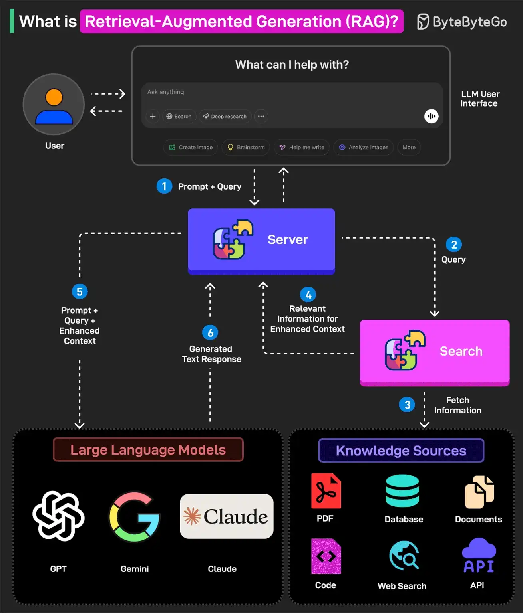

# 049 - Retrieval-Augmented Generation (RAG) là gì?

- Nguồn: ByteByteGo Big Archive System Design 2025
- Trang PDF: 102-103
- Ảnh minh họa: `../assets/049/figure-01.png`

## Hình minh họa

## Dịch sát

RAG là quá trình tối ưu output của một LLM để tham chiếu tới một knowledge base cụ thể, vốn có thể không nằm trong training data của model, trước khi tạo response.

Nói cách khác, RAG giúp mở rộng capability mạnh mẽ của LLM sang các domain hoặc knowledge base cụ thể mà không cần additional training.

Dưới đây là cách RAG hoạt động:

1. User viết một query prompt trong giao diện người dùng của LLM. Query này được chuyển tới backend server, nơi nó được convert thành vector representation.

2. Query được gửi tới một search system.

3. Search system này có thể tham chiếu nhiều knowledge source như PDF, Web Search, codebase, document, database hoặc API để fetch thông tin liên quan nhằm trả lời query.

4. Thông tin được fetch được gửi ngược về RAG model.

5. Model augment input gốc của user bằng cách thêm thông tin đã fetch vào context và gửi nó tới LLM endpoint. Một số lựa chọn LLM là GPT của OpenAI, Claude Sonnet, Google Gemini, v.v.

6. LLM sinh câu trả lời dựa trên enhanced context và cung cấp response cho user.

Câu hỏi dành cho bạn: Bạn đã dùng RAG với LLM yêu thích của mình chưa?

## Dịch nội dung trong hình

- `LLM User Interface`: giao diện để user nhập câu hỏi.
- `Prompt + Query`: prompt và query của user.
- `Server`: backend nhận query và điều phối RAG flow.
- `Search`: hệ thống tìm kiếm/retrieval.
- `Knowledge Sources`: nguồn tri thức như PDF, database, documents, code, web search và API.
- `Relevant Information for Enhanced Context`: thông tin liên quan được lấy về để tăng cường context.
- `Prompt + Query + Enhanced Context`: input gốc được bổ sung context truy xuất.
- `Large Language Models`: GPT, Gemini, Claude.
- `Generated Text Response`: câu trả lời do model sinh ra.

## Tóm tắt & giải thích dễ hiểu

RAG giải quyết một vấn đề rất thực tế: LLM không luôn biết dữ liệu riêng hoặc dữ liệu mới nhất của bạn. Thay vì fine-tune model mỗi khi tài liệu thay đổi, hệ thống tìm đoạn tài liệu liên quan, đưa vào context rồi yêu cầu LLM trả lời dựa trên context đó.

Một RAG system thường có hai phase. Phase ingest biến tài liệu thành chunks, tạo embedding và lưu vào vector database/search index. Phase query nhận câu hỏi, tạo embedding cho câu hỏi, tìm chunks liên quan, ghép context vào prompt và gọi LLM. Chất lượng RAG phụ thuộc rất nhiều vào chunking, embedding, retrieval, reranking, prompt và evaluation.

## Ví dụ thực tế - không nằm trong tài liệu gốc

Một công ty muốn chatbot trả lời theo quy trình nội bộ. Thay vì fine-tune LLM bằng toàn bộ tài liệu công ty, họ index PDF, wiki và source code vào vector database. Khi nhân viên hỏi “quy trình xin nghỉ phép thế nào?”, hệ thống retrieve đúng đoạn chính sách HR, đưa vào prompt và yêu cầu model trả lời kèm nguồn.

Nếu retrieval lấy sai tài liệu, LLM có thể trả lời sai dù model rất mạnh. Vì vậy production RAG cần logging, đánh giá retrieval quality và cơ chế trích nguồn.

## Thuật ngữ chính

- `RAG`: Retrieval-Augmented Generation, sinh câu trả lời có bổ sung dữ liệu truy xuất.
- `Knowledge base`: kho tri thức/tài liệu dùng để tham chiếu.
- `Embedding`: vector biểu diễn ý nghĩa của text.
- `Vector database`: nơi lưu và tìm kiếm embedding.
- `Chunking`: chia tài liệu thành đoạn nhỏ để index/retrieve.
- `Reranking`: sắp xếp lại kết quả retrieval để chọn context tốt hơn.
- `Context`: thông tin đưa vào prompt cho LLM xử lý.
