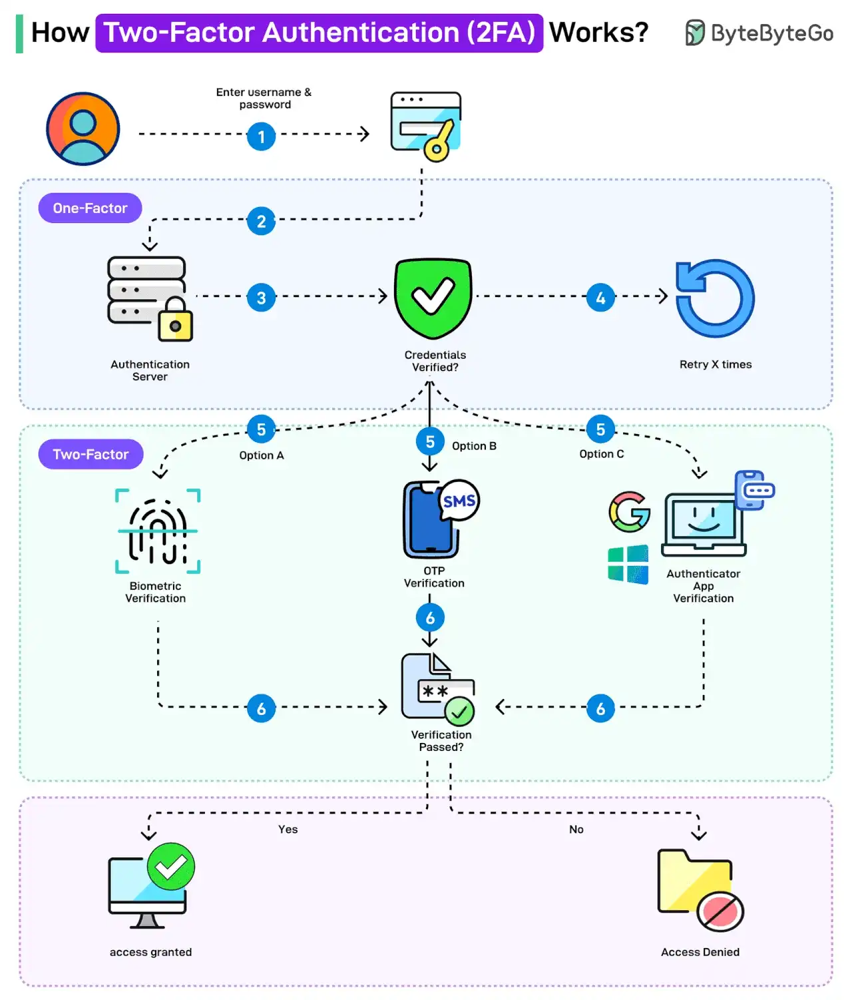

# 050 - Two-Factor Authentication (2FA) hoạt động như thế nào?

- Nguồn: ByteByteGo Big Archive System Design 2025
- Trang PDF: 104-105
- Ảnh minh họa: `../assets/050/figure-01.png`

## Hình minh họa

## Dịch sát

Two-factor authentication, viết tắt là 2FA, là một loại multi-factor authentication giúp account an toàn hơn.

Ý tưởng phía sau 2FA là bạn cần cung cấp hai identifying factor để chứng minh identity và truy cập account.

Factor đầu tiên là knowledge factor, trong đó user cần biết một secret, chẳng hạn password. Factor thứ hai phụ thuộc vào possession factor, chẳng hạn RSA hoặc authenticator app, hoặc inherence factor, chẳng hạn biometrics.

Dưới đây là cách 2FA hoạt động:

1. User nhập username và password. Đây là level authentication đầu tiên, còn gọi là single-factor.

2. Authentication request đi tới authentication server.

3. Authentication credentials được verify.

4. Nếu credential sai, có thể cho phép một số lần retry nhất định.

5. Nếu credential đúng, two-factor authentication bắt đầu. Có nhiều option: biometric verification, OTP verification hoặc Authenticator App Verification. Các tổ chức như Google và Microsoft cũng cung cấp các app như vậy.

6. User verify bằng option đã chọn.

7. Nếu verification thất bại, access bị denied. Nếu verification thành công, access được granted.

Lưu ý rằng OTP verification bằng SMS thường được xem là kém an toàn hơn như một cơ chế 2FA.

Câu hỏi dành cho bạn: Bạn đã dùng two-factor authentication chưa?

## Dịch nội dung trong hình

- `One-Factor`: user nhập username và password.
- `Authentication Server`: server xác thực credential.
- `Credentials Verified?`: kiểm tra credential đúng hay sai.
- `Retry x times`: cho phép thử lại số lần giới hạn khi sai.
- `Two-Factor`: bước xác thực thứ hai.
- `Option A - Biometric Verification`: xác thực sinh trắc học.
- `Option B - OTP Verification`: mã OTP, ví dụ qua SMS.
- `Option C - Authenticator App Verification`: app như Google/Microsoft Authenticator tạo code.
- `Verified/Passed?`: kiểm tra factor thứ hai.
- `Access granted`: cấp quyền truy cập.
- `Access Denied`: từ chối truy cập.

## Tóm tắt & giải thích dễ hiểu

2FA tăng bảo mật bằng cách yêu cầu hai loại bằng chứng khác nhau. Password thuộc nhóm “thứ bạn biết”. Authenticator app hoặc hardware key thuộc nhóm “thứ bạn có”. Biometrics thuộc nhóm “thứ thuộc về bạn”. Nếu attacker biết password nhưng không có factor thứ hai, họ vẫn khó đăng nhập.

SMS OTP tiện nhưng yếu hơn vì có rủi ro SIM swap, phishing, interception hoặc malware đọc SMS. Authenticator app TOTP tốt hơn, còn passkey/hardware security key thường mạnh hơn vì chống phishing tốt hơn.

## Ví dụ thực tế - không nằm trong tài liệu gốc

Một admin panel production nên bắt buộc 2FA cho account có quyền cao. Sau khi nhập password đúng, user phải xác nhận TOTP từ authenticator app hoặc dùng WebAuthn/passkey. Với hành động nhạy cảm như chuyển tiền hoặc xóa dữ liệu, hệ thống có thể yêu cầu step-up authentication dù user đã login.

## Thuật ngữ chính

- `2FA`: xác thực hai yếu tố.
- `MFA`: xác thực đa yếu tố.
- `Knowledge factor`: thứ user biết, ví dụ password.
- `Possession factor`: thứ user sở hữu, ví dụ phone/security key.
- `Inherence factor`: đặc điểm sinh trắc học, ví dụ vân tay/khuôn mặt.
- `OTP`: One-Time Password, mật khẩu dùng một lần.
- `TOTP`: OTP dựa trên thời gian, thường dùng trong authenticator app.

## Câu hỏi ôn tập + trả lời + thinking học tập + liên hệ

> Đây là phần học tập thêm ở cuối file. Câu hỏi ưu tiên lấy từ tài liệu gốc và được trả lời trực tiếp; nếu bài không có câu hỏi riêng thì dùng tiêu đề/nội dung chính để tạo câu hỏi tự kiểm tra.

### Câu hỏi 1

**Nguồn câu hỏi:** Câu hỏi trong tài liệu gốc.

**Câu hỏi:** Bạn đã dùng two-factor authentication chưa?

**Trả lời:** Với `Two-Factor Authentication (2FA) hoạt động như thế nào?`, cách liên hệ tốt nhất là chọn một workload nhỏ rồi kiểm chứng bằng số liệu thay vì chọn theo cảm tính. Nên kiểm bằng workload nhỏ trước: latency, độ ổn định, khả năng debug, cost và rủi ro vận hành. Phần cốt lõi cần đem theo từ bài là: 2FA tăng bảo mật bằng cách yêu cầu hai loại bằng chứng khác nhau. Password thuộc nhóm “thứ bạn biết”. Authenticator app hoặc hardware key thuộc nhóm “thứ bạn có”. Biometrics thuộc nhóm “thứ thuộc về bạn”. Nếu attacker biết password nhưng không có factor thứ hai, họ vẫn khó đăng nhập.

**Thinking học tập + liên hệ:** Khi tự liên hệ `Two-Factor Authentication (2FA) hoạt động như thế nào?`, hãy viết ra một project cụ thể, lý do chọn công nghệ và lỗi vận hành có thể xảy ra. Lens chính là actor, trust boundary, dữ liệu nhạy cảm, lifetime của token/key, quyền truy cập và cơ chế revoke. Khi làm API thật, một endpoint chạy được chưa đủ; phải kiểm thêm abuse, audit log, error leakage, rate limit và quyền ở service chứa dữ liệu. Khi ghi chú lại, hãy giải thích được các keyword: `2FA`, `MFA`, `Knowledge factor`, `Possession factor`, `Inherence factor`.
