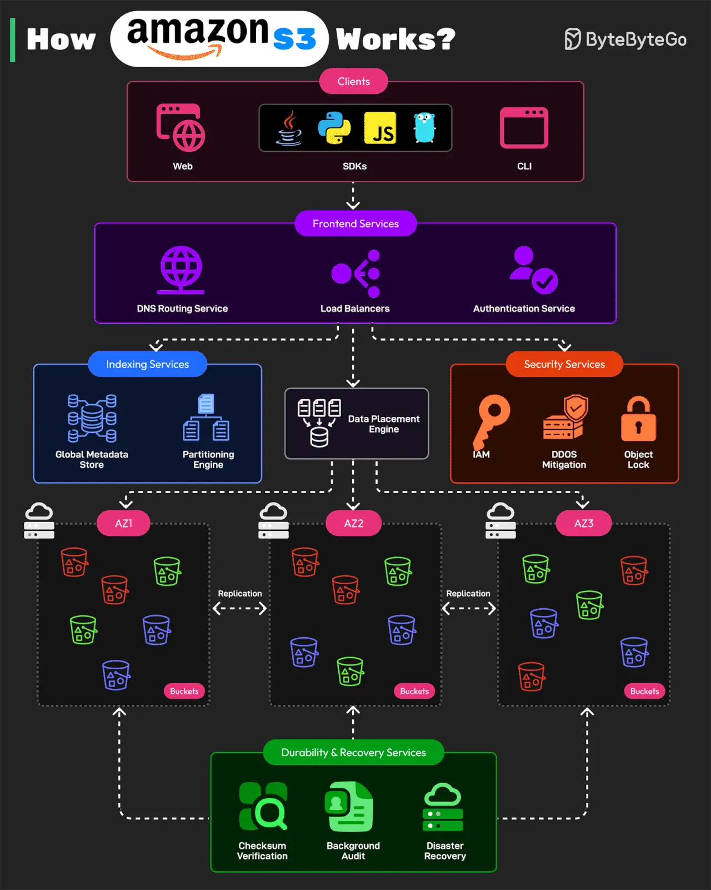

# 051 - Amazon S3 hoạt động như thế nào?

- Nguồn: ByteByteGo Big Archive System Design 2025
- Trang PDF: 106-107
- Ảnh minh họa: `../assets/051/figure-01.png`

## Hình minh họa

## Dịch sát

Bài viết này dựa trên:

1. Video AWS re:Invent 2023 - Dive deep on Amazon S3.

2. Bài “Building and operating a pretty big storage system called S3” được đăng trên All Things Distributed.

Amazon S3 là một trong những distributed storage system lớn nhất và phức tạp nhất thế giới. Nó xử lý hàng triệu request mỗi giây và lưu hơn 350 nghìn tỷ object trong khi duy trì durability 99.999999999%.

AWS thiết kế S3 bằng microservices-based design.

Dưới đây là cách nó hoạt động:

1. Front-end Request Handling Services

   Các service này nhận API request từ client. Client có thể là web, CLI và SDK cho các programming language như Java, Python, JS hoặc Golang. Sau khi nhận request, service authenticate user, validate request và route chúng tới storage service chính xác. Các service gồm DNS routing, authentication service và load balancing.

2. Indexing and Metadata Services

   Mỗi object được lưu trong S3 được gán một unique identifier và metadata. Indexing service theo dõi vị trí object. Chúng gồm global metadata store và partitioning engine.

3. Storage and Data Placement Services

   Phần này xử lý việc lưu trữ vật lý của object trên nhiều S3 node. Để bảo vệ khỏi mất dữ liệu, nó dùng erasure coding và multi-AZ replication.

4. Durability and Recovery Services

   Các service này đảm bảo data integrity và fault recovery. Chúng gồm checksum verification, background auditing và disaster recovery.

5. Security and Compliance Services

   Các service này bảo vệ S3 khỏi unauthorized access và hỗ trợ các feature như IAM và bucket policy, DDoS mitigation, Object Lock và versioning.

Câu hỏi dành cho bạn: Bạn đã dùng Amazon S3 chưa?

## Dịch nội dung trong hình

- `Clients`: web, SDK nhiều ngôn ngữ như Java/Python/JS/Go và CLI.
- `Frontend Services`: DNS Routing Service, Load Balancers và Authentication Service.
- `Indexing Services`: Global Metadata Store, Partitioning Engine và Data Placement Engine.
- `Security Services`: IAM, DDoS Mitigation và Object Lock.
- `AZ1/AZ2/AZ3`: dữ liệu được phân phối qua nhiều Availability Zone.
- `Replication`: sao chép dữ liệu giữa các vùng/lớp lưu trữ.
- `Storage Nodes`: các node lưu object thực tế.
- `Durability & Recovery Services`: Checksum Verification, Background Auditing và Disaster Recovery.

## Tóm tắt & giải thích dễ hiểu

S3 không chỉ là “một folder trên cloud”. Nó là distributed object storage cực lớn, chia thành nhiều lớp service: lớp nhận request, lớp metadata/index, lớp đặt dữ liệu vào storage node, lớp durability/recovery và lớp security/compliance.

Khi bạn `PUT` một object, request đi qua authentication/authorization, metadata được ghi để biết object nằm ở đâu, dữ liệu được phân phối qua nhiều node/AZ, checksum được dùng để kiểm tra toàn vẹn, và replication/erasure coding giúp tăng durability. Khi bạn `GET`, metadata/index giúp tìm vị trí object và trả dữ liệu về client.

S3 phù hợp lưu object như ảnh, video, backup, log, data lake file và static asset. Nó không phải database relational và không phù hợp cho update từng row nhỏ như SQL database.

## Ví dụ thực tế - không nằm trong tài liệu gốc

Một hệ thống upload video có thể lưu file gốc vào S3, metadata video vào PostgreSQL, thumbnail vào S3, CDN phía trước để phát nhanh, lifecycle policy để chuyển video cũ sang storage class rẻ hơn và Object Lock cho dữ liệu cần chống xóa/sửa theo compliance.

## Thuật ngữ chính

- `Object storage`: lưu dữ liệu dạng object gồm data, key và metadata.
- `Bucket`: container logic chứa object trong S3.
- `Durability`: xác suất dữ liệu không bị mất.
- `Availability Zone`: khu vực hạ tầng độc lập trong một region.
- `Erasure coding`: kỹ thuật chia/mã hóa dữ liệu để phục hồi khi mất một phần.
- `Checksum`: giá trị kiểm tra toàn vẹn dữ liệu.
- `Object Lock`: cơ chế khóa object để chống sửa/xóa trong thời gian nhất định.

## Câu hỏi ôn tập + trả lời + thinking học tập + liên hệ

> Đây là phần học tập thêm ở cuối file. Câu hỏi ưu tiên lấy từ tài liệu gốc và được trả lời trực tiếp; nếu bài không có câu hỏi riêng thì dùng tiêu đề/nội dung chính để tạo câu hỏi tự kiểm tra.

### Câu hỏi 1

**Nguồn câu hỏi:** Câu hỏi trong tài liệu gốc.

**Câu hỏi:** Bạn đã dùng Amazon S3 chưa?

**Trả lời:** Với `Amazon S3 hoạt động như thế nào?`, cách liên hệ tốt nhất là chọn một workload nhỏ rồi kiểm chứng bằng số liệu thay vì chọn theo cảm tính. Nên kiểm bằng workload nhỏ trước: latency, độ ổn định, khả năng debug, cost và rủi ro vận hành. Phần cốt lõi cần đem theo từ bài là: S3 không chỉ là “một folder trên cloud”. Nó là distributed object storage cực lớn, chia thành nhiều lớp service: lớp nhận request, lớp metadata/index, lớp đặt dữ liệu vào storage node, lớp durability/recovery và lớp security/compliance. Khi bạn `PUT` một object, request đi qua authentication/authorization, metadata được ghi để biết object nằm ở đâu, dữ liệu được phân phối qua nhiều node/AZ, checksum được dùng để kiểm tra toàn vẹn, và replication/erasure coding giúp tăng durability. Khi bạn `GET`, metadata/index...

**Thinking học tập + liên hệ:** Khi tự liên hệ `Amazon S3 hoạt động như thế nào?`, hãy viết ra một project cụ thể, lý do chọn công nghệ và lỗi vận hành có thể xảy ra. Lens chính là quality, latency, cost/token, privacy, cập nhật tri thức và rủi ro hallucination. Khi build AI app, hãy nối model với pipeline thật: data vào đâu, context lấy từ đâu, output được kiểm thế nào và chi phí tăng theo traffic ra sao. Khi ghi chú lại, hãy giải thích được các keyword: `Object storage`, `Bucket`, `Durability`, `Availability Zone`, `Erasure coding`.
