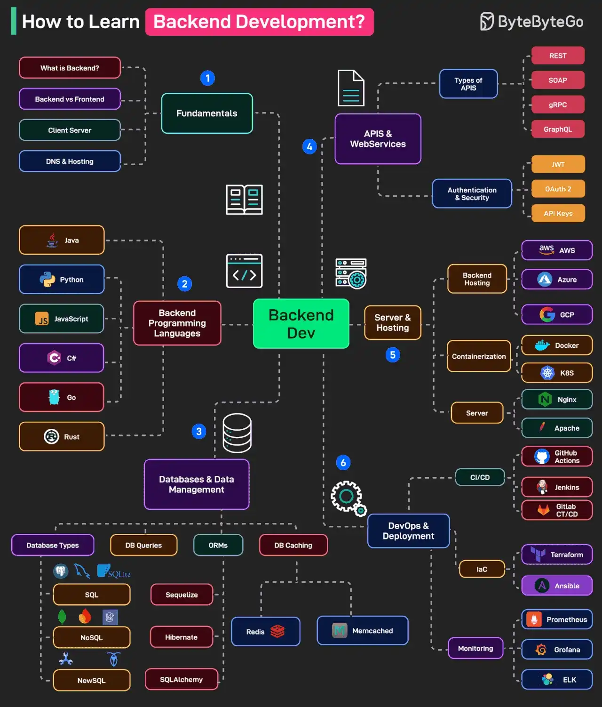

# 052 - Học Backend Development như thế nào?

- Nguồn: ByteByteGo Big Archive System Design 2025
- Trang PDF: 108-109
- Ảnh minh họa: `../assets/052/figure-01.png`

## Hình minh họa

## Dịch sát

Backend Development yêu cầu kiến thức ở nhiều khía cạnh. Dưới đây là mind map về những gì một developer nên học:

1. Fundamentals

   Bao gồm các chủ đề như backend vs frontend, client-server, DNS, v.v.

2. Backend Programming Languages

   Chọn một hoặc nhiều programming language như Java, Python, JS, Go, Rust và C#.

3. Databases

   Bao gồm các chủ đề như các loại database: SQL như Postgres, MySQL, SQLite; NoSQL như MongoDB, Firebase, DynamoDB; NewSQL như CockroachDB, Spanner. Các chủ đề khác gồm làm việc với ORM và Database Caching.

4. APIs and Web Services

   Học về API type như REST, GraphQL, gRPC, SOAP và authentication technique như JWT, OAuth 2, API keys.

5. Server and Hosting

   Bao gồm các chủ đề như backend hosting service trên AWS, Azure, GCP; containerization bằng Docker & Kubernetes; và server setup cho Nginx, Apache, v.v.

6. DevOps

   Học về CI/CD Pipeline bằng GitHub Actions và Jenkins, IaC như Terraform, Ansible và monitoring bằng các tool như Prometheus, Grafana, ELK.

Câu hỏi dành cho bạn: Bạn sẽ thêm gì khác vào danh sách học backend development?

## Dịch nội dung trong hình

- `What is Backend?`: backend vs frontend, client-server, DNS và networking.
- `Backend Programming Languages`: Java, Python, JavaScript, C#, Go và Rust.
- `Databases & Data Management`: database type, DB queries, ORM, DB caching, SQL/NoSQL/NewSQL.
- `APIs & WebServices`: API fundamentals, API type, authentication & security.
- `Server & Hosting`: backend hosting, containerization, servers.
- `DevOps & Deployment`: CI/CD, IaC, monitoring.
- Hình cũng liệt kê nhiều công nghệ liên quan như REST, SOAP, GraphQL, gRPC, JWT, OAuth2, API key, Docker, Kubernetes, Nginx, Apache, AWS, GCP, Azure, Jenkins, GitHub Actions, Terraform, Ansible, Prometheus, Grafana và ELK.

## Tóm tắt & giải thích dễ hiểu

Backend development là phần xây dựng logic phía server: API, database, authentication, business logic, integration, deployment và observability. Một backend developer tốt không chỉ biết viết endpoint, mà còn hiểu HTTP, database, cache, queue, security, deployment và monitoring.

Lộ trình hợp lý là học foundation trước: HTTP, client-server, DNS, một ngôn ngữ backend và một framework. Sau đó học database, API design, auth/security, Docker, deployment, logging/monitoring và CI/CD. Khi hệ thống lớn hơn, học thêm queue, caching strategy, distributed systems và cloud architecture.

## Ví dụ thực tế - không nằm trong tài liệu gốc

Nếu bạn chọn Node.js/TypeScript, có thể học Express/NestJS/Elysia, PostgreSQL, Redis, REST API, JWT/OAuth2, Docker, GitHub Actions, Nginx và Prometheus/Grafana. Nếu chọn Java, có thể học Spring Boot, JPA, PostgreSQL, Redis, Kafka, Docker và Kubernetes.

Quan trọng là build project thật: auth, CRUD, file upload, pagination, background job, cache, logging, test và deploy.

## Thuật ngữ chính

- `Backend`: phần server xử lý logic, dữ liệu và API.
- `ORM`: Object-Relational Mapping, ánh xạ object code với table database.
- `NewSQL`: database cố gắng kết hợp SQL và khả năng scale phân tán.
- `API`: interface để client/service giao tiếp với backend.
- `IaC`: Infrastructure as Code.
- `Monitoring`: theo dõi sức khỏe, metric, log và alert của hệ thống.

## Câu hỏi ôn tập + trả lời + thinking học tập + liên hệ

> Đây là phần học tập thêm ở cuối file. Câu hỏi ưu tiên lấy từ tài liệu gốc và được trả lời trực tiếp; nếu bài không có câu hỏi riêng thì dùng tiêu đề/nội dung chính để tạo câu hỏi tự kiểm tra.

### Câu hỏi 1

**Nguồn câu hỏi:** Câu hỏi trong tài liệu gốc.

**Câu hỏi:** Bạn sẽ thêm gì khác vào danh sách học backend development?

**Trả lời:** Phần còn thiếu đáng cân nhắc là SLO/error budget để biết hệ thống đủ tốt hay chưa; blue-green/canary deployment để giảm rủi ro release; secret management và least privilege IAM; và cost monitoring/tagging cho cloud bill. Các mục này giúp bức tranh đầy đủ hơn vì chúng chạm vào phần triển khai/vận hành mà bài gốc chưa đi sâu. Ý chính đang có của bài là: Backend development là phần xây dựng logic phía server: API, database, authentication, business logic, integration, deployment và observability. Một backend developer tốt không chỉ biết viết endpoint, mà còn hiểu HTTP, database, cache, queue, security, deployment và monitoring.

**Thinking học tập + liên hệ:** Khi bài hỏi còn thiếu gì trong `Học Backend Development như thế nào?`, hãy so danh sách hiện tại với nhu cầu production: scale, debug, security, cost và vận hành. Lens chính là độ phức tạp vận hành, rollback, cost, kỹ năng team, observability và blast radius khi hỏng. Khi đưa lên production, hãy map từng thành phần vào deploy, rollback, monitoring, alerting, secret, cost và ownership rõ ràng. Khi ghi chú lại, hãy giải thích được các keyword: `Backend`, `ORM`, `NewSQL`, `API`, `IaC`.
