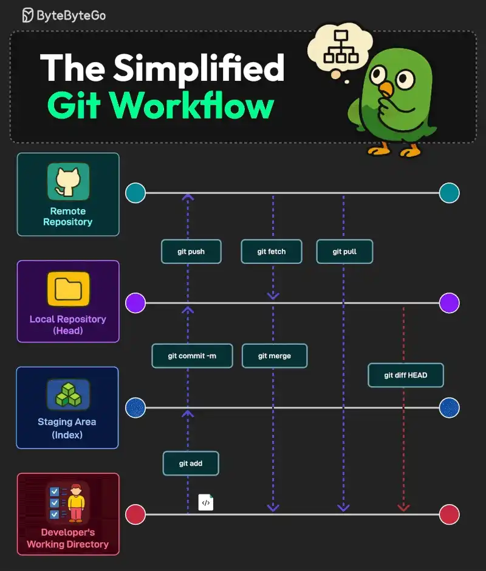

# 053 - Git workflow đơn giản hóa

- Nguồn: ByteByteGo Big Archive System Design 2025
- Trang PDF: 110-111
- Ảnh minh họa: `../assets/053/figure-01.png`

## Hình minh họa

## Dịch sát

Học Git là một trong những kỹ năng nền tảng cho mọi developer. Dưới đây là các bước trong một Git workflow đơn giản và cơ bản.

1. Developer's Working Directory, Untracked, tới Staging Area, Index

   Command tương ứng là `git add`. File đi từ untracked sang staged.

2. Staging Area tới Local Repository, Head

   Command cho bước này là `git commit -m "message"`. Nó lưu thay đổi vào local repository, HEAD, đánh dấu một version history.

3. Local Repository tới Remote Repository, Remote

   Command cho bước này là `git push`. Nó upload các committed changes lên remote repository, chẳng hạn GitHub, để collaboration.

4. Remote Repository tới Local Repository

   Các command `git pull` và `git fetch` hỗ trợ việc này. `git pull` update local file với remote changes. Ngược lại, `git fetch` lấy remote changes nhưng không merge chúng. Command `git merge` kết hợp change từ các branch khác nhau.

5. Checking the Differences

   Command `git diff HEAD` hiển thị khác biệt giữa working directory của developer và commit mới nhất.

Câu hỏi dành cho bạn: Bạn còn theo bước nào khác trong Git workflow của mình?

## Dịch nội dung trong hình

- `Remote Repository`: repository ở remote như GitHub.
- `Local Repository (Head)`: repository local sau commit.
- `Staging Area (Index)`: vùng chuẩn bị thay đổi trước commit.
- `Developer's Working Directory`: thư mục làm việc của developer.
- `git add`: đưa file vào staging area.
- `git commit -m`: tạo commit từ staged changes.
- `git push`: đẩy commit lên remote.
- `git fetch`: lấy metadata/commit từ remote nhưng chưa merge.
- `git pull`: fetch rồi merge/rebase vào branch hiện tại tùy cấu hình.
- `git merge`: hợp nhất branch/change.
- `git diff HEAD`: xem diff giữa working tree và HEAD.

## Tóm tắt & giải thích dễ hiểu

Git workflow cơ bản có bốn vùng chính: working directory, staging area, local repository và remote repository. Bạn sửa file trong working directory, dùng `git add` để chọn phần muốn commit, dùng `git commit` để lưu snapshot vào local repo, rồi `git push` để chia sẻ lên remote.

`git fetch` an toàn hơn `git pull` khi bạn muốn xem remote thay đổi gì trước. `git pull` tiện nhưng có thể merge/rebase ngay vào branch local. `git diff`, `git status` và `git log` là các lệnh nên dùng thường xuyên để biết mình đang ở trạng thái nào.

## Ví dụ thực tế - không nằm trong tài liệu gốc

Một workflow hằng ngày: tạo branch `feature/payment`, sửa code, chạy test, `git status`, `git add src/payment.ts`, `git commit -m "add payment validation"`, `git fetch origin`, rebase/merge với main nếu cần, rồi `git push` và mở pull request.

## Thuật ngữ chính

- `Working directory`: thư mục file bạn đang sửa.
- `Staging area`: vùng chọn thay đổi sẽ đi vào commit.
- `HEAD`: commit hiện tại branch đang trỏ tới.
- `Remote`: repository ở server như GitHub/GitLab.
- `Fetch`: lấy dữ liệu remote về local mà chưa hợp nhất.
- `Merge`: hợp nhất lịch sử/thay đổi từ branch khác.
