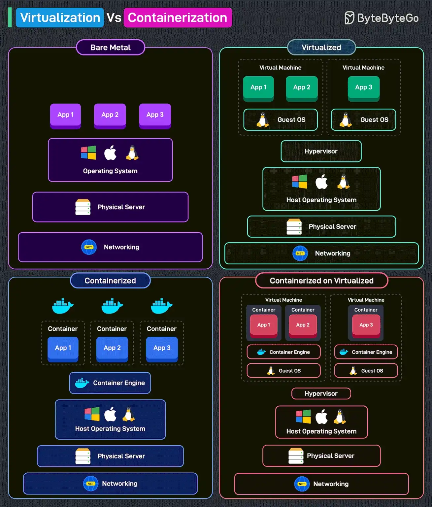

# 054 - Virtualization vs Containerization

- Nguồn: ByteByteGo Big Archive System Design 2025
- Trang PDF: 112-113
- Ảnh minh họa: `../assets/054/figure-01.png`

## Hình minh họa

## Dịch sát

Virtualization tạo nhiều VM trên một physical server duy nhất, mỗi VM có operating system riêng, bằng cách dùng hypervisor.

Containerization là một phương pháp virtualization nhẹ, chạy application trong các môi trường cô lập, tức container, dùng chung cùng operating system.

Hãy xem các khả năng khác nhau chi tiết hơn.

1. Bare Metal: Application chạy trực tiếp trên operating system. Không dùng virtualization hoặc containerization. Nó cung cấp performance cao nhưng thiếu flexibility.

2. Virtualized: dùng hypervisor để tạo VM. Mỗi VM có guest OS riêng, khiến nó nặng hơn về resource. Cung cấp isolation mạnh nhưng thêm overhead.

3. Containerized: dùng container engine thay vì hypervisor. Container chia sẻ host operating system, khiến chúng nhẹ và hiệu quả. Nó nhanh hơn và scalable hơn VM.

4. Containerized on Virtualized: chạy container bên trong VM. Cung cấp cả flexibility và isolation, phổ biến trong hybrid cloud environment. Nó cân bằng resource efficiency với security.

Câu hỏi dành cho bạn: Bạn đã dùng VM và Container để deploy workload chưa?

## Dịch nội dung trong hình

- `Bare Metal`: app chạy trực tiếp trên operating system của physical server.
- `Virtualized`: physical server chạy host operating system, hypervisor tạo nhiều virtual machine; mỗi VM có guest OS và app riêng.
- `Containerized`: host OS chạy container engine; nhiều container chia sẻ cùng kernel/OS.
- `Containerized on Virtualized`: VM chạy guest OS và container engine, container chạy bên trong VM.
- Hình nhấn mạnh trade-off giữa performance, isolation, overhead và portability.

## Tóm tắt & giải thích dễ hiểu

Virtualization mô phỏng cả máy tính, nên mỗi VM có OS riêng. Điều này giúp isolation mạnh nhưng tốn CPU/RAM/storage hơn. Containerization cô lập ở mức process/user space và chia sẻ kernel host OS, nên nhẹ hơn, khởi động nhanh hơn và phù hợp deploy nhiều service.

Trong cloud hiện đại, container thường chạy bên trong VM. Ví dụ Kubernetes node trên AWS/GCP/Azure thường là VM; bên trong VM đó chạy container runtime và pod. Cách này kết hợp isolation của VM với tính linh hoạt của container.

## Ví dụ thực tế - không nằm trong tài liệu gốc

Một database production truyền thống có thể chạy trên VM để kiểm soát tài nguyên và isolation tốt. Một backend microservice stateless phù hợp đóng gói bằng Docker container và deploy trên Kubernetes. Với môi trường local, Docker giúp developer chạy app cùng dependency mà không cài trực tiếp lên máy.

## Thuật ngữ chính

- `VM`: Virtual Machine, máy ảo có OS riêng.
- `Hypervisor`: lớp tạo và quản lý VM.
- `Container`: môi trường cô lập nhẹ chia sẻ kernel host.
- `Container engine`: runtime chạy container, ví dụ Docker/containerd.
- `Guest OS`: OS chạy bên trong VM.
- `Bare metal`: chạy trực tiếp trên phần cứng/OS không qua ảo hóa.
- `Isolation`: mức độ cô lập giữa workload.
