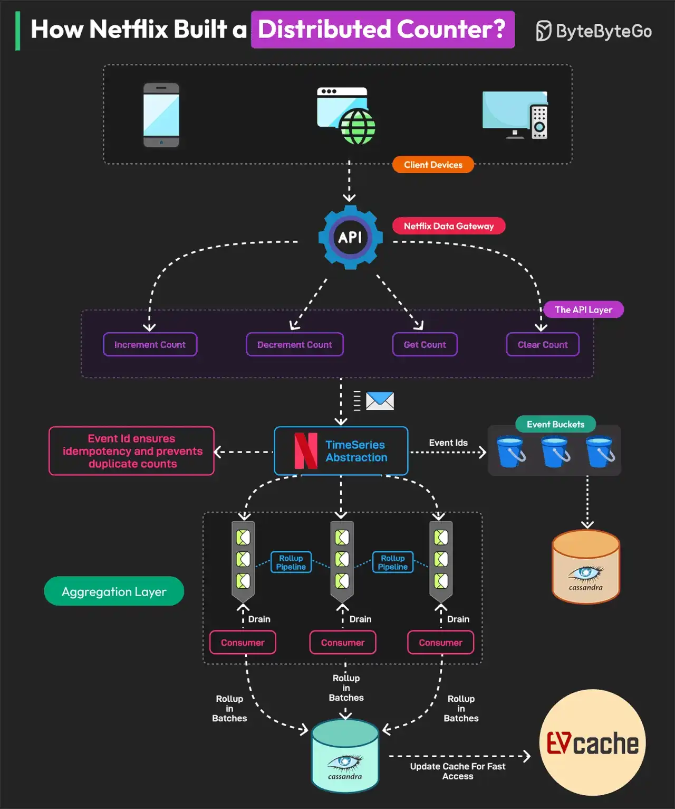

# 055 - Netflix xây dựng Distributed Counter như thế nào?

- Nguồn: ByteByteGo Big Archive System Design 2025
- Trang PDF: 114-115
- Ảnh minh họa: `../assets/055/figure-01.png`

## Hình minh họa

## Dịch sát

Distributed Counter là một hệ thống trong đó trách nhiệm đếm event được phân tán trên nhiều server hoặc node trong một network. Netflix cần track và đo lường nhiều user interaction để đưa ra decision real-time và tối ưu infrastructure.

Vì lý do này, họ xây dựng một Distributed Counter Abstraction.

Distributed Counter Abstraction của Netflix hoạt động trong bốn layer chính, đảm bảo high performance, scalability và eventual consistency.

1. Client API Layer

   User tương tác với hệ thống bằng cách gửi request AddCount, GetCount hoặc ClearCount. Netflix Data Gateway xử lý và route các request này hiệu quả.

2. Event Logging and TimeSeries Storage

   Event được lưu trong Netflix TimeSeries Abstraction để scale. Mỗi event được gắn Event ID để đảm bảo idempotency. Để tránh database contention, event được nhóm thành time partition gọi là bucket. Dữ liệu được lưu trong Cassandra.

3. Rollup Pipeline or Aggregation

   Rollup Queue thu thập event change và xử lý chúng theo batch. Aggregation xảy ra trong immutable time window, đảm bảo rollup calculation chính xác. Dữ liệu được lưu trong Cassandra Rollup Store để eventual consistency.

4. Read Optimization, Cache & Query Handling

   Aggregated counter value được cache trong EVCache để đọc cực nhanh. Nếu cache value stale, background rollup refresh cập nhật nó. Mô hình này cho phép Netflix xử lý 75K request mỗi giây với latency single-digit millisecond.

## Dịch nội dung trong hình

- `Client Devices`: mobile/web/device gửi request.
- `API`: entry point nhận request.
- `Netflix Data Gateway`: gateway route request tới abstraction layer.
- `The API Layer`: gồm Increment Count, Decrement Count, Get Count và Clear Count.
- `TimeSeries Abstraction`: lưu event theo time series.
- `Event Buckets`: gom event thành bucket theo thời gian.
- `Aggregation Layer`: consumer xử lý stream/batch và rollup dữ liệu.
- `Cassandra`: lưu event và rollup store.
- `EVCache`: cache giá trị counter để đọc nhanh.
- `Rollup Queue`: queue dùng để batch/rollup update.
- `Event Id ensures idempotency`: Event ID đảm bảo xử lý lặp không làm sai count.

## Tóm tắt & giải thích dễ hiểu

Đếm ở quy mô lớn không đơn giản như `count = count + 1` trong một row database. Nếu hàng chục nghìn request mỗi giây cùng update một key, database sẽ bị contention. Netflix tách counter thành event log/time bucket, rollup pipeline và cache đọc nhanh.

Thiết kế này ưu tiên throughput và eventual consistency. Write path ghi event idempotent vào storage phân tán. Aggregation tính toán theo time window bất biến. Read path đọc counter đã aggregate từ cache. Nếu cache stale, background job refresh lại thay vì block request path.

## Ví dụ thực tế - không nằm trong tài liệu gốc

Một nền tảng video cần đếm view/like theo video realtime. Nếu mỗi view update trực tiếp một row `videos.view_count`, row đó sẽ hot và lock nhiều. Cách tốt hơn là ghi event `VideoViewed` vào log/queue, aggregate theo bucket 1 phút, lưu rollup và cache tổng count. UI có thể chấp nhận count trễ vài giây nhưng hệ thống scale tốt hơn nhiều.

## Thuật ngữ chính

- `Distributed Counter`: counter được xử lý phân tán qua nhiều node.
- `Idempotency`: xử lý lặp cùng event không làm thay đổi kết quả sai.
- `Time bucket`: nhóm event theo khoảng thời gian.
- `Rollup`: tổng hợp dữ liệu chi tiết thành dữ liệu aggregate.
- `Eventual consistency`: dữ liệu sẽ nhất quán sau một độ trễ nhất định.
- `Contention`: nhiều request tranh cùng tài nguyên gây nghẽn.
- `EVCache`: caching solution của Netflix dựa trên Memcached.

## Câu hỏi ôn tập + trả lời + thinking học tập + liên hệ

> Đây là phần học tập thêm ở cuối file. Câu hỏi ưu tiên lấy từ tài liệu gốc và được trả lời trực tiếp; nếu bài không có câu hỏi riêng thì dùng tiêu đề/nội dung chính để tạo câu hỏi tự kiểm tra.

### Câu hỏi 1

**Nguồn câu hỏi:** Suy ra từ tiêu đề/nội dung chính vì bài gốc không có câu hỏi riêng.

**Câu hỏi:** How Netflix Built a Distributed Counter?

**Trả lời:** Luồng tốt nhất là lần theo input tới output: request/dữ liệu đi vào đâu, qua thành phần nào, state đổi ở đâu và kết quả trả ra thế nào. Với `Netflix xây dựng Distributed Counter như thế nào?`, ý chính là: Đếm ở quy mô lớn không đơn giản như `count = count + 1` trong một row database. Nếu hàng chục nghìn request mỗi giây cùng update một key, database sẽ bị contention. Netflix tách counter thành event log/time bucket, rollup pipeline và cache đọc nhanh. Thiết kế này ưu tiên throughput và eventual consistency. Write path ghi event idempotent vào storage phân tán. Aggregation tính toán theo time window bất biến. Read path đọc counter đã aggregate từ cache. Nếu cache stale, background job refresh lại thay vì block...

**Thinking học tập + liên hệ:** Luồng trong `Netflix xây dựng Distributed Counter như thế nào?` nên được vẽ từ input tới output, kèm owner của từng bước và failure mode ở mỗi boundary. Lens chính là requirement, constraint, traffic, dữ liệu, failure mode và khả năng vận hành của team. Khi gặp system design thật, hãy biến khái niệm thành quyết định: boundary ở đâu, data flow thế nào, bottleneck nào đến trước và rollback ra sao. Khi ghi chú lại, hãy giải thích được các keyword: `Distributed Counter`, `Idempotency`, `Time bucket`, `Rollup`, `Eventual consistency`.
