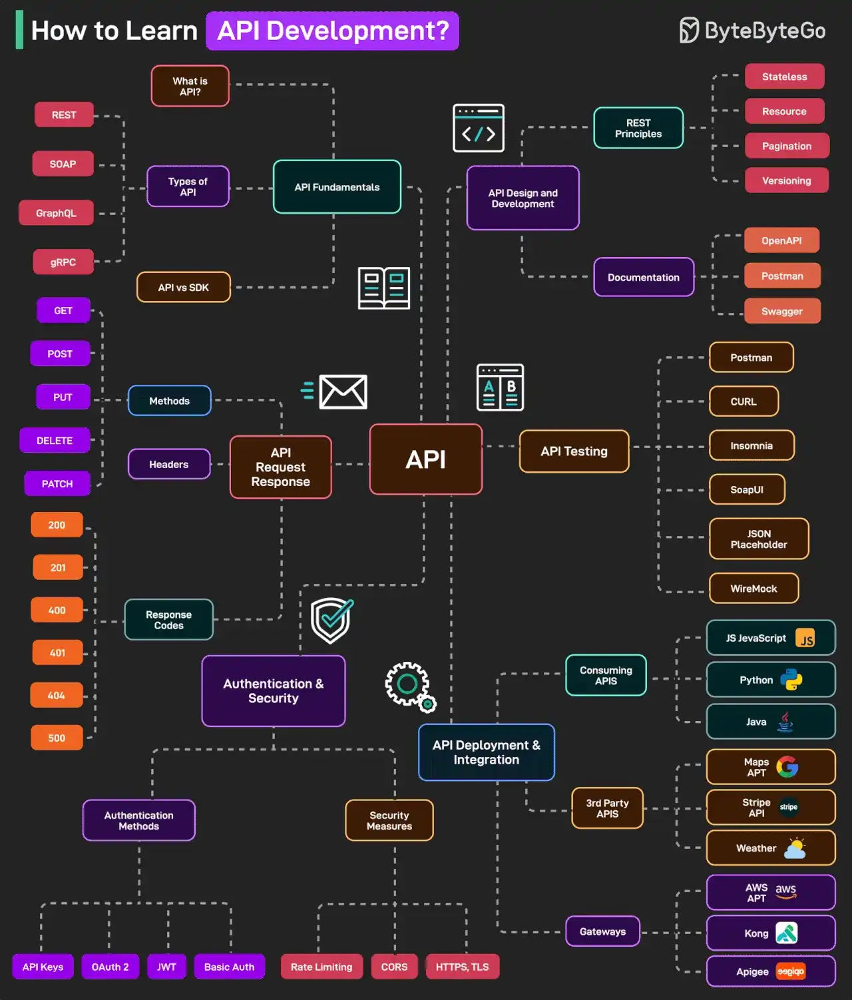

# 056 - Học API Development như thế nào?

- Nguồn: ByteByteGo Big Archive System Design 2025
- Trang PDF: 116-117
- Ảnh minh họa: `../assets/056/figure-01.png`

## Hình minh họa

## Dịch sát

Học cách phát triển API là một kỹ năng quan trọng cho developer hiện đại. Dưới đây là mind map về tất cả những gì bạn cần học về API development:

1. API Fundamentals

   API là gì, các loại API như REST, SOAP, GraphQL, gRPC, v.v., và API vs SDK.

2. API Request/Response

   HTTP Methods, Response Codes và Headers.

3. Authentication and Security

   Các authentication mechanism như JWT, OAuth 2, API Keys, Basic Auth và security strategy.

4. API Design and Development

   RESTful API principle gồm stateless, resource-based URL, versioning và pagination. Ngoài ra còn có API documentation tool như OpenAPI, Postman, Swagger.

5. API Testing

   Các tool để test API như Postman, cURL, SoapUI, v.v.

6. API Deployment and Integration

   Consume API bằng nhiều language khác nhau như JS, Python và Java. Ngoài ra, làm việc với 3rd-party API như Google Maps API và Stripe API. Học về API Gateway như AWS, Kong, Apigee.

Câu hỏi dành cho bạn: Bạn sẽ thêm gì khác vào danh sách học API development?

## Dịch nội dung trong hình

- `API Fundamentals`: API là gì, API type, API vs SDK.
- `API Request Response`: HTTP methods, headers và response codes.
- `Authentication & Security`: authentication methods như API keys, OAuth2, JWT, Basic Auth; security measure như rate limiting, CORS, HTTPS/TLS.
- `API Design and Development`: REST principles, documentation, API framework như Express, Flask, FastAPI, Spring Boot, NestJS, Rails, Django, Laravel.
- `API Testing`: Postman, cURL, SoapUI, Insomnia, Swagger UI, API automation, load testing.
- `API Deployment & Integration`: consuming APIs bằng JavaScript/Python/Java, third-party APIs như Google Maps/Stripe, API gateway như AWS/Kong/Apigee.

## Tóm tắt & giải thích dễ hiểu

API development là kỹ năng giao tiếp hệ thống. Bạn cần hiểu HTTP foundation, thiết kế endpoint/resource, request/response, authentication, security, documentation, testing, deployment và integration. Một API tốt không chỉ chạy đúng mà còn dễ hiểu, version rõ, error nhất quán, có rate limit, có document và có test.

Với REST API, các nguyên tắc quan trọng là stateless, resource-based URL, HTTP method đúng nghĩa, status code rõ, pagination cho list lớn, idempotency cho operation dễ retry và versioning để không phá client cũ.

## Ví dụ thực tế - không nằm trong tài liệu gốc

API tạo payment nên có OpenAPI spec, authentication bằng OAuth2/JWT, idempotency key để retry không tạo giao dịch trùng, validation chặt, error code rõ, logging/audit, test bằng Postman/cURL và load test trước production. Nếu API public, nên thêm rate limiting và developer documentation.

## Thuật ngữ chính

- `SDK`: Software Development Kit, bộ thư viện/tool dùng API dễ hơn.
- `HTTP method`: GET, POST, PUT, PATCH, DELETE.
- `Status code`: mã phản hồi HTTP như 200, 400, 401, 404, 500.
- `OpenAPI`: chuẩn mô tả API machine-readable.
- `CORS`: cơ chế browser kiểm soát cross-origin request.
- `Load testing`: kiểm thử API dưới tải cao.
- `API Gateway`: lớp quản lý/route/bảo vệ API tập trung.

## Câu hỏi ôn tập + trả lời + thinking học tập + liên hệ

> Đây là phần học tập thêm ở cuối file. Câu hỏi ưu tiên lấy từ tài liệu gốc và được trả lời trực tiếp; nếu bài không có câu hỏi riêng thì dùng tiêu đề/nội dung chính để tạo câu hỏi tự kiểm tra.

### Câu hỏi 1

**Nguồn câu hỏi:** Câu hỏi trong tài liệu gốc.

**Câu hỏi:** Bạn sẽ thêm gì khác vào danh sách học API development?

**Trả lời:** Phần còn thiếu đáng cân nhắc là idempotency key cho API ghi dữ liệu hoặc payment; OpenAPI/contract validation để giảm sai lệch client-server; correlation id/distributed tracing để debug production; và threat modeling theo OWASP API Top 10. Các mục này giúp bức tranh đầy đủ hơn vì chúng chạm vào phần triển khai/vận hành mà bài gốc chưa đi sâu. Ý chính đang có của bài là: API development là kỹ năng giao tiếp hệ thống. Bạn cần hiểu HTTP foundation, thiết kế endpoint/resource, request/response, authentication, security, documentation, testing, deployment và integration. Một API tốt không chỉ chạy đúng mà còn dễ hiểu, version rõ, error nhất quán, có rate limit, có document và có test.

**Thinking học tập + liên hệ:** Đừng thêm mục cho dài danh sách; với `Học API Development như thế nào?`, chỉ thêm thứ mở ra một nhóm vấn đề mới hoặc giúp ra quyết định thiết kế tốt hơn. Lens chính là actor, trust boundary, dữ liệu nhạy cảm, lifetime của token/key, quyền truy cập và cơ chế revoke. Khi làm API thật, một endpoint chạy được chưa đủ; phải kiểm thêm abuse, audit log, error leakage, rate limit và quyền ở service chứa dữ liệu. Khi ghi chú lại, hãy giải thích được các keyword: `SDK`, `HTTP method`, `Status code`, `OpenAPI`, `CORS`.
