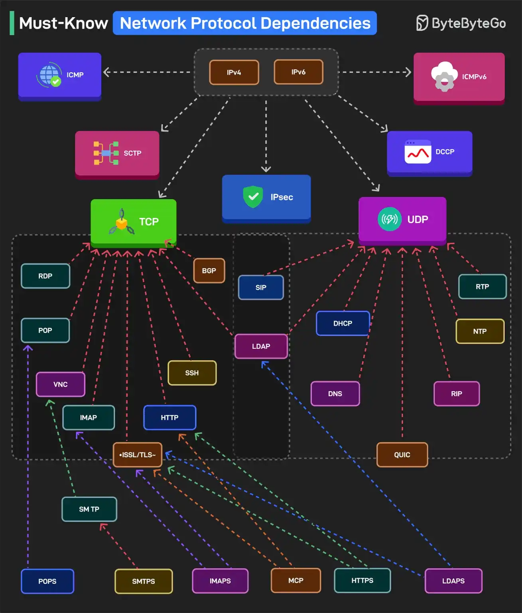

# 057 - Các dependency giữa network protocol cần biết

- Nguồn: ByteByteGo Big Archive System Design 2025
- Trang PDF: 118-119
- Ảnh minh họa: `../assets/057/figure-01.png`

## Hình minh họa

## Dịch sát

Hiểu dependency giữa các network protocol là điều thiết yếu cho cybersecurity và networking. Dưới đây là phần hiểu nhanh về chủ đề này:

1. IPv4 và IPv6 là nền tảng của toàn bộ networking. ICMP và ICMPv6 xử lý diagnostics, trong khi IPsec đảm bảo secure communication.

2. TCP và UDP hỗ trợ nhiều protocol khác nhau. SCTP và DCCP phục vụ các case cụ thể.

3. Một số protocol dựa trên TCP là HTTP, SSH, BGP, RDP, IMAP, SMTP, POP, v.v.

4. Các protocol dựa trên UDP là DNS, DHCP, SIP, RTP, NTP, v.v.

5. SSL/TLS mã hóa HTTPS, IMAPS và SMTPS.

6. LDAP và LDAPS được dùng cho directory services qua TCP và được bảo mật bằng SSL/TLS.

7. QUIC là một replacement dựa trên UDP cho TCP+TLS để có connection nhanh hơn, encrypted.

8. MCP, hay Model Context Protocol, là một emerging standard để giao tiếp với LLM.

Câu hỏi dành cho bạn: Bạn sẽ thêm network protocol nào khác vào danh sách?

## Dịch nội dung trong hình

- `IPv4/IPv6`: nền tảng IP layer cho network.
- `ICMP/ICMPv6`: diagnostics như ping/traceroute.
- `IPsec`: bảo mật ở tầng IP.
- `TCP`: nền cho nhiều protocol như HTTP, HTTPS/TLS, SSH, SMTP, IMAP, POP3, LDAP, BGP, RDP, VNC, SMB, FTP và MCP.
- `UDP`: nền cho DNS, DHCP, SIP, RTP, NTP và QUIC.
- `SSL/TLS`: mã hóa các protocol như HTTPS, IMAPS, SMTPS và LDAPS.
- `QUIC`: protocol chạy trên UDP, tích hợp encryption và cải thiện latency.
- `SCTP`, `DCCP`: transport protocol cho các use case riêng.

## Tóm tắt & giải thích dễ hiểu

Network protocol thường xếp thành nhiều lớp phụ thuộc. IP là nền để gửi packet giữa host. Trên IP có transport protocol như TCP/UDP. Trên TCP/UDP có application protocol như HTTP, DNS, SMTP, SSH. TLS có thể nằm giữa transport và application để mã hóa, tạo ra HTTPS, IMAPS hoặc SMTPS.

Hiểu dependency giúp debug tốt hơn. Nếu HTTPS lỗi, nguyên nhân có thể nằm ở DNS, TCP handshake, TLS certificate, HTTP layer hoặc firewall. Nếu DNS lỗi, HTTP/HTTPS phía trên cũng không hoạt động dù web server vẫn chạy.

## Ví dụ thực tế - không nằm trong tài liệu gốc

Khi user báo không vào được website, bạn có thể kiểm tra theo lớp: domain resolve được không bằng DNS, TCP port 443 connect được không, TLS certificate hợp lệ không, HTTP response status là gì, CDN/load balancer/backend có lỗi không. Cách debug theo layer nhanh hơn đoán mò.

## Thuật ngữ chính

- `Protocol dependency`: quan hệ một protocol chạy dựa trên protocol khác.
- `IP`: Internet Protocol, định tuyến packet giữa host.
- `TCP`: transport tin cậy, connection-oriented.
- `UDP`: transport nhẹ, connectionless.
- `TLS`: protocol mã hóa và xác thực kết nối.
- `QUIC`: transport mới trên UDP, dùng cho HTTP/3.
- `LDAP`: protocol truy cập directory service.
