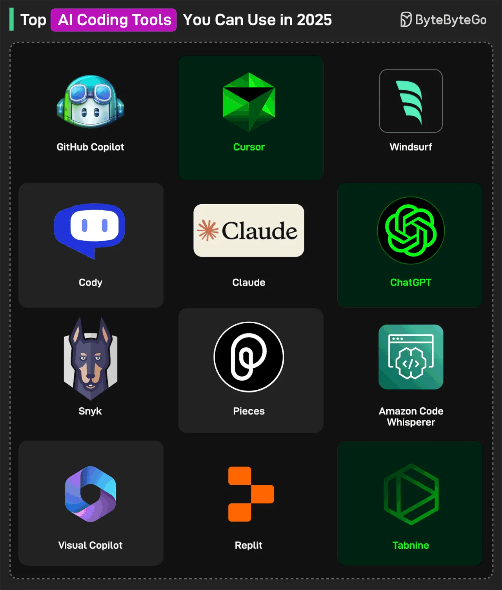

# 058 - Các AI coding tool hàng đầu cho developer có thể dùng trong năm 2025

- Nguồn: ByteByteGo Big Archive System Design 2025
- Trang PDF: 120-121
- Ảnh minh họa: `../assets/058/figure-01.png`

## Hình minh họa

## Dịch sát

1. AI Code Assistants

   GitHub Copilot: công cụ code completion và automatic programming.

   ChatGPT: giúp viết và debug code với các model mới nhất.

   Claude: kiến thức coding gần đây và chuyên biệt để generate code chính xác và cập nhật.

   Amazon CodeWhisperer: AI Assistant trong IDE.

2. AI-Powered IDEs

   Cursor: AI-powered IDE cho Windows, macOS và Linux.

   Windsurf: AI-powered IDE xử lý các task phức tạp một cách độc lập.

   Replit: tạo app hoạt động đầy đủ để go live nhanh.

3. Team Productivity

   Cody: enterprise AI code assistant để viết, sửa và maintain code.

   Pieces: AI-enabled productivity tool giúp developer quản lý code snippet.

   Visual Copilot: chuyển Figma design thành code React, Vue, Svelte, Angular hoặc HTML.

4. Code Quality and Completion

   Snyk: scan vulnerability real-time cho code do con người và AI generate.

   Tabnine: code completion tool để tăng tốc software development.

Câu hỏi dành cho bạn: Bạn sẽ thêm AI Coding Tool nào khác vào danh sách? Tool yêu thích của bạn là gì?

## Dịch nội dung trong hình

Hình liệt kê các tool: GitHub Copilot, Cursor, Windsurf, Cody, Claude, ChatGPT, Snyk, Pieces, Amazon CodeWhisperer, Visual Copilot, Replit và Tabnine.

## Tóm tắt & giải thích dễ hiểu

AI coding tool có nhiều nhóm. Code assistant như Copilot/ChatGPT/Claude hỗ trợ viết và giải thích code. AI IDE như Cursor/Windsurf tích hợp sâu vào repo và workflow. Tool productivity giúp quản lý snippet, sinh code từ design hoặc hỗ trợ team. Tool security/code quality như Snyk kiểm tra lỗ hổng, đặc biệt quan trọng khi AI generate code.

Trong production, AI coding tool nên là trợ lý, không phải người quyết định cuối. Developer vẫn cần đọc diff, hiểu logic, chạy test, kiểm tra security và đảm bảo code phù hợp kiến trúc hiện có.

## Ghi chú kỹ thuật - không nằm trong tài liệu gốc

Danh sách tool và claim “latest” trong bài phản ánh thời điểm tài liệu được biên soạn. Tool AI thay đổi rất nhanh, nên khi chọn tool hiện tại cần kiểm tra giá, privacy policy, model hỗ trợ, IDE integration và khả năng làm việc với codebase riêng.

## Ví dụ thực tế - không nằm trong tài liệu gốc

Một team có thể dùng AI IDE để refactor code, ChatGPT/Claude để phân tích thiết kế, Snyk để scan security, và CI để chạy test/lint. Với repository có dữ liệu nhạy cảm, cần kiểm tra policy: code có được gửi ra cloud không, có training trên dữ liệu của mình không, có hỗ trợ enterprise privacy không.

## Thuật ngữ chính

- `Code completion`: gợi ý code khi developer đang gõ.
- `AI-powered IDE`: IDE tích hợp AI sâu vào file, terminal, repo và workflow.
- `Vulnerability scanning`: quét lỗ hổng bảo mật trong dependency/code.
- `Snippet`: đoạn code nhỏ tái sử dụng.
- `Design-to-code`: chuyển thiết kế UI thành code.
- `Generated code`: code do AI hoặc tool sinh ra.
