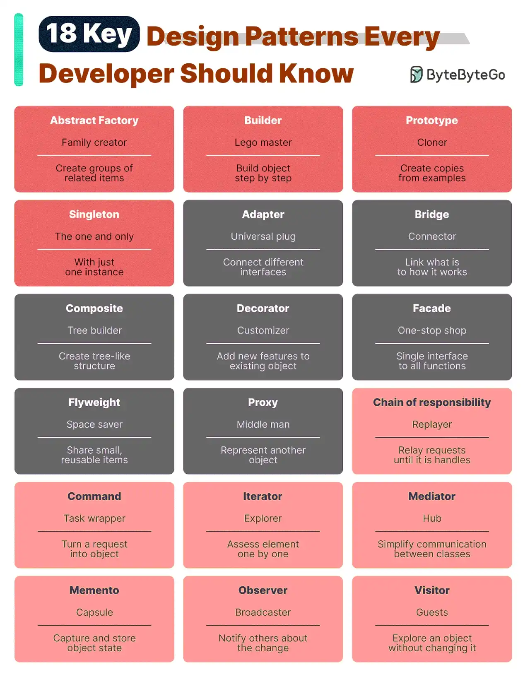

# 059 - 18 design pattern quan trọng mọi developer nên biết

- Nguồn: ByteByteGo Big Archive System Design 2025
- Trang PDF: 122-123
- Ảnh minh họa: `../assets/059/figure-01.png`

## Hình minh họa

## Dịch sát

Pattern là các solution tái sử dụng cho những design problem phổ biến, giúp quá trình development mượt hơn và hiệu quả hơn. Chúng đóng vai trò blueprint để xây dựng software structure tốt hơn. Dưới đây là một số pattern phổ biến nhất:

- Abstract Factory: Family Creator - tạo các nhóm item liên quan.
- Builder: Lego Master - xây object từng bước, tách quá trình tạo khỏi representation/appearance.
- Prototype: Clone Maker - tạo bản copy từ example đã chuẩn bị đầy đủ.
- Singleton: One and Only - một class đặc biệt chỉ có một instance.
- Adapter: Universal Plug - kết nối các thứ có interface khác nhau.
- Bridge: Function Connector - liên kết cách object hoạt động với điều nó làm.
- Composite: Tree Builder - tạo cấu trúc dạng cây từ các phần đơn giản và phức tạp.
- Decorator: Customizer - thêm feature vào object mà không thay đổi core của nó.
- Facade: One-Stop-Shop - đại diện cho cả hệ thống bằng một interface đơn giản hóa.
- Flyweight: Space Saver - chia sẻ các item nhỏ, tái sử dụng hiệu quả.
- Proxy: Stand-In Actor - đại diện cho object khác, kiểm soát access hoặc action.
- Chain of Responsibility: Request Relay - truyền request qua một chuỗi object cho tới khi được xử lý.
- Command: Task Wrapper - biến request thành object, sẵn sàng để thực thi.
- Iterator: Collection Explorer - truy cập từng element trong collection.
- Mediator: Communication Hub - đơn giản hóa tương tác giữa các class khác nhau.
- Memento: Time Capsule - capture và restore state của object.
- Observer: News Broadcaster - thông báo cho class khi object khác thay đổi.
- Visitor: Skillful Guest - thêm operation mới vào class mà không sửa class đó.

## Dịch nội dung trong hình

Hình liệt kê 18 pattern cùng cách ví von ngắn: Abstract Factory, Builder, Prototype, Singleton, Adapter, Bridge, Composite, Decorator, Facade, Flyweight, Proxy, Chain of Responsibility, Command, Iterator, Mediator, Memento, Observer và Visitor.

## Tóm tắt & giải thích dễ hiểu

Design pattern là ngôn ngữ chung để mô tả giải pháp thiết kế. Khi nói “dùng Adapter”, team hiểu ta đang bọc interface không tương thích. Khi nói “Observer”, team hiểu một object phát event và nhiều subscriber được notify. Pattern giúp giao tiếp nhanh hơn và tránh phát minh lại giải pháp đã quen thuộc.

Tuy nhiên, pattern không nên bị lạm dụng. Nếu code đơn giản chỉ cần một function, không nên ép thành nhiều class pattern. Design pattern hữu ích nhất khi vấn đề thật sự xuất hiện: cần tách construction phức tạp, cần plugin interface, cần undo/redo, cần event notification hoặc cần proxy kiểm soát access.

## Ví dụ thực tế - không nằm trong tài liệu gốc

Trong backend, `Adapter` có thể bọc nhiều payment provider như Stripe, PayPal, VNPay dưới một interface `PaymentGateway`. `Observer` có thể dùng cho event `OrderCreated` để gửi email, cập nhật analytics và trừ kho. `Command` có thể dùng cho job queue, mỗi job là một command có thể serialize và retry.

## Thuật ngữ chính

- `Design pattern`: mẫu giải pháp thiết kế tái sử dụng.
- `Creational pattern`: pattern liên quan đến tạo object.
- `Structural pattern`: pattern tổ chức quan hệ/cấu trúc giữa object.
- `Behavioral pattern`: pattern tổ chức hành vi và giao tiếp.
- `Interface`: hợp đồng phương thức giữa các thành phần.
- `Composition`: ghép object nhỏ thành object lớn hơn.

## Câu hỏi ôn tập + trả lời + thinking học tập + liên hệ

> Đây là phần học tập thêm ở cuối file. Câu hỏi ưu tiên lấy từ tài liệu gốc và được trả lời trực tiếp; nếu bài không có câu hỏi riêng thì dùng tiêu đề/nội dung chính để tạo câu hỏi tự kiểm tra.

### Câu hỏi 1

**Nguồn câu hỏi:** Suy ra từ tiêu đề/nội dung chính vì bài gốc không có câu hỏi riêng.

**Câu hỏi:** Sau khi đọc bài “18 Key Design Patterns Every Developer Should Know”, ý chính cần trả lời và áp dụng vào system design là gì?

**Trả lời:** Sau bài này, phần đáng nhớ nhất là: Design pattern là ngôn ngữ chung để mô tả giải pháp thiết kế. Khi nói “dùng Adapter”, team hiểu ta đang bọc interface không tương thích. Khi nói “Observer”, team hiểu một object phát event và nhiều subscriber được notify. Pattern giúp giao tiếp nhanh hơn và tránh phát minh lại giải pháp đã quen thuộc. Khi áp dụng vào hệ thống thật, hãy kiểm thêm requirement, constraint, traffic, dữ liệu, failure mode và khả năng vận hành của team.

**Thinking học tập + liên hệ:** Ôn tập `18 design pattern quan trọng mọi developer nên biết` bằng cách biến khái niệm thành quyết định thiết kế cụ thể: chọn gì, bỏ gì, đo gì và ai chịu trách nhiệm. Lens chính là requirement, constraint, traffic, dữ liệu, failure mode và khả năng vận hành của team. Khi gặp system design thật, hãy biến khái niệm thành quyết định: boundary ở đâu, data flow thế nào, bottleneck nào đến trước và rollback ra sao. Khi ghi chú lại, hãy giải thích được các keyword: `Design pattern`, `Creational pattern`, `Structural pattern`, `Behavioral pattern`, `Interface`.
