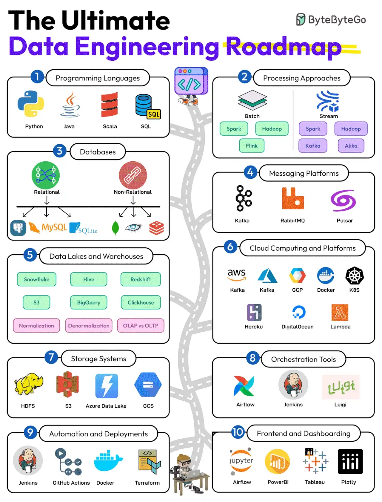
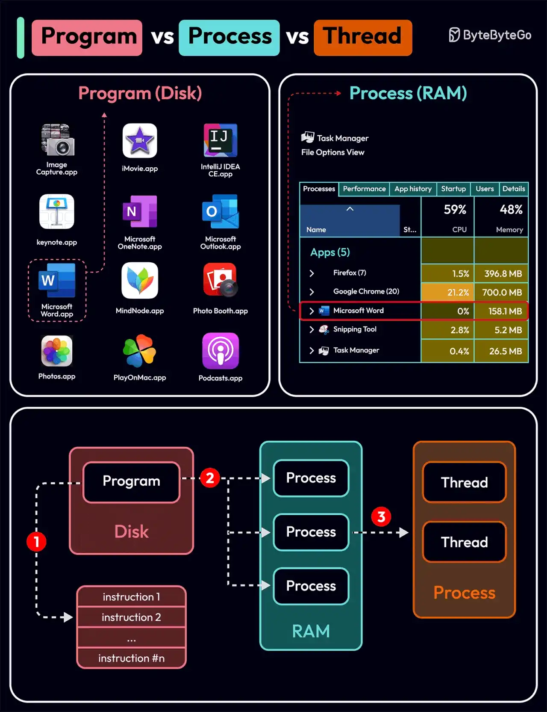

# 060 - Lộ trình Data Engineering

- Nguồn: ByteByteGo Big Archive System Design 2025
- Trang PDF: 124-127
- Ảnh minh họa: `../assets/060/figure-01.png`, `../assets/060/figure-02.png`

## Hình minh họa

## Dịch sát - The Data Engineering Roadmap

Data engineering đã trở thành backbone của data analysis hiệu quả. Nó liên quan đến việc quản lý, xử lý và tối ưu dữ liệu để rút ra actionable insights.

Dưới đây là roadmap có thể giúp bạn giỏi hơn trong data engineering:

1. Programming Languages

   Học SQL và một vài programming language như Python, Java và Scala.

2. Processing Techniques

   Học batch processing tool như Spark và Hadoop, cùng stream processing tool như Flink và Kafka.

3. Databases

   Tập trung vào cả relational và non-relational database. Một số ví dụ là MySQL, Postgres, MongoDB, Cassandra và Redis.

4. Messaging Platforms

   Master việc dùng các platform như Kafka, RabbitMQ và Pulsar.

5. Data Lakes and Warehouses

   Học về nhiều giải pháp data lake và warehousing như Snowflake, Hive, S3, Redshift và ClickHouse. Ngoài ra, học về Normalization, Denormalization và OLTP vs OLAP.

6. Cloud Computing Platforms

   Master việc dùng cloud platform như AWS, Azure, Docker và K8S.

7. Storage Systems

   Học các storage system quan trọng như S3, Azure Data Lake và HDFS.

8. Orchestration Tools

   Học các orchestration tool như Airflow, Jenkins và Luigi.

9. Automation and Deployments

   Học automation tool như Jenkins, GitHub Actions và Terraform.

10. Frontend and Dashboarding

   Master việc dùng các tool như Jupyter Notebooks, PowerBI, Tableau và Plotly.

Câu hỏi dành cho bạn: Bạn sẽ thêm gì khác vào Data Engineering Roadmap?

## Dịch nội dung hình 1

- `Programming Languages`: Python, Java, Scala, SQL và một số ngôn ngữ liên quan.
- `Processing Approaches`: batch và streaming; Spark, Hadoop, Flink, Kafka.
- `Databases`: relational và non-relational như MySQL, Postgres, MongoDB, Cassandra, Redis.
- `Messaging Platforms`: Kafka, RabbitMQ và Pulsar.
- `Data Lakes and Warehouses`: Snowflake, Hive, Redshift, S3, BigQuery, ClickHouse; thêm normalization, denormalization, OLAP vs OLTP.
- `Cloud Computing and Platforms`: AWS, Azure, GCP, Docker, K8S, Heroku, DigitalOcean và Lambda.
- `Storage Systems`: HDFS, S3, Azure Data Lake và GCS.
- `Orchestration Tools`: Airflow, Jenkins và Luigi.
- `Automation and Deployments`: Jenkins, GitHub Actions, Docker và Terraform.
- `Frontend and Dashboarding`: Jupyter, PowerBI, Tableau và Plotly.

## Tóm tắt & giải thích dễ hiểu - Data Engineering

Data engineering là công việc xây nền móng để dữ liệu có thể được thu thập, xử lý, lưu trữ, phân tích và hiển thị đáng tin cậy. Data engineer cần biết SQL, programming, batch/stream processing, database, messaging, storage, data warehouse/lake, orchestration, cloud, automation và dashboarding.

Khác với backend thông thường, data engineering quan tâm nhiều đến pipeline, chất lượng dữ liệu, schema evolution, data freshness, lineage, throughput, partitioning và cost xử lý. Một pipeline tốt không chỉ chạy được một lần, mà phải chạy lặp lại ổn định, detect lỗi, retry được và có monitoring.

## Ví dụ thực tế - không nằm trong tài liệu gốc

Một hệ thống analytics cho e-commerce có thể nhận event click/order qua Kafka, lưu raw event vào S3 data lake, xử lý batch bằng Spark, ghi dữ liệu đã transform vào BigQuery/Redshift/Snowflake, orchestration bằng Airflow, rồi hiển thị dashboard trong PowerBI/Tableau. Nếu cần realtime dashboard, có thể thêm Flink để xử lý stream gần real-time.

## Dịch sát - Process vs Thread

Câu hỏi phỏng vấn phổ biến: Process và Thread khác nhau ở điểm nào?

Để hiểu rõ hơn câu hỏi này, trước tiên hãy xem Program là gì. Program là một executable file chứa một tập instruction và được lưu thụ động trên disk. Một program có thể có nhiều process. Ví dụ, browser Chrome tạo một process khác nhau cho từng tab.

Process nghĩa là một program đang được execution. Khi một program được load vào memory và trở nên active, program trở thành process. Process cần một số resource thiết yếu như register, program counter và stack.

Thread là đơn vị execution nhỏ nhất bên trong một process.

Quy trình sau giải thích quan hệ giữa program, process và thread.

1. Program chứa một tập instruction.

2. Program được load vào memory. Nó trở thành một hoặc nhiều running process.

3. Khi một process bắt đầu, nó được cấp memory và resource. Một process có thể có một hoặc nhiều thread. Ví dụ, trong app Microsoft Word, một thread có thể chịu trách nhiệm kiểm tra chính tả và thread khác chịu trách nhiệm chèn text vào document.

Các khác biệt chính giữa process và thread:

- Process thường độc lập, trong khi thread tồn tại như subset của một process.
- Mỗi process có memory space riêng. Các thread thuộc cùng một process chia sẻ cùng memory.
- Process là một operation heavyweight. Tạo và terminate process mất nhiều thời gian hơn.
- Context switching giữa process đắt hơn.
- Inter-thread communication nhanh hơn đối với thread.

Câu hỏi dành cho bạn:

1. Một số programming language hỗ trợ coroutine. Coroutine và thread khác nhau ở điểm nào?
2. Làm sao liệt kê running process trong Linux?

## Dịch nội dung hình 2

- `Program (Disk)`: program nằm trên disk, ví dụ app executable như Chrome, Word, Photoshop.
- `Process (RAM)`: khi program chạy, nó trở thành process trong RAM; task manager hiển thị CPU, memory, thread và user.
- `Thread`: đơn vị execution bên trong process.
- Luồng minh họa: program trên disk chứa instruction; khi load vào RAM tạo process; process có thể chứa nhiều thread.

## Tóm tắt & giải thích dễ hiểu - Process vs Thread

Program là file chưa chạy. Process là chương trình đang chạy và có memory/resource riêng. Thread là luồng thực thi nhỏ hơn nằm trong process. Vì thread cùng process chia sẻ memory, chúng giao tiếp nhanh hơn nhưng cũng dễ gặp bug concurrency như race condition. Process cô lập mạnh hơn nhưng tạo mới và context switch tốn kém hơn.

Trong system design và backend, hiểu process/thread giúp chọn mô hình concurrency. Web server có thể dùng multi-process, multi-thread, event loop, coroutine hoặc virtual thread tùy ngôn ngữ/runtime và workload.

## Ví dụ thực tế - không nằm trong tài liệu gốc

Chrome thường tách tab thành process riêng để nếu một tab crash, tab khác ít bị ảnh hưởng. Một backend Java có thể dùng nhiều thread trong cùng process để xử lý nhiều request. Một Node.js process dùng event loop single-thread chính, nhưng có thể dùng worker thread hoặc nhiều process để tận dụng nhiều CPU core.

Trên Linux, có thể xem process bằng `ps aux`, `top`, `htop` hoặc `pgrep`. Thread có thể xem bằng `ps -eLf` hoặc trong `top` bật chế độ thread.

## Thuật ngữ chính

- `Data engineering`: xây dựng pipeline và hạ tầng dữ liệu cho phân tích.
- `Batch processing`: xử lý dữ liệu theo lô.
- `Stream processing`: xử lý dữ liệu liên tục theo dòng event.
- `Data lake`: kho lưu dữ liệu raw/semi-structured ở quy mô lớn.
- `Data warehouse`: kho dữ liệu tối ưu cho analytics/reporting.
- `Program`: file executable chứa instruction.
- `Process`: instance đang chạy của program.
- `Thread`: đơn vị execution bên trong process.
- `Context switch`: chuyển CPU từ execution context này sang context khác.
- `Coroutine`: đơn vị concurrency hợp tác, thường nhẹ hơn thread và được scheduler ở user/runtime level.
