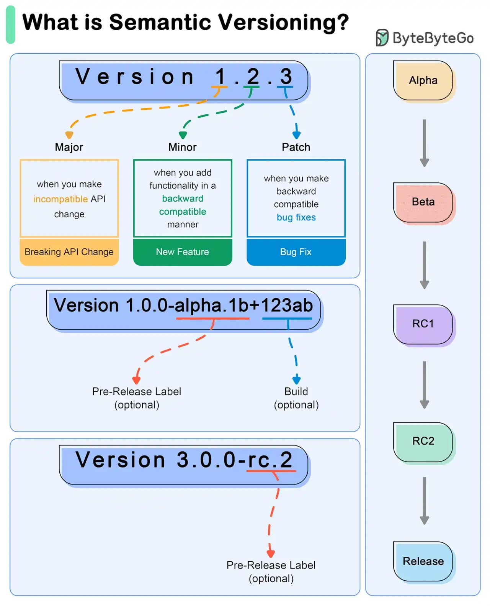

# 061 - Version number có ý nghĩa gì?

- Nguồn: ByteByteGo Big Archive System Design 2025
- Trang PDF: 128-129
- Ảnh minh họa: `../assets/061/figure-01.png`

## Hình minh họa

## Dịch sát

Semantic Versioning, viết tắt là SemVer, là một versioning scheme cho software nhằm truyền đạt ý nghĩa về các thay đổi bên dưới trong một release.

- SemVer dùng version number gồm ba phần: `MAJOR.MINOR.PATCH`.

  1. `MAJOR` version: tăng khi có incompatible API changes.
  2. `MINOR` version: tăng khi functionality được thêm theo cách backward-compatible.
  3. `PATCH` version: tăng khi có backward-compatible bug fixes.

- Example Workflow

  1. Initial Development Phase

     Bắt đầu với version `0.1.0`.

  2. First Stable Release

     Đạt stable release: `1.0.0`.

  3. Subsequent Changes

     Patch Release: cần bug fix cho `1.0.0`. Cập nhật lên `1.0.1`.

     Minor Release: thêm một feature mới backward-compatible vào `1.0.3`. Cập nhật lên `1.1.0`.

     Major Release: giới thiệu một thay đổi lớn không backward-compatible trong `1.2.2`. Cập nhật lên `2.0.0`.

  4. Special Versions and Pre-releases

     Pre-release Versions: `1.0.0-alpha`, `1.0.0-beta`, `1.0.0-rc.1`.

     Build Metadata: `1.0.0+20130313144700`.

## Dịch nội dung trong hình

- `Version 1.2.3`: `1` là Major, `2` là Minor, `3` là Patch.
- `Major`: tăng khi tạo incompatible API change hoặc breaking API change.
- `Minor`: tăng khi thêm functionality theo cách backward-compatible, tức new feature.
- `Patch`: tăng khi sửa bug theo cách backward-compatible, tức bug fix.
- `Version 1.0.0-alpha.1b+123ab`: có pre-release label và build metadata.
- `Version 3.0.0-rc.2`: release candidate label.
- Luồng release trong hình: Alpha -> Beta -> RC1 -> RC2 -> Release.

## Tóm tắt & giải thích dễ hiểu

SemVer giúp người dùng package hiểu mức độ rủi ro khi upgrade. Nếu chỉ tăng patch, thường là bug fix an toàn. Nếu tăng minor, có feature mới nhưng API cũ vẫn chạy. Nếu tăng major, có thể có breaking change và consumer cần sửa code.

Trong hệ sinh thái package như npm, Composer, Maven hoặc Cargo, version number ảnh hưởng trực tiếp tới dependency resolution. Một thư viện tăng major từ `1.x` lên `2.x` có thể làm app build fail nếu API thay đổi.

## Ví dụ thực tế - không nằm trong tài liệu gốc

Một package `auth-client` đang ở `1.4.2`. Nếu sửa bug refresh token, release `1.4.3`. Nếu thêm method `logoutAllDevices()` nhưng không phá API cũ, release `1.5.0`. Nếu đổi signature của `login(email, password)` thành `login(credentials)`, đó là breaking change và nên release `2.0.0`.

## Thuật ngữ chính

- `SemVer`: Semantic Versioning, quy ước version có ý nghĩa.
- `Breaking change`: thay đổi không tương thích ngược.
- `Backward-compatible`: tương thích ngược với consumer cũ.
- `Pre-release`: bản alpha/beta/rc trước release chính thức.
- `Build metadata`: metadata build sau dấu `+`, không đổi ý nghĩa version chính.
