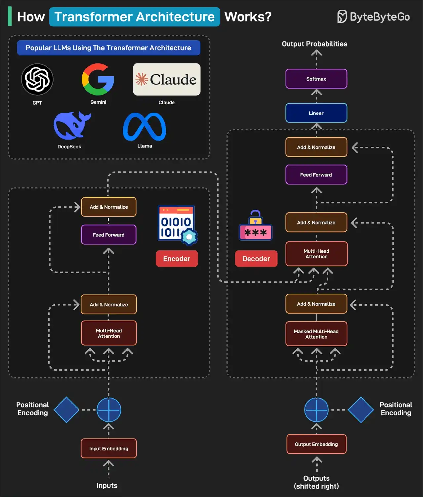

# 062 - Ai cũng nói về Transformers: kiến trúc Transformer hoạt động như thế nào?

- Nguồn: ByteByteGo Big Archive System Design 2025
- Trang PDF: 130-131
- Ảnh minh họa: `../assets/062/figure-01.png`

## Hình minh họa

## Dịch sát

Transformer Architecture đã trở thành nền tảng của một số LLM phổ biến nhất, bao gồm GPT, Gemini, Claude, DeepSeek và Llama.

Dưới đây là cách nó hoạt động:

1. Một transformer-based model điển hình có hai phần chính: encoder và decoder. Encoder đọc và hiểu input. Decoder dùng sự hiểu biết này để generate output đúng.

2. Ở bước đầu tiên, Input Embedding, mỗi word được chuyển thành một number, tức vector, đại diện cho meaning của nó.

3. Tiếp theo, một pattern gọi là Positional Encoding cho model biết mỗi word nằm ở vị trí nào trong sentence. Điều này cần thiết vì thứ tự word quan trọng. Ví dụ “the cat ate the fish” khác với “the fish ate the cat”.

4. Tiếp theo là Multi-Head Attention, bộ não của encoder. Nó cho phép model nhìn tất cả word cùng lúc và xác định word nào liên quan với nhau. Trong phase Add & Normalize, model thêm những gì học được từ attention trở lại sentence.

5. Feed Forward process thêm chiều sâu cho understanding. Toàn bộ process được lặp lại nhiều lần để model có thể hiểu sâu sentence.

6. Sau khi encoder hoàn tất, decoder bắt đầu hoạt động. Output embedding chuyển mỗi word trong expected output thành number. Để hiểu mỗi word nên nằm ở đâu, chúng ta thêm Positional Encoding.

7. Masked Multi-Head Attention ẩn các future word để model chỉ predict từng word một.

8. Multi-Head Attention phase align phần đúng của input với phần đúng của output. Decoder nhìn cả input sentence và các word nó đã generate cho tới thời điểm hiện tại.

9. Feed Forward áp dụng thêm processing để làm final word choice tốt hơn. Process được lặp lại nhiều lần để refine result.

10. Khi decoder đã predict number cho mỗi word, nó truyền chúng qua Linear Layer để chuẩn bị output. Layer này map output của decoder tới một tập rất lớn các possible word.

11. Sau khi Linear Layer tạo score cho mỗi word, Softmax layer chuyển các score đó thành probability. Word có probability cao nhất được chọn làm next word.

12. Cuối cùng, một sentence human-readable được generate.

Câu hỏi dành cho bạn: Bạn sẽ thêm gì khác để hiểu Transformer Architecture?

## Dịch nội dung trong hình

- `Popular LLMs Using The Transformer Architecture`: GPT, Gemini, Claude, DeepSeek và Llama.
- `Inputs`: input text.
- `Input Embedding`: chuyển token/word thành vector.
- `Positional Encoding`: thêm thông tin vị trí token.
- `Encoder`: gồm Multi-Head Attention, Add & Normalize và Feed Forward.
- `Decoder`: gồm Output Embedding, Positional Encoding, Masked Multi-Head Attention, Multi-Head Attention, Feed Forward, Add & Normalize.
- `Linear`: map hidden state sang vocabulary score.
- `Softmax`: chuyển score thành probability.
- `Output Probabilities`: xác suất token tiếp theo.
- `Outputs`: output generated text.

## Tóm tắt & giải thích dễ hiểu

Transformer mạnh nhờ attention. Thay vì xử lý từng word theo thứ tự cứng như nhiều mô hình cũ, attention cho model xem quan hệ giữa các token trong toàn câu/context. Multi-head attention dùng nhiều “góc nhìn” song song để học các loại quan hệ khác nhau.

Encoder-decoder là kiến trúc đầy đủ ban đầu. Nhiều LLM hiện đại dùng biến thể decoder-only cho text generation, nhưng các khái niệm embedding, positional encoding, attention, feed-forward, linear và softmax vẫn là nền tảng.

## Ví dụ thực tế - không nằm trong tài liệu gốc

Khi bạn hỏi LLM “Tóm tắt đoạn code này”, model biến code thành token, token thành vector, dùng attention để hiểu quan hệ giữa function, biến, comment và call site, rồi generate câu trả lời từng token một. Nếu context quá dài vượt context window, model không thể “thấy” toàn bộ nội dung trừ khi hệ thống dùng RAG/chunking.

## Thuật ngữ chính

- `Transformer`: kiến trúc neural network dựa trên attention.
- `Token`: đơn vị text model xử lý.
- `Embedding`: vector biểu diễn token.
- `Attention`: cơ chế học token nào liên quan đến token nào.
- `Encoder`: phần đọc và biểu diễn input.
- `Decoder`: phần sinh output.
- `Softmax`: hàm chuyển score thành xác suất.
