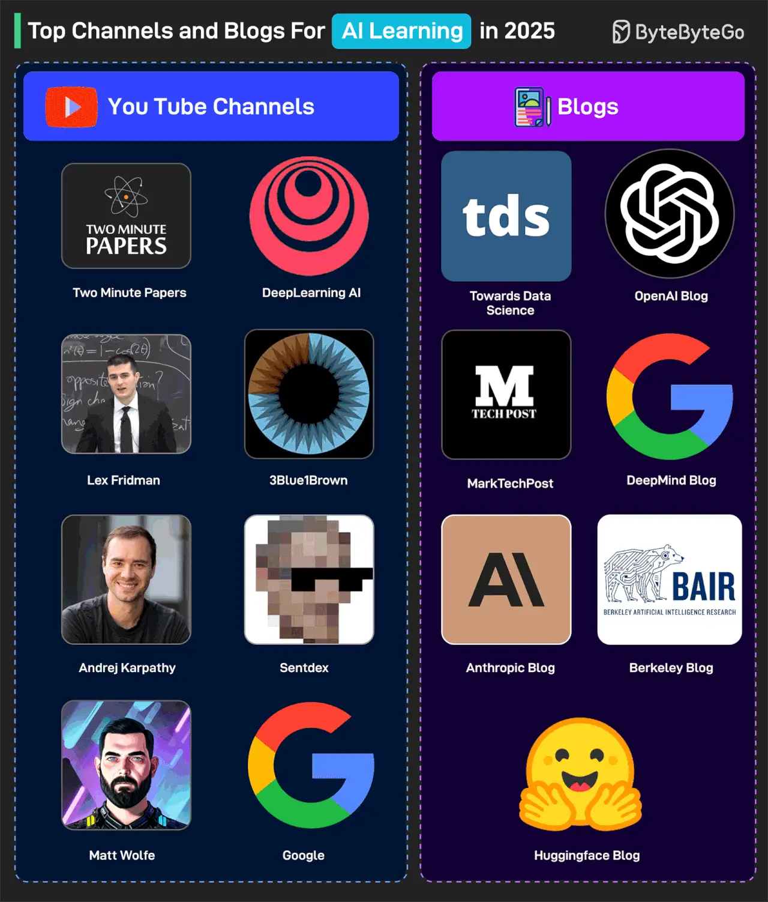

# 063 - Các kênh YouTube và blog hàng đầu để học AI trong năm 2025

- Nguồn: ByteByteGo Big Archive System Design 2025
- Trang PDF: 132-133
- Ảnh minh họa: `../assets/063/figure-01.png`

## Hình minh họa

## Dịch sát

Một số kênh YouTube rất tốt là:

1. Two Minute Papers
2. DeepLearning AI
3. Lex Fridman
4. 3Blue1Brown
5. Andrej Karpathy
6. Sentdex
7. Matt Wolfe
8. Google YouTube Channel

Ngoài ra, dưới đây là một số blog rất tốt tập trung vào AI:

1. TowardsDataScience
2. OpenAI Blog
3. MarkTechPost
4. DeepMind Blog
5. Anthropic Blog
6. Berkeley BAIR
7. HuggingFace Blog

Câu hỏi dành cho bạn: Bạn sẽ thêm channel và blog nào khác vào danh sách?

## Dịch nội dung trong hình

- `YouTube Channels`: Two Minute Papers, DeepLearning AI, Lex Fridman, 3Blue1Brown, Andrej Karpathy, Sentdex, Matt Wolfe và Google.
- `Blogs`: Towards Data Science, OpenAI Blog, MarkTechPost, DeepMind Blog, Anthropic Blog, Berkeley BAIR và HuggingFace Blog.

## Tóm tắt & giải thích dễ hiểu

Bài này là danh sách nguồn học AI theo hai nhóm: video và blog. Video phù hợp để nắm intuition, demo và bài giảng trực quan. Blog phù hợp để đọc cập nhật, release note, research insight và case study kỹ thuật.

Khi học AI, nên kết hợp nguồn nền tảng và nguồn cập nhật. 3Blue1Brown giúp hiểu trực giác toán học. DeepLearning AI giúp học structured course. Blog của OpenAI/DeepMind/Anthropic/HuggingFace giúp theo dõi hướng phát triển model, tooling và safety.

## Ghi chú kỹ thuật - không nằm trong tài liệu gốc

Danh sách “top” thay đổi nhanh theo thời gian. Khi dùng làm roadmap hiện tại, nên kiểm tra kênh/blog còn active không, nội dung có phù hợp level của bạn không và có thiên về research, engineering hay product không.

## Ví dụ thực tế - không nằm trong tài liệu gốc

Nếu bạn là backend developer muốn học AI ứng dụng, có thể bắt đầu với DeepLearning AI để hiểu khái niệm, HuggingFace Blog để học model/tooling open-source, OpenAI/Anthropic Blog để theo dõi API/model mới, rồi tự build một RAG app nhỏ để biến kiến thức thành kỹ năng thực tế.

## Thuật ngữ chính

- `AI learning resource`: nguồn học AI như course, blog, video, paper.
- `Research blog`: blog giải thích kết quả nghiên cứu hoặc model mới.
- `Applied AI`: AI ứng dụng vào sản phẩm thực tế.
- `Foundation knowledge`: kiến thức nền như toán, ML, neural networks.
