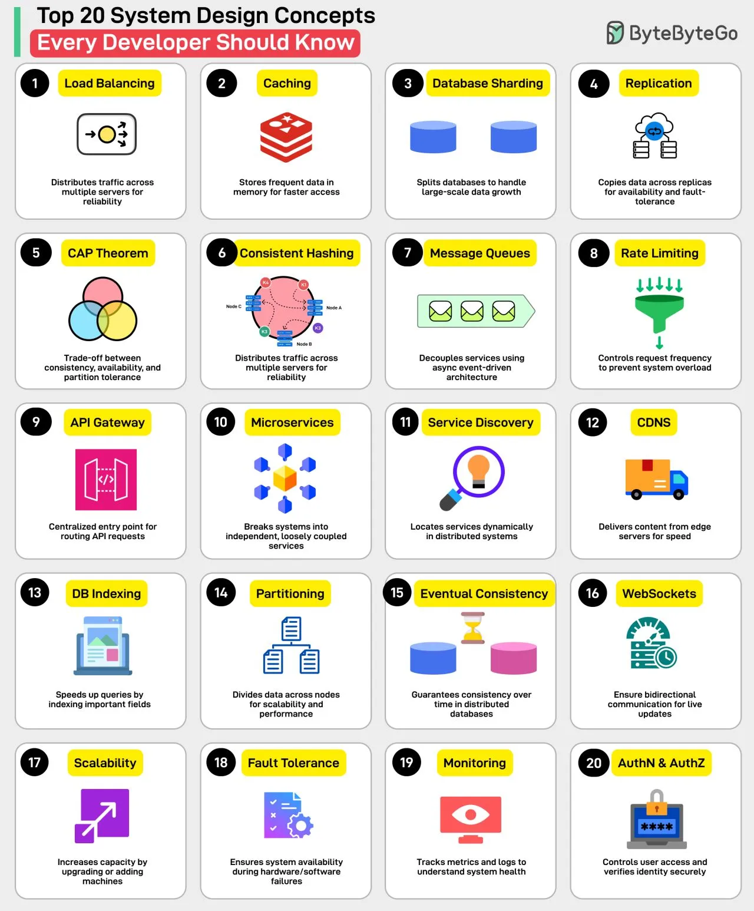
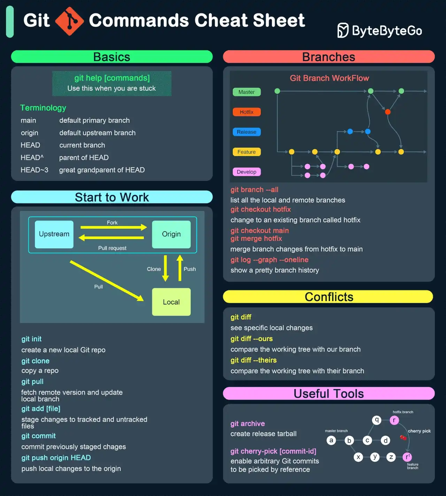

# 064 - Top 20 khái niệm System Design bạn nên biết

- Nguồn: ByteByteGo Big Archive System Design 2025
- Trang PDF: 134-138
- Ảnh minh họa: `../assets/064/figure-01.png`, `../assets/064/figure-02.png`

## Hình minh họa

## Dịch sát - Top 20 System Design Concepts

1. Load Balancing: phân phối traffic qua nhiều server để tăng reliability và availability.

2. Caching: lưu dữ liệu được truy cập thường xuyên trong memory để truy cập nhanh hơn.

3. Database Sharding: chia database để xử lý data growth quy mô lớn.

4. Replication: copy dữ liệu qua các replica để tăng availability và fault tolerance.

5. CAP Theorem: trade-off giữa consistency, availability và partition tolerance.

6. Consistent Hashing: phân phối load đều trong môi trường server dynamic.

7. Message Queues: decouple service bằng asynchronous event-driven architecture.

8. Rate Limiting: kiểm soát request frequency để tránh system overload.

9. API Gateway: entry point tập trung để route API request.

10. Microservices: chia hệ thống thành các service độc lập, loosely coupled.

11. Service Discovery: định vị service dynamic trong distributed system.

12. CDN: phân phối content từ edge server để tăng tốc.

13. Database Indexing: tăng tốc query bằng cách index các field quan trọng.

14. Data Partitioning: chia data qua các node để tăng scalability và performance.

15. Eventual Consistency: đảm bảo consistency theo thời gian trong distributed database.

16. WebSockets: cho phép giao tiếp hai chiều cho live update.

17. Scalability: tăng capacity bằng cách nâng cấp hoặc thêm machine.

18. Fault Tolerance: đảm bảo system availability trong lúc hardware/software failure.

19. Monitoring: theo dõi metric và log để hiểu system health.

20. Authentication & Authorization: kiểm soát user access và verify identity một cách an toàn.

Câu hỏi dành cho bạn: Bạn sẽ thêm khái niệm System Design nào khác vào danh sách?

## Dịch sát - Essential Git Cheatsheet

### Basic Commands

- `git init`: khởi tạo Git repository mới.
- `git clone <repo_url>`: clone remote repository.
- `git status`: kiểm tra trạng thái working directory.
- `git add <file>`: stage change để commit.
- `git commit -m "message"`: commit staged changes với message.
- `git push`: push local commit lên remote repository.
- `git pull`: fetch và merge change từ remote repo.
- `git diff`: hiển thị change trong working directory, tức uncommitted changes.
- `git diff --staged`: hiển thị change giữa staging area và last commit.

### Branching & Merging

- `git branch`: liệt kê branch.
- `git branch <branch_name>`: tạo branch mới.
- `git checkout <branch_name>`: chuyển sang branch khác.
- `git checkout -b <branch_name>`: tạo và chuyển sang branch mới.
- `git merge <branch_name>`: merge một branch vào branch hiện tại.
- `git branch -d <branch_name>`: xóa branch sau khi merge.
- `git branch -D <branch_name>`: xóa branch cưỡng bức, kể cả khi chưa merge.

### Synchronization

- `git fetch`: tải change từ remote mà không merge.
- `git rebase <branch>`: áp lại commit lên trên branch khác để giữ history tuyến tính.
- `git pull --rebase`: fetch và reapply change của bạn lên latest remote changes.
- `git remote add <name> <url>`: thêm remote repository mới.

### Advanced Git

- `git stash`: tạm lưu change mà không commit.
- `git stash pop`: apply lại stashed changes.
- `git cherry-pick <commit>`: apply một commit cụ thể vào branch hiện tại.
- `git log --oneline`: xem commit history rút gọn.
- `git reflog`: hiển thị lịch sử thay đổi reference, ví dụ checkout/reset.
- `git log --graph --decorate --all`: hiển thị lịch sử commit dạng trực quan.

### Undoing Changes

- `git reset <file>`: unstage file.
- `git reset --soft <commit>`: reset về commit nhưng giữ change trong working directory.
- `git reset --hard <commit>`: reset hoàn toàn về commit trước đó, bỏ change.
- `git revert <commit>`: tạo commit mới để undo một commit cụ thể.

### Collaborating with Others

- `git fork`: fork repository trên GitHub qua UI để bắt đầu contribute.
- `git pull origin <branch>`: pull change từ original remote branch.
- `git push origin <branch>`: push branch của bạn lên original repository để collaboration.

Câu hỏi dành cho bạn: chúng tôi có bỏ sót gì không?

## Tóm tắt & giải thích dễ hiểu

Phần đầu là checklist khái niệm system design nền tảng. Chúng bao phủ traffic distribution, caching, data scaling, consistency, async communication, API boundary, microservices, realtime, scalability, resilience, observability và security.

Phần sau là Git cheatsheet thực dụng. Bản gốc đặt hai nội dung trong cùng một cụm trang, nên file dịch giữ cả hai để không mất nội dung.

## Ví dụ thực tế - không nằm trong tài liệu gốc

Khi thiết kế chat app realtime, bạn có thể dùng load balancer để phân phối connection, WebSocket cho realtime, Redis pub/sub hoặc message queue để fan-out message, database indexing cho query lịch sử chat, monitoring để đo latency/error và authentication/authorization để bảo vệ room riêng tư.

## Thuật ngữ chính

- `System design`: thiết kế kiến trúc hệ thống ở mức component và trade-off.
- `Replica`: bản sao dữ liệu/service.
- `Partitioning`: chia dữ liệu để scale.
- `Observability`: khả năng hiểu trạng thái hệ thống qua log, metric, trace.
- `Git rebase`: viết lại base của commit để history tuyến tính hơn.
