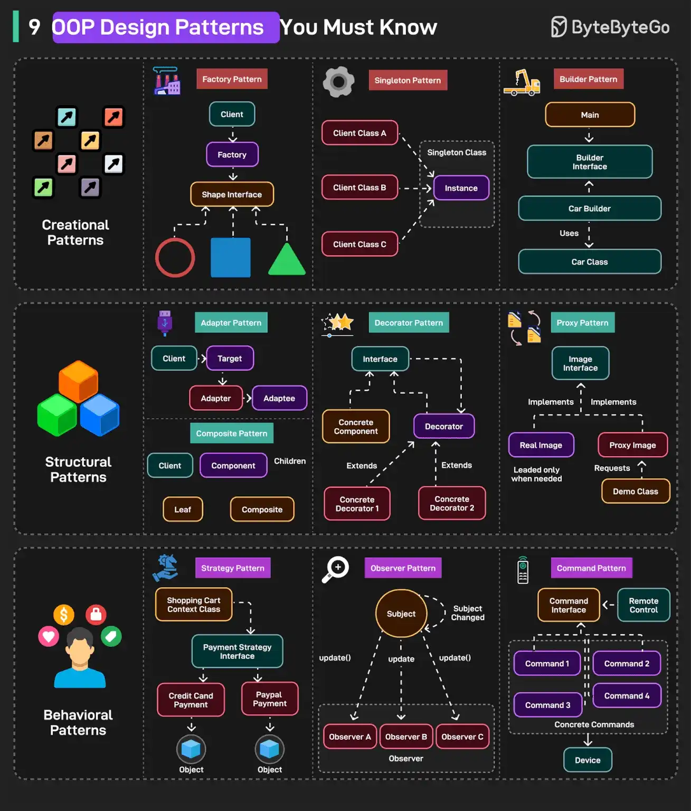
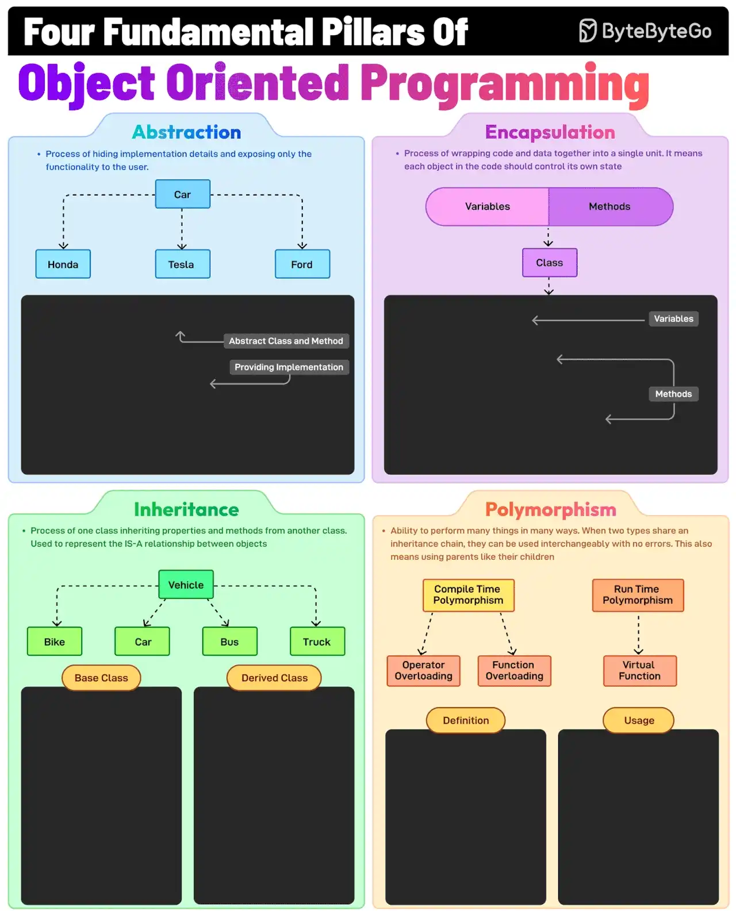

# 065 - 9 OOP Design Pattern bạn phải biết

- Nguồn: ByteByteGo Big Archive System Design 2025
- Trang PDF: 139-142
- Ảnh minh họa: `../assets/065/figure-01.png`, `../assets/065/figure-02.png`

## Hình minh họa

## Dịch sát - 9 OOP Design Patterns

Các pattern này có thể được chia thành 3 category:

### A - Creational Patterns

Xử lý cơ chế tạo object để decouple client code khỏi concrete class.

1. Factory Pattern: tập trung object creation logic và trả về các subclass khác nhau dựa trên input.

2. Singleton Pattern: đảm bảo chỉ tồn tại một instance của một class và cung cấp global access tới nó.

3. Builder Pattern: xây dựng complex object từng bước, cho phép optional configuration.

### B - Structural Patterns

Giúp compose class và object thành structure lớn hơn.

1. Adapter Pattern: cho phép các interface không tương thích làm việc với nhau bằng cách translate interface này sang interface khác.

2. Decorator Pattern: thêm behavior mới vào object một cách dynamic mà không thay đổi original structure của chúng.

3. Proxy Pattern: đóng vai trò placeholder để truy cập một object khác.

### C - Behavioral Patterns

Tập trung vào communication và interaction giữa các object.

1. Strategy Pattern: cho phép chọn algorithm hoặc behavior từ một family các strategy có thể thay thế nhau tại runtime.

2. Observer Pattern: cho phép dependency một-nhiều để khi một object thay đổi state, tất cả dependent của nó được notify.

3. Command Pattern: một object encapsulate toàn bộ thông tin cần thiết để thực hiện một action hoặc trigger một event.

Câu hỏi dành cho bạn: Bạn đã dùng pattern nào trong số này?

## Dịch sát - Bốn trụ cột nền tảng của OOP

Abstraction, Encapsulation, Inheritance và Polymorphism là bốn trụ cột của object-oriented programming. Chúng có nghĩa là gì?

1. Abstraction

   Đây là quá trình ẩn implementation detail và chỉ hiển thị các essential feature của một object. Ví dụ, class `Vehicle` có abstract method `stop`.

2. Encapsulation

   Nó liên quan đến việc gói data, tức field, và method trong một unit duy nhất, tức class, đồng thời hạn chế direct access bằng access modifier. Ví dụ, private field với public getter và setter.

3. Inheritance

   Quá trình tạo một class mới, child, kế thừa attribute và method từ một class hiện có, parent, qua đó thúc đẩy code reuse. Ví dụ, class `Car` kế thừa từ class `Vehicle`.

4. Polymorphism

   Nó cho phép method hoạt động khác nhau dựa trên object mà chúng được invoke. Khi hai type chia sẻ một inheritance chain, chúng có thể được dùng thay thế cho nhau mà không lỗi.

Câu hỏi dành cho bạn: Bạn có dùng object-oriented programming không?

## Dịch nội dung trong hình

- `Creational Patterns`: Factory, Singleton, Builder.
- `Structural Patterns`: Adapter, Decorator, Proxy.
- `Behavioral Patterns`: Strategy, Observer, Command.
- `Abstraction`: process hiding implementation details và exposing only essentials.
- `Encapsulation`: wrapping variables/data và methods trong class.
- `Inheritance`: child class kế thừa parent/base class.
- `Polymorphism`: cùng interface/method nhưng behavior khác nhau theo concrete type.

## Tóm tắt & giải thích dễ hiểu

OOP pattern giúp tổ chức object và dependency rõ hơn. Creational pattern kiểm soát cách tạo object. Structural pattern giúp các object/class ghép lại với nhau linh hoạt. Behavioral pattern điều phối cách object giao tiếp và chọn behavior.

Bốn trụ cột OOP là nền tảng để hiểu pattern. Abstraction giúp ẩn chi tiết. Encapsulation bảo vệ state. Inheritance tái sử dụng behavior qua quan hệ cha-con. Polymorphism giúp code xử lý nhiều implementation qua cùng một interface.

## Ví dụ thực tế - không nằm trong tài liệu gốc

Trong hệ thống thanh toán, `PaymentGatewayFactory` chọn Stripe/PayPal/VNPay theo config. `Strategy` chọn thuật toán tính phí ship. `Observer` notify email/analytics khi order được tạo. `Decorator` thêm retry/logging quanh một service mà không sửa core logic.

## Thuật ngữ chính

- `Concrete class`: class triển khai cụ thể.
- `Factory`: pattern tập trung logic tạo object.
- `Strategy`: pattern chọn behavior/algorithm lúc runtime.
- `Observer`: pattern publish/notify khi state thay đổi.
- `Encapsulation`: đóng gói data và behavior.
- `Polymorphism`: đa hình, cùng interface nhiều implementation.
