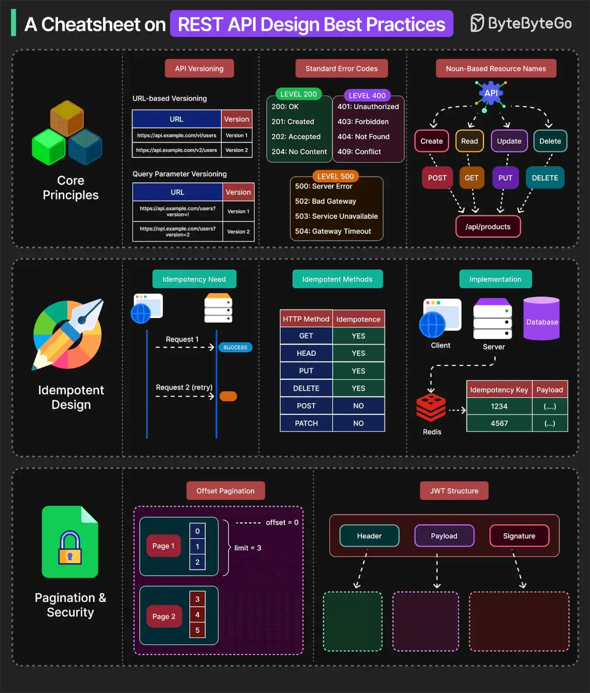

# 066 - Cheatsheet về best practice khi thiết kế REST API

- Nguồn: ByteByteGo Big Archive System Design 2025
- Trang PDF: 143-144
- Ảnh minh họa: `../assets/066/figure-01.png`

## Hình minh họa

## Dịch sát

API được thiết kế tốt hoạt động nhất quán, khá predictable và phát triển mà không gây ma sát. Một số best practice cần ghi nhớ như sau:

1. Resource-oriented path và việc dùng đúng HTTP verb giúp API align với standard tool.

2. Dùng một API versioning approach phù hợp.

3. Dùng standard error code khi generate API response.

4. API nên idempotent. Chúng đảm bảo retry an toàn bằng cách làm cho request lặp lại tạo cùng một result, đặc biệt với POST operation.

5. Idempotency key cho phép client deduplicate operation có side effect một cách an toàn.

6. API nên hỗ trợ pagination để tránh performance bottleneck và payload bloat. Một số pagination strategy phổ biến là offset-based, cursor-based và keyset-based.

7. API security là bắt buộc với API được thiết kế tốt. Dùng authentication và authorization đúng cách với API Keys, JWT, OAuth2 và các mechanism khác. HTTPS cũng là must-have cho API chạy production.

Câu hỏi dành cho bạn: Bạn theo best practice nào khác khi thiết kế API?

## Dịch nội dung trong hình

- `Core Principles`: API versioning, standard error codes và noun-based resource names.
- `API Versioning`: path versioning như `/v1/users`, query parameter versioning và header versioning.
- `Standard Error Codes`: nhóm 2XX success, 3XX redirect, 4XX client error, 5XX server error và các code như 200, 201, 400, 401, 404, 500, 502.
- `Noun-Based Resource Names`: resource như clients, read, update, delete kết hợp HTTP verb GET/POST/PUT/DELETE.
- `Idempotent Design`: request lặp lại tạo cùng kết quả; idempotency table lưu idempotency key và payload/result.
- `Pagination & Security`: offset pagination, JWT structure, HTTPS methods và authorization/authentication.

## Tóm tắt & giải thích dễ hiểu

REST API tốt nên nhất quán, dễ đoán và dễ tiến hóa. Path nên đại diện resource, còn action nên dùng HTTP method. Versioning giúp thay đổi API mà không phá client cũ. Error code chuẩn giúp client xử lý đúng. Pagination tránh response quá lớn. Security là bắt buộc, không phải phần thêm sau.

Idempotency đặc biệt quan trọng với operation có side effect như thanh toán, tạo đơn, hoàn tiền. Khi client retry do timeout, idempotency key giúp server nhận ra request đã xử lý trước đó và không tạo duplicate.

## Ví dụ thực tế - không nằm trong tài liệu gốc

API tạo đơn hàng có thể là `POST /v1/orders` với header `Idempotency-Key`. Nếu client timeout và gửi lại cùng request, server trả lại order đã tạo thay vì tạo đơn thứ hai. API danh sách nên dùng `GET /v1/orders?limit=20&cursor=...` để tránh trả quá nhiều dữ liệu.

## Thuật ngữ chính

- `REST`: style API dựa trên resource và HTTP.
- `HTTP verb`: GET, POST, PUT, PATCH, DELETE.
- `Idempotency`: request lặp lại cho cùng kết quả logic.
- `Pagination`: phân trang dữ liệu.
- `Cursor-based pagination`: phân trang bằng cursor.
- `Payload bloat`: response/request quá lớn gây chậm và tốn tài nguyên.
- `API versioning`: quản lý nhiều phiên bản API.

## Câu hỏi ôn tập + trả lời + thinking học tập + liên hệ

> Đây là phần học tập thêm ở cuối file. Câu hỏi ưu tiên lấy từ tài liệu gốc và được trả lời trực tiếp; nếu bài không có câu hỏi riêng thì dùng tiêu đề/nội dung chính để tạo câu hỏi tự kiểm tra.

### Câu hỏi 1

**Nguồn câu hỏi:** Câu hỏi trong tài liệu gốc.

**Câu hỏi:** Bạn theo best practice nào khác khi thiết kế API?

**Trả lời:** Có thể thêm idempotency key cho API ghi dữ liệu hoặc payment; OpenAPI/contract validation để giảm sai lệch client-server; correlation id/distributed tracing để debug production; và threat modeling theo OWASP API Top 10. Các mục này giúp bức tranh đầy đủ hơn vì chúng chạm vào phần triển khai/vận hành mà bài gốc chưa đi sâu. Ý chính đang có của bài là: REST API tốt nên nhất quán, dễ đoán và dễ tiến hóa. Path nên đại diện resource, còn action nên dùng HTTP method. Versioning giúp thay đổi API mà không phá client cũ. Error code chuẩn giúp client xử lý đúng. Pagination tránh response quá lớn. Security là bắt buộc, không phải phần thêm sau.

**Thinking học tập + liên hệ:** Khi bài hỏi còn thiếu gì trong `Cheatsheet về best practice khi thiết kế REST API`, hãy so danh sách hiện tại với nhu cầu production: scale, debug, security, cost và vận hành. Lens chính là actor, trust boundary, dữ liệu nhạy cảm, lifetime của token/key, quyền truy cập và cơ chế revoke. Khi làm API thật, một endpoint chạy được chưa đủ; phải kiểm thêm abuse, audit log, error leakage, rate limit và quyền ở service chứa dữ liệu. Khi ghi chú lại, hãy giải thích được các keyword: `REST`, `HTTP verb`, `Idempotency`, `Pagination`, `Cursor-based pagination`.
