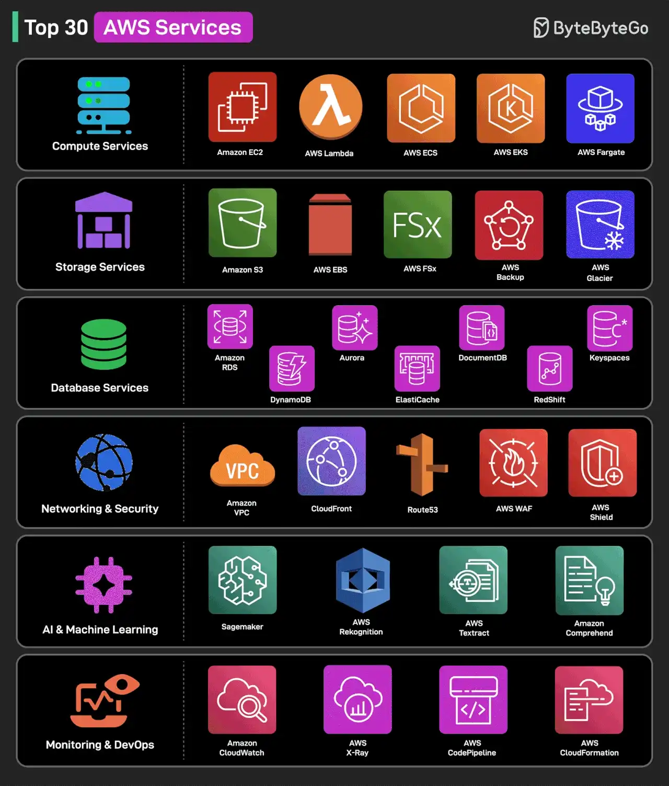

# 067 - Top 30 AWS service thường được sử dụng

- Nguồn: ByteByteGo Big Archive System Design 2025
- Trang PDF: 145-146
- Ảnh minh họa: `../assets/067/figure-01.png`

## Hình minh họa

## Dịch sát

Chúng ta nhóm chúng theo category và hiểu chúng làm gì.

### Compute Services

1. Amazon EC2: virtual server trên cloud.
2. AWS Lambda: serverless function cho event-driven workload.
3. Amazon ECS: managed container orchestration.
4. Amazon EKS: Kubernetes cluster management service.
5. AWS Fargate: serverless compute cho container.

### Storage Services

6. Amazon S3: scalable secure object storage.
7. Amazon EBS: block storage cho EC2 instance.
8. Amazon FSx: fully managed file storage.
9. AWS Backup: centralized backup automation.
10. Amazon Glacier: archival cold storage cho backup.

### Database Services

11. Amazon RDS: managed relational database service.
12. Amazon DynamoDB: NoSQL database với low latency.
13. Amazon Aurora: high-performance cloud-native database.
14. Amazon Redshift: scalable data warehousing solution.
15. Amazon ElastiCache: in-memory caching với Redis/Memcached.
16. Amazon DocumentDB: NoSQL document database, MongoDB-compatible.
17. Amazon Keyspaces: managed Cassandra database service.

### Networking & Security

18. Amazon VPC: secure cloud networking.
19. AWS CloudFront: Content Delivery Network.
20. AWS Route53: scalable domain name system, DNS.
21. AWS WAF: bảo vệ web application khỏi attack.
22. AWS Shield: DDoS protection cho AWS workload.

### AI & Machine Learning

23. Amazon SageMaker: build, train và deploy ML model.
24. AWS Rekognition: image và video analysis bằng AI.
25. AWS Textract: extract text từ scanned document.
26. Amazon Comprehend: natural language processing chạy bằng AI.

### Monitoring & DevOps

27. Amazon CloudWatch: AWS performance monitoring và alert.
28. AWS X-Ray: distributed tracing cho application.
29. AWS CodePipeline: CI/CD automation cho deployment.
30. AWS CloudFormation: Infrastructure as Code, IaC.

Câu hỏi dành cho bạn: Bạn sẽ thêm AWS service nào khác vào danh sách?

## Dịch nội dung trong hình

Hình nhóm 30 AWS service theo 6 category: Compute Services, Storage Services, Database Services, Networking & Security, AI & Machine Learning, Monitoring & DevOps.

## Tóm tắt & giải thích dễ hiểu

AWS có rất nhiều service, nhưng developer nên học theo nhóm năng lực. Compute chạy workload. Storage lưu object/block/file. Database lưu dữ liệu có cấu trúc hoặc NoSQL. Networking/security quản lý traffic và bảo vệ hệ thống. AI/ML hỗ trợ model và phân tích. Monitoring/DevOps giúp quan sát và deploy.

Khi design trên AWS, nên mô tả bài toán trước rồi map sang service. Ví dụ cần object storage thì S3, cần serverless event handler thì Lambda, cần managed PostgreSQL thì RDS/Aurora, cần CDN thì CloudFront, cần IaC thì CloudFormation hoặc Terraform.

## Ví dụ thực tế - không nằm trong tài liệu gốc

Một API upload hóa đơn có thể dùng API Gateway/Lambda hoặc ECS cho backend, S3 lưu file, Textract đọc text, SQS để queue xử lý, RDS lưu metadata, CloudWatch/X-Ray để monitoring/tracing và IAM để giới hạn quyền truy cập bucket.

## Thuật ngữ chính

- `EC2`: virtual machine trên AWS.
- `Lambda`: serverless function.
- `S3`: object storage.
- `RDS`: managed relational database.
- `VPC`: mạng riêng ảo trên AWS.
- `WAF`: Web Application Firewall.
- `CloudFormation`: IaC service của AWS.
