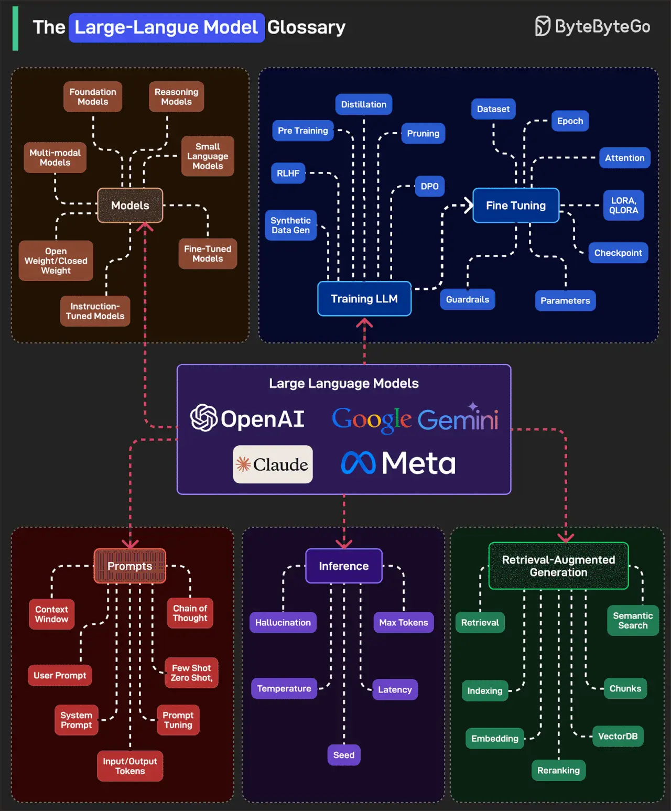

# 068 - Glossary về Large Language Model

- Nguồn: ByteByteGo Big Archive System Design 2025
- Trang PDF: 147-148
- Ảnh minh họa: `../assets/068/figure-01.png`

## Hình minh họa

## Dịch sát

Glossary này có thể được chia thành các category cấp cao:

1. Models: bao gồm các loại model như Foundation, Instruction-Tuned, Multi-modal, Reasoning và Small Language Model.

2. Training LLM: training bắt đầu với pretraining, RLHF, DPO và Synthetic Data. Fine-Tuning thêm khả năng control bằng dataset, checkpoint, LoRA/QLoRA, guardrails và parameter tuning.

3. Prompts: prompt định hướng cách model response bằng User/System Prompt, Chain of Thought và Few/Zero-Shot learning. Prompt Tuning và Context Window lớn giúp định hình các conversation multi-turn chính xác hơn.

4. Inference: đây là cách model generate response. Các yếu tố chính gồm Temperature, Max Tokens, Seed và Latency. Hallucination là vấn đề phổ biến ở đây, khi model tạo ra điều nghe có vẻ thật nhưng không đúng.

5. Retrieval-Augmented Generation: RAG cải thiện accuracy bằng cách fetch real-world data. Nó dùng Retrieval, Semantic Search, Chunks, Embeddings và VectorDB. Reranking và Indexing đảm bảo các answer tốt nhất được đưa lên, không chỉ là các answer có vẻ khả dĩ nhất.

Câu hỏi dành cho bạn: Bạn sẽ thêm gì khác vào LLM glossary?

## Dịch nội dung trong hình

- `Models`: foundation models, reasoning models, multi-modal models, small language models, fine-tuned models, open/closed weights, synthetic data used model.
- `Training LLM`: pre-training, SFT, RLHF, DPO, fine-tuning, dataset, checkpoint, attention, parameters, LoRA/QLoRA, guardrails.
- `Prompts`: context, user prompt, system prompt, prompt tuning, fine-tune the shot, chain of thought và zero/few-shot.
- `Inference`: hallucination, max tokens, temperature, latency và seed.
- `Retrieval-Augmented Generation`: retrieval, semantic search, chunks, embeddings, VectorDB, reranking và indexing.

## Tóm tắt & giải thích dễ hiểu

LLM ecosystem có nhiều thuật ngữ, nhưng có thể gom theo vòng đời: model là gì, model được train/fine-tune thế nào, prompt điều khiển model ra sao, inference sinh output thế nào và RAG bổ sung tri thức bên ngoài như thế nào.

Đối với developer xây sản phẩm AI, các khái niệm inference và RAG thường gặp hằng ngày nhất. Temperature ảnh hưởng độ sáng tạo, max tokens ảnh hưởng độ dài và chi phí, latency ảnh hưởng UX, hallucination ảnh hưởng độ tin cậy. RAG giúp model trả lời dựa trên dữ liệu riêng hoặc dữ liệu mới.

## Ví dụ thực tế - không nằm trong tài liệu gốc

Khi chatbot trả lời sai chính sách công ty, có thể vấn đề không nằm ở model mà ở retrieval: chunk sai, embedding kém, không rerank hoặc context bị thiếu. Khi output quá dài và tốn tiền, kiểm tra max tokens. Khi câu trả lời quá ngẫu nhiên, giảm temperature.

## Thuật ngữ chính

- `Foundation model`: model nền lớn dùng cho nhiều task.
- `SFT`: Supervised Fine-Tuning.
- `RLHF`: Reinforcement Learning from Human Feedback.
- `DPO`: Direct Preference Optimization.
- `LoRA/QLoRA`: kỹ thuật fine-tune tiết kiệm tài nguyên.
- `Hallucination`: model bịa hoặc trả sai nhưng nghe có vẻ đúng.
- `RAG`: retrieval-augmented generation.

## Câu hỏi ôn tập + trả lời + thinking học tập + liên hệ

> Đây là phần học tập thêm ở cuối file. Câu hỏi ưu tiên lấy từ tài liệu gốc và được trả lời trực tiếp; nếu bài không có câu hỏi riêng thì dùng tiêu đề/nội dung chính để tạo câu hỏi tự kiểm tra.

### Câu hỏi 1

**Nguồn câu hỏi:** Câu hỏi trong tài liệu gốc.

**Câu hỏi:** Bạn sẽ thêm gì khác vào LLM glossary?

**Trả lời:** Danh sách sẽ đầy đủ hơn nếu thêm evaluation harness để đo chất lượng thay vì cảm tính; guardrails/policy để giảm prompt injection và output nguy hiểm; observability cho prompt, context, latency, cost và hallucination; và model routing theo độ khó/cost của request. Các mục này giúp bức tranh đầy đủ hơn vì chúng chạm vào phần triển khai/vận hành mà bài gốc chưa đi sâu. Ý chính đang có của bài là: LLM ecosystem có nhiều thuật ngữ, nhưng có thể gom theo vòng đời: model là gì, model được train/fine-tune thế nào, prompt điều khiển model ra sao, inference sinh output thế nào và RAG bổ sung tri thức bên ngoài như thế nào. Đối với developer xây sản phẩm AI, các khái niệm inference và RAG thường gặp hằng ngày nhất. Temperature ảnh hưởng độ sáng tạo, max tokens ảnh hưởng độ dài và chi phí, latency ảnh hưởng UX, hallucination ảnh hưởng độ tin cậy. RAG giúp model trả lời dựa trên dữ liệu riêng hoặc dữ liệu mới.

**Thinking học tập + liên hệ:** Danh sách trong `Glossary về Large Language Model` nên được kiểm theo coverage: nó đã nói phần nào, thiếu phần nào và phần thiếu có làm thay đổi quyết định thiết kế không. Lens chính là quality, latency, cost/token, privacy, cập nhật tri thức và rủi ro hallucination. Khi build AI app, hãy nối model với pipeline thật: data vào đâu, context lấy từ đâu, output được kiểm thế nào và chi phí tăng theo traffic ra sao. Khi ghi chú lại, hãy giải thích được các keyword: `Foundation model`, `SFT`, `RLHF`, `DPO`, `LoRA/QLoRA`.
