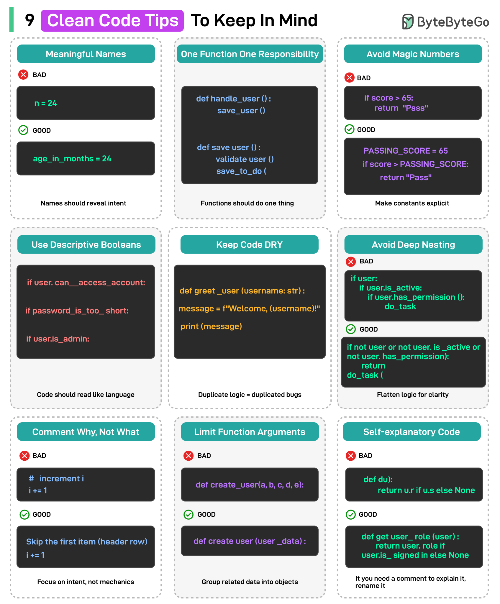

# 069 - 9 nguyên tắc Clean Code cần ghi nhớ

- Nguồn: ByteByteGo Big Archive System Design 2025
- Trang PDF: 149-150
- Ảnh minh họa: `../assets/069/figure-01.png`, `../assets/069/figure-02.png`

## Hình minh họa

## Dịch sát

1. Meaningful Names: đặt tên variable và function để thể hiện purpose của chúng, không chỉ value.

2. One Function, One Responsibility: function nên làm một việc.

3. Avoid Magic Numbers: thay hard-code value bằng named constant để làm chúng có ý nghĩa.

4. Use Descriptive Booleans: tên boolean nên thể hiện condition, không chỉ value.

5. Keep Code DRY: duplicate code nghĩa là duplicate bug. Cố gắng reuse logic ở nơi hợp lý.

6. Avoid Deep Nesting: làm phẳng code flow để cải thiện clarity và giảm cognitive load.

7. Comment Why, Not What: giải thích intention phía sau code, không giải thích mechanics hiển nhiên.

8. Limit Function Arguments: quá nhiều parameter gây rối. Nhóm dữ liệu liên quan vào object.

9. Code Should Be Self-Explanatory: code viết tốt cần ít comment hơn vì nó đọc giống một câu chuyện.

Câu hỏi dành cho bạn: Bạn sẽ thêm nguyên tắc clean code nào khác vào danh sách?

## Dịch nội dung trong hình

- `Meaningful Names`: tên phải thể hiện intent; ví dụ `age_in_months` tốt hơn tên mơ hồ.
- `One Function One Responsibility`: function chỉ nên làm một việc.
- `Avoid Magic Numbers`: thay số hard-code như `65` bằng constant như `PASSING_SCORE`.
- `Use Descriptive Booleans`: boolean nên thể hiện điều kiện như `if user_is_admin`.
- `Keep Code DRY`: tránh duplicated logic.
- `Avoid Deep Nesting`: tránh nhiều tầng `if` lồng nhau; return sớm khi phù hợp.
- `Comment Why, Not What`: comment nên giải thích intent, không nhắc lại code đang làm gì.
- `Limit Function Arguments`: nhóm data liên quan vào object.
- `Self-explanatory Code`: code nên đủ rõ để không cần comment giải thích mọi dòng.

## Tóm tắt & giải thích dễ hiểu

Clean code giúp code dễ đọc, dễ sửa và ít bug hơn. Tên rõ ràng giảm nhu cầu comment. Function nhỏ một trách nhiệm giúp test và reuse dễ hơn. Tránh magic number và boolean mơ hồ giúp business rule rõ hơn. Tránh nesting sâu giúp người đọc không phải giữ quá nhiều context trong đầu.

Nguyên tắc “comment why, not what” rất quan trọng. Nếu code đã nói rõ “làm gì”, comment nên giải thích “vì sao làm như vậy”, nhất là với workaround, business rule lạ hoặc constraint kỹ thuật.

## Ví dụ thực tế - không nằm trong tài liệu gốc

Thay vì viết `if (score >= 65)`, hãy dùng `const PASSING_SCORE = 65`. Thay vì function `processUser(user, true, false, 3)`, tạo object option như `processUser(user, { sendEmail: true, dryRun: false, retryCount: 3 })`. Code sẽ tự giải thích tốt hơn và ít nhầm parameter hơn.

## Thuật ngữ chính

- `Clean Code`: code dễ đọc, dễ hiểu và dễ maintain.
- `Magic number`: số hard-code không rõ ý nghĩa.
- `DRY`: Don't Repeat Yourself, tránh lặp logic.
- `Cognitive load`: tải nhận thức người đọc phải giữ trong đầu.
- `Early return`: return sớm để giảm nesting.
- `Self-explanatory`: tự giải thích qua tên và cấu trúc code.
