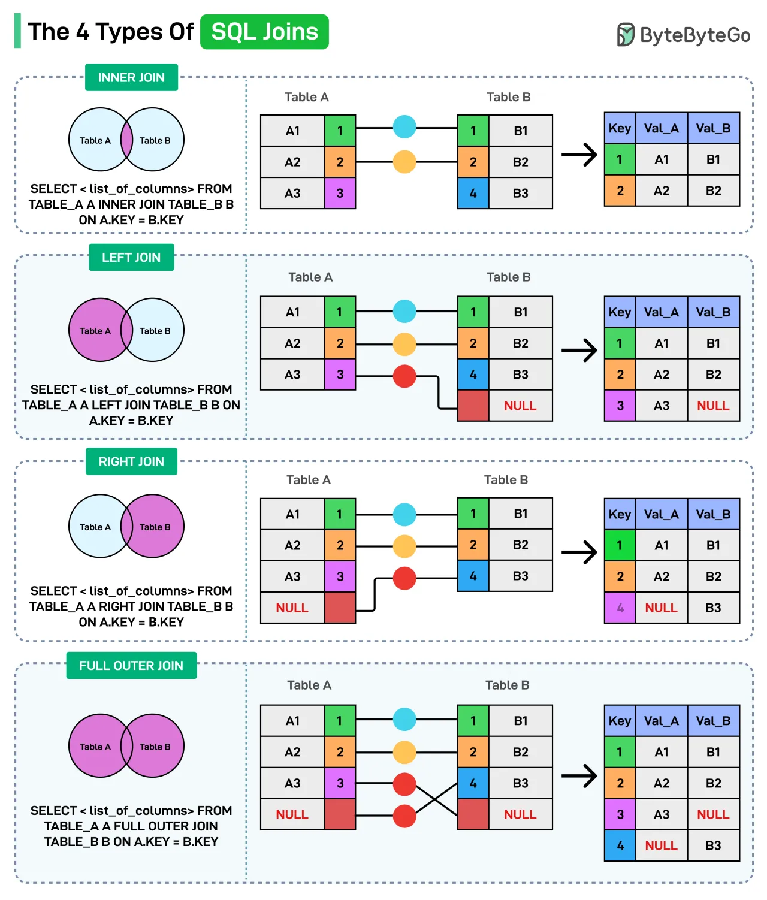

# 070 - 4 loại SQL Join

- Nguồn: ByteByteGo Big Archive System Design 2025
- Trang PDF: 151-152
- Ảnh minh họa: `../assets/070/figure-01.png`

## Hình minh họa

## Dịch sát

SQL join kết hợp row từ hai hoặc nhiều table dựa trên một related column. Dưới đây là các loại join khác nhau bạn có thể dùng:

1. Inner Join

   Chỉ trả về các row matching giữa cả hai table. Nó chỉ giữ common data.

2. Left Join

   Trả về tất cả row từ left table và các row matching từ right table. Nếu một row trong left table không có match trong right table, các column của right table sẽ chứa giá trị NULL trong row đó.

3. Right Join

   Trả về tất cả row từ right table và các row matching từ left table. Nếu không có record matching trong left table cho một record trong right table, các column từ left table trong result sẽ chứa giá trị NULL.

4. FULL OUTER JOIN

   Trả về tất cả row từ cả hai table, điền NULL cho các match bị thiếu.

Câu hỏi dành cho bạn: Bạn dùng SQL Join nào nhiều nhất?

## Dịch nội dung trong hình

- `INNER JOIN`: chỉ lấy phần giao nhau giữa Table A và Table B.
- `LEFT JOIN`: lấy tất cả row từ Table A, ghép row matching từ Table B, không match thì cột B là NULL.
- `RIGHT JOIN`: lấy tất cả row từ Table B, ghép row matching từ Table A, không match thì cột A là NULL.
- `FULL OUTER JOIN`: lấy tất cả row từ cả hai table, không match thì bên thiếu là NULL.
- Hình minh họa SQL syntax và bảng kết quả cho từng join type.

## Tóm tắt & giải thích dễ hiểu

Join là cách kết hợp dữ liệu giữa các table quan hệ. Inner join phù hợp khi chỉ cần record có đủ dữ liệu ở cả hai bên. Left join phù hợp khi muốn giữ toàn bộ dữ liệu gốc bên trái, ví dụ danh sách user dù user chưa có order. Right join tương tự nhưng giữ toàn bộ bảng bên phải. Full outer join dùng khi muốn thấy tất cả record từ cả hai phía, kể cả không match.

Trong thực tế, `LEFT JOIN` rất phổ biến vì nó giữ entity chính và bổ sung dữ liệu liên quan nếu có. Hiệu năng join phụ thuộc index, cardinality, query plan và kích thước bảng.

## Ví dụ thực tế - không nằm trong tài liệu gốc

Nếu muốn lấy tất cả user và số đơn hàng của họ, kể cả user chưa mua lần nào, dùng `LEFT JOIN orders ON users.id = orders.user_id`. Nếu dùng `INNER JOIN`, user chưa có order sẽ biến mất khỏi kết quả.

## Thuật ngữ chính

- `Join`: kết hợp row giữa nhiều table.
- `NULL`: giá trị thiếu/không có.
- `Primary key`: khóa chính định danh row.
- `Foreign key`: khóa tham chiếu sang table khác.
- `Cardinality`: số lượng/độ phân bố row matching.
- `Query plan`: kế hoạch database dùng để thực thi query.
