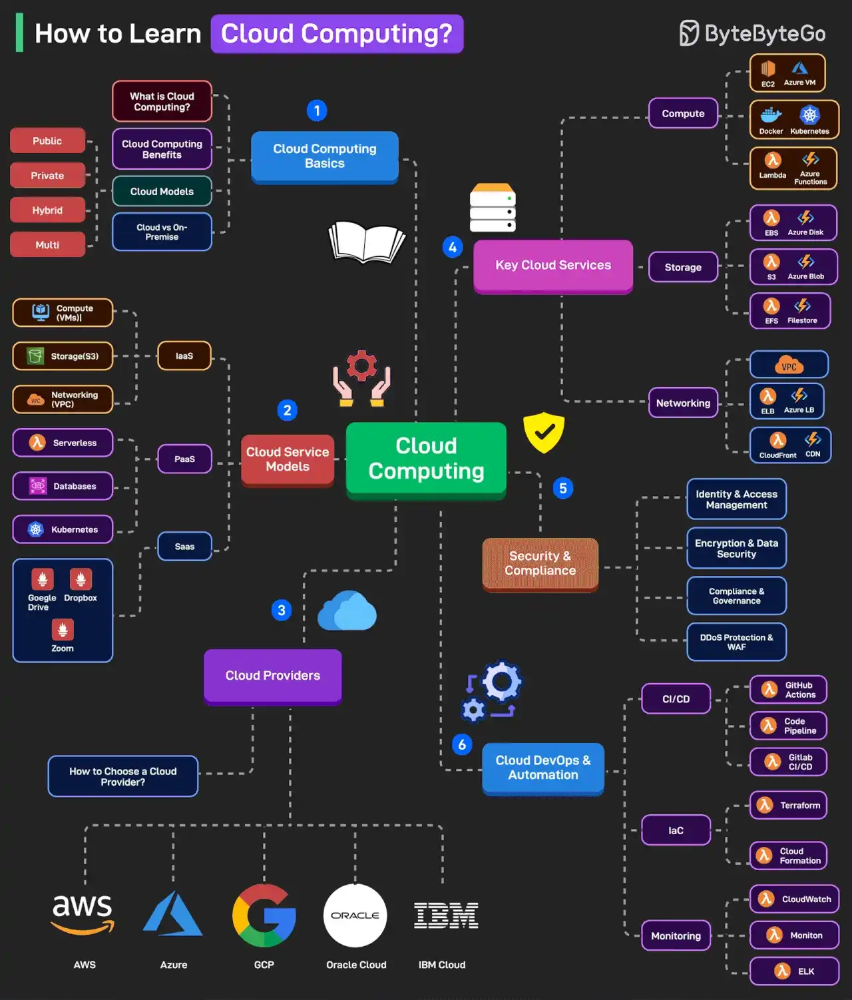

# 071 - Học Cloud Computing như thế nào?

- Nguồn: ByteByteGo Big Archive System Design 2025
- Trang PDF: 153-154
- Ảnh minh họa: `../assets/071/figure-01.png`

## Hình minh họa

## Dịch sát

Cloud computing là một lĩnh vực rộng với footprint ngày càng tăng. Với developer mới, thường khó hiểu nên bắt đầu từ đâu. Dưới đây là learning map:

1. Cloud Computing Basics

   Bao gồm các topic như “cloud computing là gì”, lợi ích của nó, cloud model như public, private, hybrid và multi, cùng so sánh cloud vs on-premise.

2. Cloud Service Models

   Học về cloud service model như IaaS, PaaS và SaaS.

3. Cloud Providers

   Khám phá các cloud platform phổ biến như AWS, Azure, GCP, Oracle Cloud, IBM Cloud, v.v. Ngoài ra, học cách chọn cloud provider.

4. Key Cloud Services

   Học các cloud service quan trọng liên quan đến Compute như EC2, Azure VM, Docker, Kubernetes, Lambda, v.v.; Storage như EBS, Azure Disk, S3, Azure Blob, EFS, v.v.; và Networking như VPC, ELB, Azure LB, CloudFront và Azure CDN.

5. Security & Compliance

   Học các điểm security và compliance critical liên quan đến identity, access management, encryption, data security, DDoS protection và WAF.

6. Cloud DevOps & Automation

   Học Cloud DevOps và automation ở các area cụ thể như CI/CD, IaC và Monitoring.

Câu hỏi dành cho bạn: Bạn sẽ thêm gì khác vào danh sách học cloud computing?

## Dịch nội dung trong hình

- `Cloud Computing Basics`: what is cloud computing, benefits, cloud models, cloud vs on-premise.
- `Cloud Service Models`: IaaS, PaaS và SaaS.
- `Cloud Providers`: AWS, Azure, GCP, Oracle Cloud, IBM.
- `Key Cloud Services`: compute, storage, networking.
- `Security & Compliance`: identity/access management, encryption, data security, DDoS protection và WAF.
- `Cloud DevOps & Automation`: CI/CD, IaC và monitoring.
- Hình cũng liệt kê nhiều service như EC2, Azure VM, Docker, Kubernetes, Lambda, EBS, Azure Disk, S3, Azure Blob, EFS, VPC, ELB, CloudFront và Azure CDN.

## Tóm tắt & giải thích dễ hiểu

Học cloud nên đi từ mô hình trước, service sau. Trước hết hiểu cloud khác on-premise thế nào, các model public/private/hybrid/multi-cloud là gì, và IaaS/PaaS/SaaS khác nhau ra sao. Sau đó học các service cốt lõi: compute để chạy app, storage để lưu dữ liệu, networking để kết nối, security để bảo vệ, DevOps để deploy/monitor.

Với developer, cloud không chỉ là biết click console. Cần hiểu IAM, network boundary, cost, region/AZ, backup, monitoring, logging và automation. Production cloud tốt thường được quản lý bằng IaC thay vì thao tác thủ công.

## Ví dụ thực tế - không nằm trong tài liệu gốc

Một backend API trên AWS có thể dùng VPC, EC2/ECS/Lambda cho compute, RDS cho database, S3 cho file, CloudFront cho CDN, Route53 cho DNS, WAF/Shield cho bảo vệ, CloudWatch cho monitoring và Terraform/CloudFormation cho IaC.

## Thuật ngữ chính

- `IaaS`: Infrastructure as a Service.
- `PaaS`: Platform as a Service.
- `SaaS`: Software as a Service.
- `On-premise`: hạ tầng tự vận hành tại datacenter riêng.
- `Region/AZ`: vùng địa lý và availability zone trong cloud.
- `IAM`: quản lý danh tính và quyền truy cập.
- `WAF`: Web Application Firewall.
