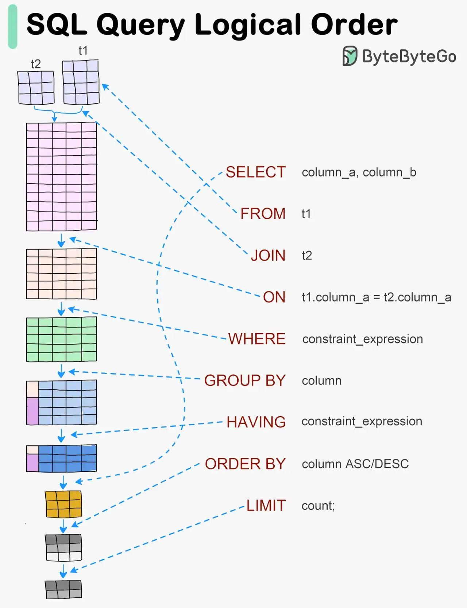

# 072 - Trực quan hóa một SQL query

- Nguồn: ByteByteGo Big Archive System Design 2025
- Trang PDF: 155
- Ảnh minh họa: `../assets/072/figure-01.png`

## Hình minh họa

## Dịch sát

SQL statement được database system execute qua nhiều bước, bao gồm:

- Parsing SQL statement và kiểm tra validity của nó.
- Transform SQL thành internal representation, chẳng hạn relational algebra.
- Optimize internal representation và tạo execution plan sử dụng index information.
- Execute plan và trả result.

## Dịch nội dung trong hình

Hình minh họa logical order của SQL query:

1. `FROM t1`: xác định source table.
2. `JOIN t2`: join với table khác.
3. `ON t1.column_a = t2.column_a`: điều kiện join.
4. `WHERE constraint_expression`: lọc row.
5. `GROUP BY column`: gom nhóm.
6. `HAVING constraint_expression`: lọc sau khi group.
7. `SELECT column_a, column_b`: chọn column/output expression.
8. `ORDER BY column ASC/DESC`: sắp xếp.
9. `LIMIT count`: giới hạn số row trả về.

## Tóm tắt & giải thích dễ hiểu

SQL được viết theo thứ tự `SELECT ... FROM ... WHERE ...`, nhưng database xử lý logic theo thứ tự khác. Thường nó xác định source từ `FROM/JOIN`, áp điều kiện join `ON`, lọc `WHERE`, gom `GROUP BY`, lọc group bằng `HAVING`, rồi mới chọn output `SELECT`, sắp xếp `ORDER BY` và giới hạn `LIMIT`.

Ngoài logical order, database optimizer có thể chọn execution plan vật lý khác để chạy nhanh hơn, miễn là kết quả tương đương. Vì vậy khi tối ưu query, cần xem execution plan thay vì chỉ nhìn thứ tự câu SQL.

## Ví dụ thực tế - không nằm trong tài liệu gốc

Nếu bạn đặt alias trong `SELECT`, đôi khi không dùng được alias đó trong `WHERE` vì `WHERE` được xử lý logic trước `SELECT`. Với aggregate như `COUNT(*)`, bạn dùng `HAVING COUNT(*) > 10` để lọc group, không dùng `WHERE COUNT(*) > 10`.

Khi query chậm, dùng `EXPLAIN` hoặc `EXPLAIN ANALYZE` để xem database có dùng index không, join order ra sao và bottleneck nằm ở scan, join, sort hay aggregation.

## Thuật ngữ chính

- `Parsing`: phân tích cú pháp SQL.
- `Relational algebra`: biểu diễn logic quan hệ bên trong database.
- `Optimizer`: thành phần chọn kế hoạch chạy query.
- `Execution plan`: kế hoạch thực thi query.
- `Predicate`: điều kiện lọc/join.
- `Aggregation`: tính toán theo nhóm như COUNT, SUM, AVG.
- `EXPLAIN`: lệnh xem query plan.

## Câu hỏi ôn tập + trả lời + thinking học tập + liên hệ

> Đây là phần học tập thêm ở cuối file. Câu hỏi ưu tiên lấy từ tài liệu gốc và được trả lời trực tiếp; nếu bài không có câu hỏi riêng thì dùng tiêu đề/nội dung chính để tạo câu hỏi tự kiểm tra.

### Câu hỏi 1

**Nguồn câu hỏi:** Suy ra từ tiêu đề/nội dung chính vì bài gốc không có câu hỏi riêng.

**Câu hỏi:** Sau khi đọc bài “Visualizing a SQL query”, ý chính cần trả lời và áp dụng vào system design là gì?

**Trả lời:** Sau bài này, phần đáng nhớ nhất là: SQL được viết theo thứ tự `SELECT ... FROM ... WHERE ...`, nhưng database xử lý logic theo thứ tự khác. Thường nó xác định source từ `FROM/JOIN`, áp điều kiện join `ON`, lọc `WHERE`, gom `GROUP BY`, lọc group bằng `HAVING`, rồi mới chọn output `SELECT`, sắp xếp `ORDER BY` và giới hạn `LIMIT`. Khi áp dụng vào hệ thống thật, hãy kiểm thêm read/write ratio, consistency, cardinality, query pattern, growth rate và recovery requirement.

**Thinking học tập + liên hệ:** Liên hệ `Trực quan hóa một SQL query` bằng một scenario thật sẽ giúp thấy trade-off rõ hơn so với chỉ đọc định nghĩa. Lens chính là read/write ratio, consistency, cardinality, query pattern, growth rate và recovery requirement. Khi gặp bài toán dữ liệu, hãy nối bài học với truy vấn nóng nhất, index thật sự được dùng, cache nào có thể stale và thời gian restore sau sự cố. Khi ghi chú lại, hãy giải thích được các keyword: `Parsing`, `Relational algebra`, `Optimizer`, `Execution plan`, `Predicate`.
