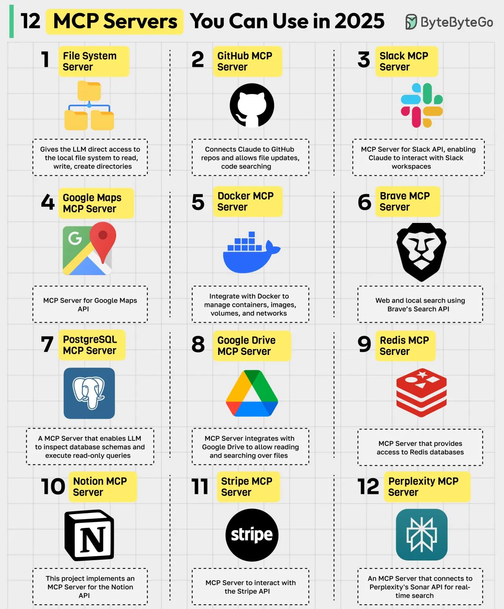

# 074 - 12 MCP Server bạn có thể dùng trong năm 2025

- Nguồn: ByteByteGo Big Archive System Design 2025
- Trang PDF: 158-159
- Ảnh minh họa: `../assets/074/figure-01.png`

## Hình minh họa

## Dịch sát

MCP (Model Context Protocol) là một open standard giúp đơn giản hóa cách AI model, đặc biệt là LLM, tương tác với external data source, tool và service. Một MCP server đóng vai trò như cầu nối giữa các AI model này và external tool. Dưới đây là các MCP server hàng đầu:

1. File System MCP Server
   Cho phép LLM truy cập trực tiếp local file system để đọc, ghi và tạo thư mục.

2. GitHub MCP Server
   Kết nối Claude với GitHub repo và cho phép cập nhật file, tìm kiếm code.

3. Slack MCP Server
   MCP Server cho Slack API, cho phép Claude tương tác với Slack workspace.

4. Google Maps MCP Server
   MCP Server cho Google Maps API.

5. Docker MCP Server
   Tích hợp với Docker để quản lý container, image, volume và network.

6. Brave MCP Server
   Web search và local search bằng Brave Search API.

7. PostgreSQL MCP Server
   MCP server cho phép LLM inspect database schema và execute read-only query.

8. Google Drive MCP Server
   MCP server tích hợp với Google Drive để đọc và tìm kiếm file.

9. Redis MCP Server
   MCP Server cung cấp quyền truy cập Redis database.

10. Notion MCP Server
    Project này triển khai MCP server cho Notion API.

11. Stripe MCP Server
    MCP Server để tương tác với Stripe API.

12. Perplexity MCP Server
    MCP Server kết nối tới Perplexity Sonar API để search theo thời gian thực.

Câu hỏi dành cho bạn: Bạn sẽ thêm MCP Server nào khác vào danh sách?

## Dịch nội dung trong hình

Hình minh họa 12 MCP server theo từng ô: File System, GitHub, Slack, Google Maps, Docker, Brave, PostgreSQL, Google Drive, Redis, Notion, Stripe và Perplexity. Mỗi server đại diện cho một loại capability mà LLM có thể dùng qua MCP: thao tác file, code repo, chat workspace, bản đồ, container, search, database, document, cache, knowledge workspace, thanh toán và real-time search.

## Tóm tắt & giải thích dễ hiểu

MCP chuẩn hóa cách LLM gọi tool. Thay vì mỗi ứng dụng AI phải viết integration riêng với GitHub, Slack, PostgreSQL hoặc Docker, MCP tạo ra mô hình client-server thống nhất. AI app đóng vai trò host/client, còn MCP server bọc external system thành tool có schema rõ ràng.

Trong system design, MCP giống một integration layer cho AI agent. Giá trị lớn nhất là giảm coupling giữa model và từng hệ thống bên ngoài, đồng thời giúp kiểm soát permission, capability và audit dễ hơn.

## Ví dụ thực tế - không nằm trong tài liệu gốc

Một coding agent có thể dùng File System MCP để đọc project, GitHub MCP để xem PR, PostgreSQL MCP để inspect schema read-only và Slack MCP để tóm tắt thông báo release. Nếu thiết kế tốt, mỗi MCP server chỉ được cấp quyền tối thiểu cần thiết, ví dụ database chỉ read-only và chỉ được query schema/dev data.

## Thuật ngữ chính

- `MCP`: Model Context Protocol.
- `MCP Server`: process cung cấp tool/resource/prompt cho AI client.
- `MCP Client`: thành phần kết nối tới MCP server.
- `Host`: ứng dụng AI như Claude Desktop, IDE hoặc agent runtime.
- `Tool`: capability có thể được model gọi.
- `Read-only query`: truy vấn chỉ đọc, không thay đổi dữ liệu.
- `Integration layer`: lớp kết nối nhiều hệ thống với nhau.

