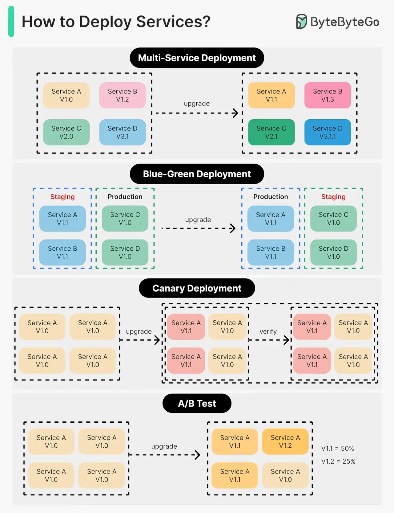

# 075 - Cách deploy service

- Nguồn: ByteByteGo Big Archive System Design 2025
- Trang PDF: 160-161
- Ảnh minh họa: `../assets/075/figure-01.png`

## Hình minh họa

## Dịch sát

Deploy hoặc upgrade service là việc có rủi ro. Trong bài này, chúng ta khám phá các chiến lược giảm thiểu rủi ro.

Sơ đồ bên dưới minh họa những chiến lược phổ biến.

Multi-Service Deployment

Trong model này, chúng ta deploy thay đổi mới tới nhiều service cùng lúc. Cách tiếp cận này dễ triển khai. Nhưng vì tất cả service được upgrade cùng thời điểm, dependency rất khó quản lý và test. Rollback an toàn cũng khó.

Blue-Green Deployment

Với blue-green deployment, chúng ta có hai environment giống hệt nhau: một là staging (blue), một là production (green). Staging environment đi trước production một version. Sau khi test xong ở staging environment, user traffic được chuyển sang staging environment, và staging trở thành production. Deployment strategy này rollback đơn giản, nhưng duy trì hai environment đạt chất lượng production có thể tốn kém.

Canary Deployment

Canary deployment upgrade service dần dần, mỗi lần cho một subset user. Nó rẻ hơn blue-green deployment và dễ rollback. Tuy nhiên, vì không có staging environment, chúng ta phải test trên production. Process này phức tạp hơn vì cần monitor canary trong khi dần dần migrate ngày càng nhiều user rời khỏi old version.

A/B Test

Trong A/B test, các version khác nhau của service chạy đồng thời trên production. Mỗi version chạy một “experiment” cho một subset user. A/B test là phương pháp rẻ để test feature mới trên production. Chúng ta cần kiểm soát deployment process để tránh trường hợp một số feature bị đẩy tới user ngoài ý muốn.

Câu hỏi dành cho bạn: Bạn đã dùng deployment strategy nào? Bạn từng chứng kiến outage production liên quan đến deployment chưa, và vì sao nó xảy ra?

## Dịch nội dung trong hình

- `Multi-Service Deployment`: nhiều service A/B/C/D được nâng version đồng thời từ v1.0/v2.0/v3.0 lên v1.1/v2.1/v3.1.
- `Blue-Green Deployment`: có hai environment staging và production; upgrade/test ở staging rồi switch traffic để staging thành production.
- `Canary Deployment`: nâng một phần instance/user trước, verify rồi mới mở rộng sang toàn bộ.
- `A/B Test`: nhiều version chạy song song, ví dụ V1.1 nhận 50% traffic và V1.2 nhận 25% traffic.

## Tóm tắt & giải thích dễ hiểu

Không có deployment strategy nào tốt nhất cho mọi hệ thống. Multi-service deploy đơn giản nhưng rủi ro cao khi dependency phức tạp. Blue-green rollback nhanh nhưng tốn chi phí hạ tầng. Canary giảm blast radius nhưng đòi hỏi observability tốt. A/B test phù hợp để đo hành vi người dùng, không chỉ để giảm rủi ro kỹ thuật.

Điểm mấu chốt trong production là kiểm soát phạm vi ảnh hưởng. Nếu release lỗi, hệ thống phải phát hiện nhanh, dừng rollout và rollback hoặc disable feature trước khi ảnh hưởng quá nhiều user.

## Ví dụ thực tế - không nằm trong tài liệu gốc

Với API thanh toán, nên dùng canary rất nhỏ, ví dụ 1% traffic nội bộ hoặc một region ít rủi ro, theo dõi error rate, latency, payment success rate và log bất thường. Với frontend feature mới, A/B test có thể đo conversion, nhưng vẫn nên dùng feature flag để tắt nhanh nếu có lỗi.

## Thuật ngữ chính

- `Deployment`: đưa version mới ra môi trường chạy thật.
- `Rollback`: quay về version cũ.
- `Blue-green deployment`: hai environment tương đương, switch traffic khi sẵn sàng.
- `Canary deployment`: rollout từng phần nhỏ.
- `A/B test`: thử nghiệm nhiều version với các nhóm user.
- `Blast radius`: phạm vi ảnh hưởng khi có lỗi.
- `Feature flag`: cờ bật/tắt feature mà không cần deploy lại.

