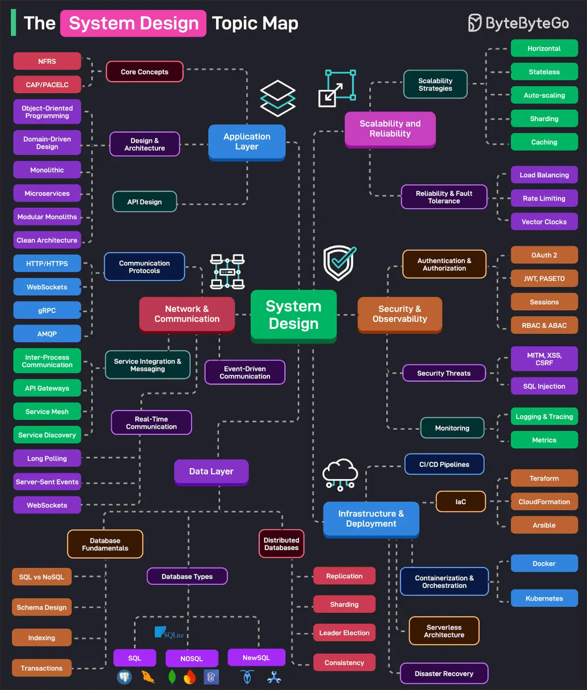

# 076 - Bản đồ chủ đề System Design

- Nguồn: ByteByteGo Big Archive System Design 2025
- Trang PDF: 162-163
- Ảnh minh họa: `../assets/076/figure-01.png`

## Hình minh họa

## Dịch sát

System design hiệu quả là một trò chơi của trade-off và đòi hỏi nền tảng kiến thức rộng để đưa ra quyết định tốt nhất. Topic map này phân loại các chủ đề system design thiết yếu theo category.

1. Application Layer: Bao gồm các core concept như availability, scalability, reliability và các NFR khác. Đồng thời bao phủ các chủ đề design và architecture như OOP, DDD, Microservices, Clean Architecture, Modular Monoliths, v.v.

2. Network & Communication: Bao phủ communication protocol, service integration, messaging, real-time communication và event-driven architecture.

3. Data Layer: Bao phủ nền tảng của database system như schema design, indexing, SQL vs NoSQL, transaction, v.v.; các loại database khác nhau; và các sắc thái của distributed database như replication, sharding, leader election, v.v.

4. Scalability & Reliability: Bao phủ scalability strategy như horizontal scaling, stateless, caching, partitioning, v.v. và reliability strategy như load balancing, rate limiting, v.v.

5. Security & Observability: Bao phủ authentication và authorization technique như OAuth 2, JWT, PASETO, Sessions, Cookies, RBAC, v.v. và security threat. Mảng observability xử lý các chủ đề như monitoring, tracing và logging.

6. Infrastructure & Deployments: Xử lý CI/CD pipeline, containerization và orchestration, serverless architecture, IaC và disaster recovery technique.

Câu hỏi dành cho bạn: Bạn sẽ thêm gì khác vào danh sách?

## Dịch nội dung trong hình

Hình chia System Design thành nhiều nhánh lớn:

- `Application Layer`: NFRs, CAP/PACELC, object-oriented programming, domain-driven design, monoliths, microservices, modular monoliths, clean architecture, HTTP/HTTPS, WebSocket, gRPC, AMQP, IPC, API gateway, service discovery, service mesh, server-sent events, long polling, webhooks.
- `Network & Communication`: communication protocol, service integration & messaging, real-time communication, event-driven communication.
- `Data Layer`: database fundamentals, database types, distributed databases với replication, sharding, leader election, consistency.
- `Scalability and Reliability`: horizontal scaling, stateless, auto scaling, sharding, caching, load balancing, rate limiting, vector clocks.
- `Security & Observability`: authentication/authorization, OAuth 2, JWT/PASETO, sessions, RBAC/ABAC, threats, metrics/logging/tracing.
- `Infrastructure & Deployment`: CI/CD pipeline, IaC, Terraform, CloudFormation, Ansible, Docker, Kubernetes, containerization/orchestration, serverless, disaster recovery.

## Tóm tắt & giải thích dễ hiểu

System design không chỉ là vẽ vài box service. Nó là quá trình cân bằng nhiều trade-off: tốc độ, chi phí, độ tin cậy, bảo mật, khả năng mở rộng, độ phức tạp vận hành và trải nghiệm developer. Topic map giúp người học biết mình đang thiếu mảng nào.

Một cách học tốt là đi từ request path đơn giản: client gọi API, request đi qua network, service xử lý business logic, đọc/ghi database, cache/queue hỗ trợ performance, observability theo dõi lỗi, infrastructure triển khai và scale hệ thống.

## Ví dụ thực tế - không nằm trong tài liệu gốc

Khi thiết kế hệ thống đặt vé, Application Layer xử lý use case đặt chỗ, Data Layer đảm bảo transaction/consistency, Scalability & Reliability dùng cache/queue/rate limit để chịu tải cao, Security kiểm soát user/payment, Observability theo dõi booking failure, còn Infrastructure & Deployment đảm bảo release an toàn.

## Thuật ngữ chính

- `NFR`: non-functional requirement như availability, latency, scalability.
- `Trade-off`: đánh đổi giữa các mục tiêu thiết kế.
- `DDD`: Domain-Driven Design.
- `Event-driven architecture`: kiến trúc giao tiếp qua event.
- `Replication`: sao chép dữ liệu.
- `Sharding`: chia dữ liệu theo shard.
- `Observability`: khả năng hiểu trạng thái hệ thống qua metrics, logs, traces.

