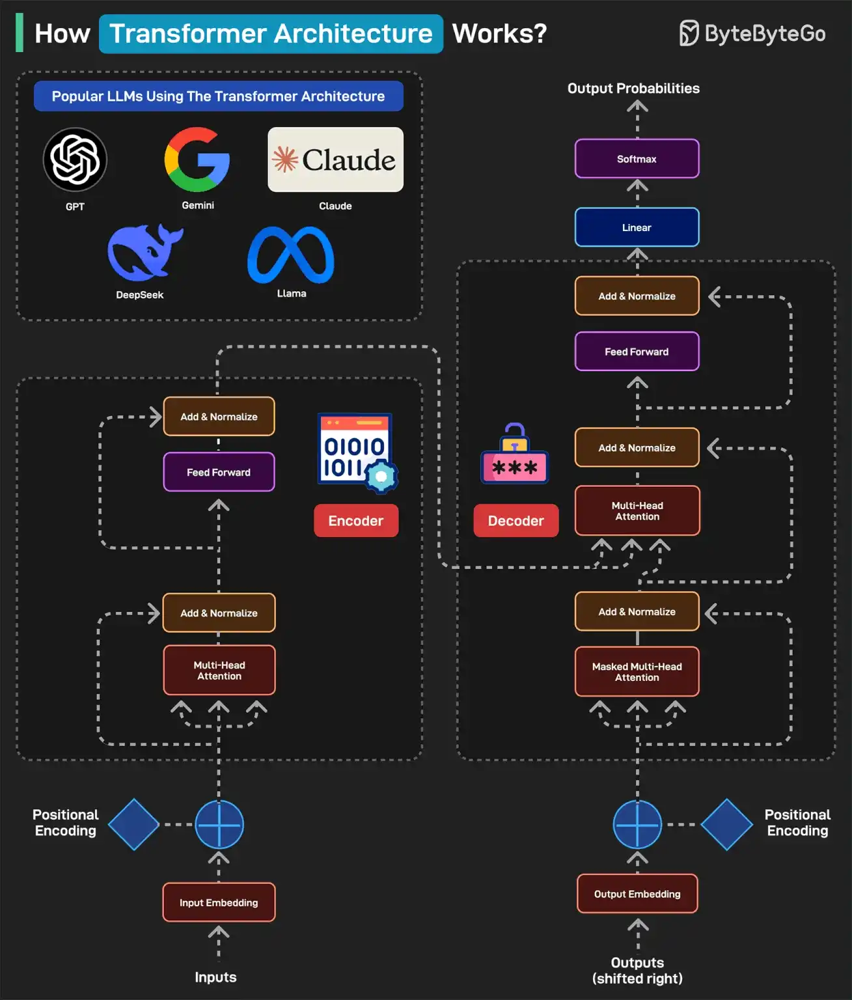

# 077 - Transformer Architecture hoạt động như thế nào?

- Nguồn: ByteByteGo Big Archive System Design 2025
- Trang PDF: 164-165
- Ảnh minh họa: `../assets/077/figure-01.png`

## Hình minh họa

## Dịch sát

Transformer Architecture đã trở thành nền tảng của một số LLM phổ biến nhất, bao gồm GPT, Gemini, Claude, DeepSeek và Llama.

Dưới đây là cách nó hoạt động:

1. Một model dựa trên transformer điển hình có hai phần chính: encoder và decoder. Encoder đọc và hiểu input. Decoder dùng sự hiểu biết này để generate output chính xác.

2. Ở bước đầu tiên (Input Embedding), mỗi word được chuyển thành một number (vector) đại diện cho meaning của nó.

3. Tiếp theo, một pattern gọi là Positional Encoding cho model biết mỗi word nằm ở đâu trong câu. Điều này cần thiết vì word order có ý nghĩa trong câu. Ví dụ “the cat ate the fish” khác với “the fish ate the cat”.

4. Tiếp theo là Multi-Head Attention, bộ não của encoder. Nó cho phép model nhìn tất cả word cùng lúc và xác định word nào liên quan với word nào. Trong phase Add & Normalize, model cộng những gì học được từ attention trở lại vào câu.

5. Feed Forward process thêm chiều sâu cho sự hiểu biết. Toàn bộ process được lặp lại nhiều lần để model có thể hiểu câu sâu hơn.

6. Sau khi encoder hoàn tất, decoder bắt đầu hoạt động. Output embedding chuyển mỗi word trong expected output thành number. Để hiểu mỗi word nên nằm ở đâu, chúng ta thêm Positional Encoding.

7. Masked Multi-Head Attention che các word tương lai để model chỉ dự đoán từng word một.

8. Multi-Head Attention phase align các phần đúng của input với các phần đúng của output. Decoder nhìn cả input sentence và các word mà nó đã generate cho tới hiện tại.

9. Feed Forward áp dụng thêm xử lý để lựa chọn final word tốt hơn. Process được lặp lại nhiều lần để tinh chỉnh kết quả.

10. Khi decoder đã dự đoán number cho mỗi word, nó đưa chúng qua Linear Layer để chuẩn bị output. Layer này map output của decoder sang một tập rất lớn các word có thể có.

11. Sau khi Linear Layer generate score cho mỗi word, Softmax layer chuyển các score đó thành probability. Word có probability cao nhất được chọn làm word tiếp theo.

12. Cuối cùng, một câu mà con người đọc được được generate.

## Dịch nội dung trong hình

- Các LLM phổ biến dùng Transformer Architecture: GPT, Gemini, Claude, DeepSeek, Llama.
- Luồng encoder: `Inputs` -> `Input Embedding` -> `Positional Encoding` -> `Multi-Head Attention` -> `Add & Normalize` -> `Feed Forward` -> `Add & Normalize` -> `Encoder`.
- Luồng decoder: `Outputs (shifted right)` -> `Output Embedding` -> `Positional Encoding` -> `Masked Multi-Head Attention` -> `Add & Normalize` -> `Multi-Head Attention` -> `Add & Normalize` -> `Feed Forward` -> `Add & Normalize` -> `Decoder`.
- Đầu ra cuối: `Linear` -> `Softmax` -> `Output Probabilities`.

## Tóm tắt & giải thích dễ hiểu

Transformer biến text thành vector, thêm thông tin vị trí, rồi dùng attention để học quan hệ giữa các token. Encoder tập trung hiểu input; decoder tập trung sinh output từng token một. Masking giúp decoder không “nhìn trước đáp án”, nên nó học cách dự đoán token kế tiếp.

Trong nhiều LLM hiện đại, kiến trúc thực tế có thể là encoder-only, decoder-only hoặc encoder-decoder. Các model sinh văn bản kiểu GPT thường là decoder-only transformer, nhưng các khối như embedding, positional information, attention, feed-forward, linear/softmax vẫn là ý tưởng nền tảng.

## Ví dụ thực tế - không nằm trong tài liệu gốc

Khi dịch câu “I love system design” sang tiếng Việt, attention giúp model liên kết “I” với “tôi”, “love” với “thích/yêu”, và “system design” như một cụm technical term nên có thể giữ nguyên hoặc dịch là “thiết kế hệ thống” tùy context. Nếu không có positional encoding, model khó phân biệt vai trò của từ theo thứ tự câu.

## Thuật ngữ chính

- `Transformer`: kiến trúc deep learning dựa nhiều vào attention.
- `Embedding`: vector biểu diễn token/word.
- `Positional Encoding`: thông tin vị trí của token.
- `Multi-Head Attention`: nhiều attention head học nhiều quan hệ khác nhau.
- `Masked Attention`: attention có che token tương lai.
- `Feed Forward`: mạng xử lý phi tuyến sau attention.
- `Softmax`: chuyển score thành xác suất.

## Câu hỏi ôn tập + trả lời + thinking học tập + liên hệ

> Đây là phần học tập thêm ở cuối file. Câu hỏi ưu tiên lấy từ tài liệu gốc và được trả lời trực tiếp; nếu bài không có câu hỏi riêng thì dùng tiêu đề/nội dung chính để tạo câu hỏi tự kiểm tra.

### Câu hỏi 1

**Nguồn câu hỏi:** Suy ra từ tiêu đề/nội dung chính vì bài gốc không có câu hỏi riêng.

**Câu hỏi:** How Transformers Architecture Works?

**Trả lời:** Hãy tách flow thành các bước có state rõ ràng: request/dữ liệu đi vào đâu, qua thành phần nào, state đổi ở đâu và kết quả trả ra thế nào. Với `Transformer Architecture hoạt động như thế nào?`, ý chính là: Transformer biến text thành vector, thêm thông tin vị trí, rồi dùng attention để học quan hệ giữa các token. Encoder tập trung hiểu input; decoder tập trung sinh output từng token một. Masking giúp decoder không “nhìn trước đáp án”, nên nó học cách dự đoán token kế tiếp.

**Thinking học tập + liên hệ:** Luồng trong `Transformer Architecture hoạt động như thế nào?` nên được vẽ từ input tới output, kèm owner của từng bước và failure mode ở mỗi boundary. Lens chính là quality, latency, cost/token, privacy, cập nhật tri thức và rủi ro hallucination. Khi build AI app, hãy nối model với pipeline thật: data vào đâu, context lấy từ đâu, output được kiểm thế nào và chi phí tăng theo traffic ra sao. Khi ghi chú lại, hãy giải thích được các keyword: `Transformer`, `Embedding`, `Positional Encoding`, `Multi-Head Attention`, `Masked Attention`.
