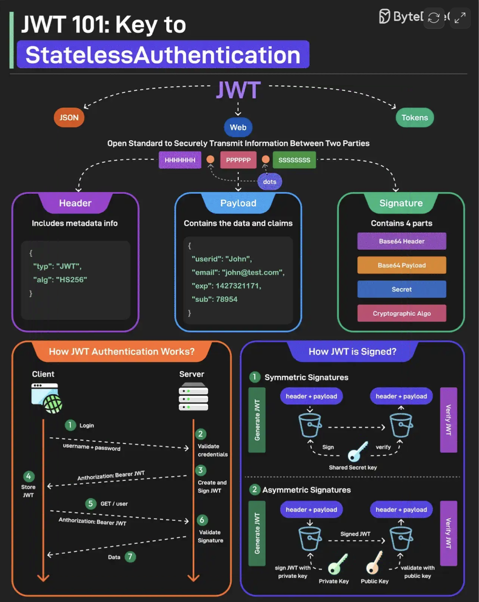

# 078 - JWT được giải thích đơn giản

- Nguồn: ByteByteGo Big Archive System Design 2025
- Trang PDF: 166-167
- Ảnh minh họa: `../assets/078/figure-01.png`

## Hình minh họa

## Dịch sát

JWT hay JSON Web Tokens là một open standard để truyền thông tin an toàn giữa hai bên. Chúng được dùng rộng rãi cho authentication và authorization.

Một JWT gồm ba component chính:

1. Header
   Mỗi JWT mang một header chỉ định algorithm dùng để sign JWT. Nó được viết ở JSON format.

2. Payload
   Payload gồm claims và user data. Có nhiều loại claim khác nhau như registered, public và private claims.

3. Signature
   Signature là phần làm JWT an toàn. Nó được tạo bằng cách lấy encoded header, encoded payload, secret key và algorithm rồi ký chúng.

JWT có thể được sign theo hai cách khác nhau:

1. Symmetric Signatures
   Dùng một secret key duy nhất cho cả việc sign token và verify token. Cùng một key phải được chia sẻ giữa server ký JWT và system verify JWT.

2. Asymmetric Signatures
   Trong trường hợp này, private key được dùng để sign token, còn public key được dùng để verify token. Private key được giữ an toàn trên server, còn public key có thể được phân phối cho bất kỳ ai cần verify token.

Câu hỏi dành cho bạn: Bạn có dùng JWT cho authentication không?

## Dịch nội dung trong hình

- JWT 101: key cho stateless authentication.
- JWT là open standard để truyền thông tin giữa hai bên an toàn, gồm `Header`, `Payload`, `Signature`.
- Header chứa metadata như `typ: JWT`, `alg: HS256`.
- Payload chứa data và claims như `userid`, `email`, `exp`, `sub`.
- Signature gồm base64 header, base64 payload, secret và cryptographic algorithm.
- Luồng authentication: client login, server validate credential, create/sign JWT, trả JWT, client gửi JWT trong request sau, server validate signature rồi trả data.
- Cách ký JWT: symmetric signature dùng shared secret; asymmetric signature dùng private key để sign và public key để verify.

## Tóm tắt & giải thích dễ hiểu

JWT giúp server xác thực request mà không nhất thiết phải lưu session server-side. Server chỉ cần verify chữ ký và kiểm tra claim như expiration, issuer, audience, subject. Đây là lý do JWT hay được gọi là phù hợp với stateless authentication.

Điểm quan trọng là “signed” không đồng nghĩa với “encrypted”. JWT được ký để chống sửa đổi, nhưng payload có thể đọc được nếu token bị lộ. Vì vậy cần dùng HTTPS, thời hạn token ngắn và tránh chứa dữ liệu nhạy cảm trong payload.

## Ví dụ thực tế - không nằm trong tài liệu gốc

Trong microservices, Auth Service có thể ký JWT bằng private key. Các service khác chỉ cần public key để verify request mà không cần gọi Auth Service mỗi lần. Cách này giảm latency và coupling, nhưng cần cơ chế rotate key qua JWKS và xử lý token hết hạn đúng cách.

## Thuật ngữ chính

- `Stateless authentication`: xác thực không cần lưu session tập trung cho mỗi request.
- `Registered claim`: claim chuẩn như `iss`, `sub`, `aud`, `exp`.
- `Public claim`: claim công khai theo tên thống nhất.
- `Private claim`: claim riêng giữa các hệ thống.
- `Symmetric signature`: ký và verify bằng cùng một secret.
- `Asymmetric signature`: ký bằng private key, verify bằng public key.
- `JWKS`: JSON Web Key Set để phân phối public key.

## Câu hỏi ôn tập + trả lời + thinking học tập + liên hệ

> Đây là phần học tập thêm ở cuối file. Câu hỏi ưu tiên lấy từ tài liệu gốc và được trả lời trực tiếp; nếu bài không có câu hỏi riêng thì dùng tiêu đề/nội dung chính để tạo câu hỏi tự kiểm tra.

### Câu hỏi 1

**Nguồn câu hỏi:** Câu hỏi trong tài liệu gốc.

**Câu hỏi:** Bạn có dùng JWT cho authentication không?

**Trả lời:** Với `JWT được giải thích đơn giản`, cách liên hệ tốt nhất là chọn một workload nhỏ rồi kiểm chứng bằng số liệu thay vì chọn theo cảm tính. Nên kiểm bằng workload nhỏ trước: latency, độ ổn định, khả năng debug, cost và rủi ro vận hành. Phần cốt lõi cần đem theo từ bài là: JWT giúp server xác thực request mà không nhất thiết phải lưu session server-side. Server chỉ cần verify chữ ký và kiểm tra claim như expiration, issuer, audience, subject. Đây là lý do JWT hay được gọi là phù hợp với stateless authentication. Điểm quan trọng là “signed” không đồng nghĩa với “encrypted”. JWT được ký để chống sửa đổi, nhưng payload có thể đọc được nếu token bị lộ. Vì vậy cần dùng HTTPS, thời hạn token ngắn và tránh chứa dữ liệu nhạy cảm trong payload.

**Thinking học tập + liên hệ:** Khi tự liên hệ `JWT được giải thích đơn giản`, hãy viết ra một project cụ thể, lý do chọn công nghệ và lỗi vận hành có thể xảy ra. Lens chính là actor, trust boundary, dữ liệu nhạy cảm, lifetime của token/key, quyền truy cập và cơ chế revoke. Khi làm API thật, một endpoint chạy được chưa đủ; phải kiểm thêm abuse, audit log, error leakage, rate limit và quyền ở service chứa dữ liệu. Khi ghi chú lại, hãy giải thích được các keyword: `Stateless authentication`, `Registered claim`, `Public claim`, `Private claim`, `Symmetric signature`.
