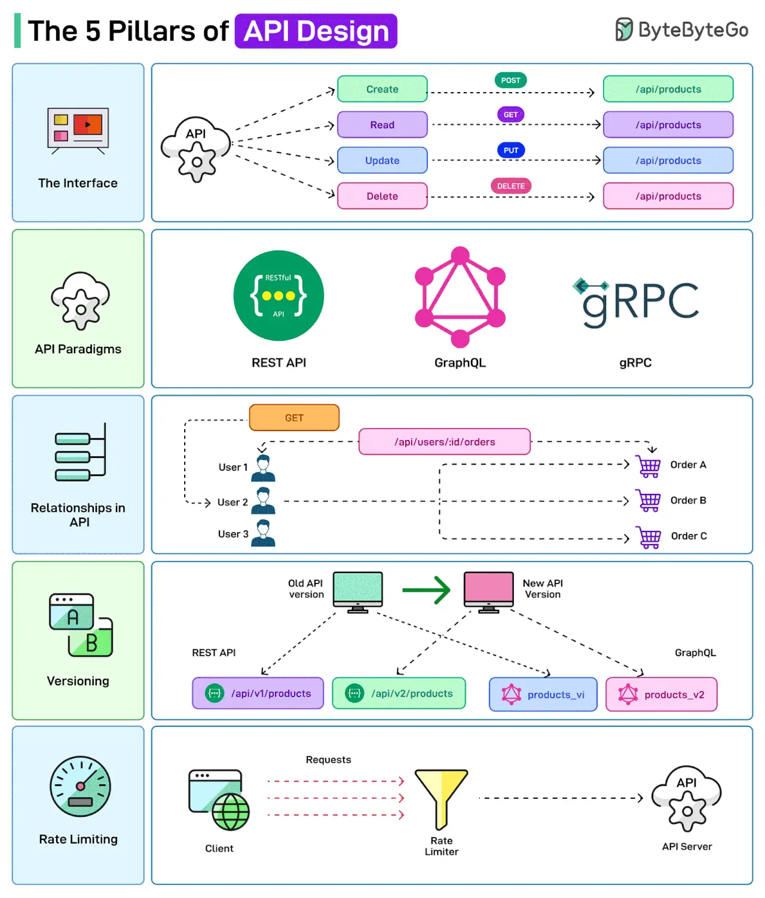

# 079 - 5 trụ cột của API Design

- Nguồn: ByteByteGo Big Archive System Design 2025
- Trang PDF: 168-169
- Ảnh minh họa: `../assets/079/figure-01.png`

## Hình minh họa

## Dịch sát

API là xương sống của các hệ thống hiện đại. Nhưng thiết kế API theo đúng cách cũng rất quan trọng.

Dưới đây là một vài điều developer nên cân nhắc khi thiết kế API.

1. The Interface
   API Design liên quan tới việc định nghĩa input và output của một API. Ví dụ, định nghĩa cách các CRUD operation có thể được expose cho user hoặc client.

2. API Paradigms
   API có thể được xây dựng theo các paradigm khác nhau, mỗi paradigm có bộ protocol và standard riêng. Một số lựa chọn là REST, GraphQL và gRPC.

3. Relationships in API
   API thường cần thiết lập relationship giữa nhiều entity. Ví dụ, một user có thể có nhiều order liên quan tới account của họ. API endpoint nên phản ánh các relationship này để client có trải nghiệm tốt hơn.

4. Versioning
   Khi chỉnh sửa API endpoint, versioning đúng cách và hỗ trợ backward compatibility là quan trọng.

5. Rate Limiting
   Rate limiting được dùng để kiểm soát số request mà một user có thể gọi tới API trong một khung thời gian nhất định. Điều này rất quan trọng để duy trì reliability và availability của API.

Câu hỏi dành cho bạn: Bạn sẽ thêm principle nào khác cho API Design vào danh sách?

## Dịch nội dung trong hình

- `The Interface`: API expose các operation `Create`, `Read`, `Update`, `Delete` tương ứng với endpoint như `/api/products` và HTTP method `POST`, `GET`, `PUT`, `DELETE`.
- `API Paradigms`: các lựa chọn phổ biến gồm REST API, GraphQL và gRPC.
- `Relationships in API`: ví dụ user liên kết với order qua endpoint như `/api/users/{id}/orders`.
- `Versioning`: old API version và new API version có thể cùng tồn tại, ví dụ REST `/api/v1/products`, `/api/v2/products`; GraphQL có thể thêm field/schema mới.
- `Rate Limiting`: request từ client đi qua rate limiter trước khi tới API server.

## Tóm tắt & giải thích dễ hiểu

API tốt bắt đầu từ contract rõ ràng: client gửi gì, server trả gì, lỗi trả ra sao, version thay đổi thế nào. Sau đó mới chọn style phù hợp: REST đơn giản và phổ biến, GraphQL linh hoạt cho client query dữ liệu, gRPC mạnh cho service-to-service hiệu năng cao.

Quan hệ giữa resource nên thể hiện tự nhiên nhưng không quá lồng sâu. Versioning giúp thay đổi an toàn. Rate limiting bảo vệ API khỏi abuse, bug client hoặc traffic spike.

## Ví dụ thực tế - không nằm trong tài liệu gốc

Một e-commerce API có thể dùng `GET /v1/users/{user_id}/orders` để lấy order của user, nhưng tránh path quá sâu như `/users/{id}/orders/{id}/items/{id}/reviews`. Với internal service có latency thấp và contract chặt, gRPC có thể tốt hơn REST; với mobile/web app cần query linh hoạt, GraphQL có thể phù hợp hơn.

## Thuật ngữ chính

- `API contract`: thỏa thuận input/output/error giữa client và server.
- `CRUD`: Create, Read, Update, Delete.
- `REST`: API paradigm dựa trên resource và HTTP.
- `GraphQL`: query language cho API.
- `gRPC`: RPC framework dùng Protobuf và HTTP/2.
- `Backward compatibility`: tương thích ngược với client cũ.
- `Rate limiting`: giới hạn tốc độ gọi API.

## Câu hỏi ôn tập + trả lời + thinking học tập + liên hệ

> Đây là phần học tập thêm ở cuối file. Câu hỏi ưu tiên lấy từ tài liệu gốc và được trả lời trực tiếp; nếu bài không có câu hỏi riêng thì dùng tiêu đề/nội dung chính để tạo câu hỏi tự kiểm tra.

### Câu hỏi 1

**Nguồn câu hỏi:** Câu hỏi trong tài liệu gốc.

**Câu hỏi:** Bạn sẽ thêm principle nào khác cho API Design vào danh sách?

**Trả lời:** Có thể thêm idempotency key cho API ghi dữ liệu hoặc payment; OpenAPI/contract validation để giảm sai lệch client-server; correlation id/distributed tracing để debug production; và threat modeling theo OWASP API Top 10. Các mục này giúp bức tranh đầy đủ hơn vì chúng chạm vào phần triển khai/vận hành mà bài gốc chưa đi sâu. Ý chính đang có của bài là: API tốt bắt đầu từ contract rõ ràng: client gửi gì, server trả gì, lỗi trả ra sao, version thay đổi thế nào. Sau đó mới chọn style phù hợp: REST đơn giản và phổ biến, GraphQL linh hoạt cho client query dữ liệu, gRPC mạnh cho service-to-service hiệu năng cao. Quan hệ giữa resource nên thể hiện tự nhiên nhưng không quá lồng sâu. Versioning giúp thay đổi an toàn. Rate limiting bảo vệ API khỏi abuse, bug client hoặc traffic spike.

**Thinking học tập + liên hệ:** Danh sách trong `5 trụ cột của API Design` nên được kiểm theo coverage: nó đã nói phần nào, thiếu phần nào và phần thiếu có làm thay đổi quyết định thiết kế không. Lens chính là actor, trust boundary, dữ liệu nhạy cảm, lifetime của token/key, quyền truy cập và cơ chế revoke. Khi làm API thật, một endpoint chạy được chưa đủ; phải kiểm thêm abuse, audit log, error leakage, rate limit và quyền ở service chứa dữ liệu. Khi ghi chú lại, hãy giải thích được các keyword: `API contract`, `CRUD`, `REST`, `GraphQL`, `gRPC`.
