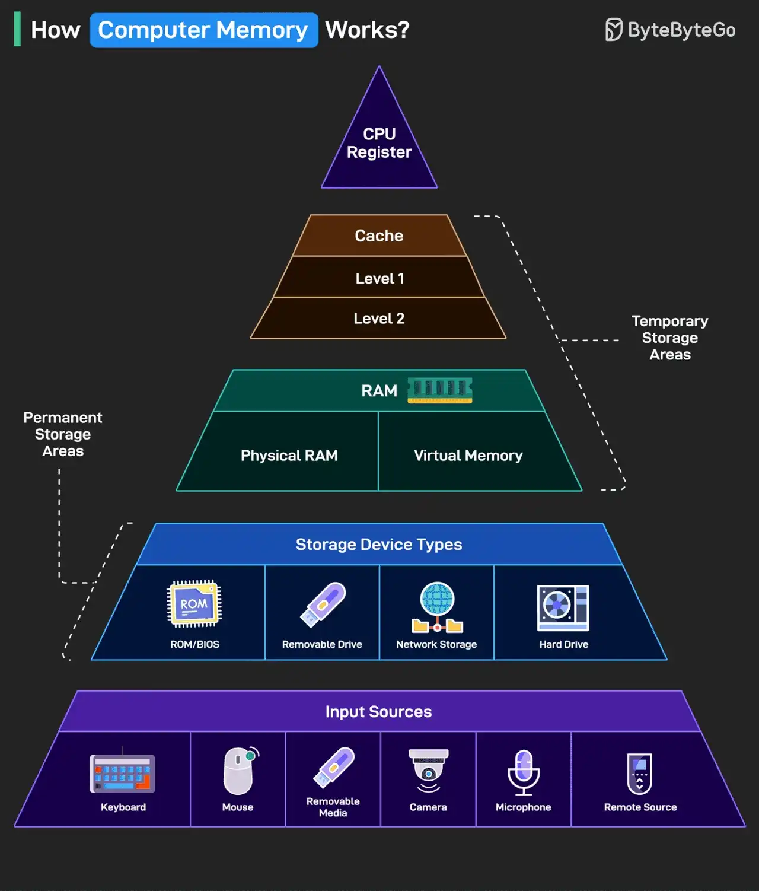

# 080 - Bộ nhớ máy tính hoạt động như thế nào?

- Nguồn: ByteByteGo Big Archive System Design 2025
- Trang PDF: 170-171
- Ảnh minh họa: `../assets/080/figure-01.png`

## Hình minh họa

## Dịch sát

Dưới đây là một breakdown đơn giản cho thấy dữ liệu di chuyển qua system như thế nào, từ input tới processing rồi tới storage.

1. Data đi vào thông qua input source như keyboard, mouse, camera hoặc remote system.

2. Permanent storage giữ system file, app và media của bạn. Nó bao gồm hard drive, USB drive, ROM/BIOS và network-based storage.

3. RAM là workspace của computer. Nó bao gồm physical memory và virtual memory, tạm thời lưu data và program trong lúc bạn đang sử dụng chúng.

4. Cache memory nằm gần CPU hơn và được chia thành Level 1 và Level 2. Nó giúp tăng tốc truy cập tới data được dùng thường xuyên.

5. CPU registers là các memory unit nhanh nhất và nhỏ nhất. Chúng được processor dùng trực tiếp để execute instruction gần như tức thì.

Càng đi lên cao trong memory pyramid, storage càng nhanh hơn và nhỏ hơn.

Câu hỏi dành cho bạn: Bạn sẽ thêm gì khác để cải thiện việc hiểu cách computer memory hoạt động?

## Dịch nội dung trong hình

- `Input Sources`: keyboard, mouse, removable media, camera, microphone, remote source.
- `Storage Device Types`: ROM/BIOS, removable drive, network storage, hard drive; đây là permanent storage area.
- `RAM`: gồm physical RAM và virtual memory; là temporary storage area.
- `Cache`: gồm Level 1 và Level 2, nằm gần CPU hơn RAM.
- `CPU Register`: tầng cao nhất, nhỏ nhất và nhanh nhất trong memory pyramid.
- Ghi chú chính: càng gần CPU thì access nhanh hơn nhưng capacity nhỏ hơn; càng xa CPU thì capacity lớn hơn nhưng access chậm hơn.

## Tóm tắt & giải thích dễ hiểu

Máy tính có nhiều tầng bộ nhớ vì không có một loại storage nào vừa cực nhanh, vừa cực lớn, vừa rẻ. CPU register rất nhanh nhưng nhỏ. Cache nhanh hơn RAM nhưng đắt và nhỏ. RAM nhanh hơn disk nhưng mất dữ liệu khi tắt máy. Disk/network storage lớn hơn nhưng chậm hơn nhiều.

Trong performance engineering, bottleneck thường xuất hiện khi data phải đi xuống tầng chậm hơn. Vì vậy cache locality, giảm random I/O, batch processing và dùng memory hợp lý có thể tạo khác biệt lớn.

## Ví dụ thực tế - không nằm trong tài liệu gốc

Khi database query dùng index tốt, nó giảm số page phải đọc từ disk và tăng khả năng dữ liệu cần nằm trong memory/cache. Khi chương trình xử lý array tuần tự, CPU cache hoạt động hiệu quả hơn so với truy cập object rải rác trong memory.

## Thuật ngữ chính

- `Register`: bộ nhớ cực nhỏ nằm trong CPU.
- `CPU cache`: bộ nhớ nhanh gần CPU.
- `RAM`: bộ nhớ tạm để chương trình đang chạy sử dụng.
- `Virtual memory`: cơ chế dùng không gian địa chỉ ảo, có thể map sang RAM/disk.
- `Permanent storage`: lưu trữ lâu dài như SSD/HDD.
- `Cache locality`: khả năng dữ liệu gần nhau được truy cập gần thời điểm nhau.
- `I/O`: input/output giữa chương trình và thiết bị/lưu trữ.

