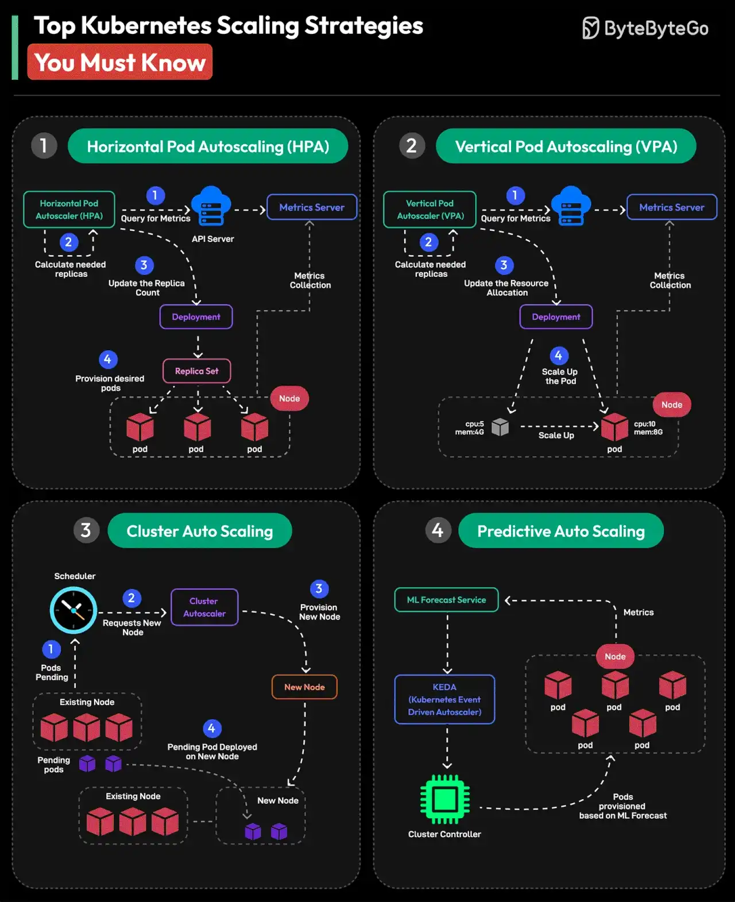

# 081 - Các chiến lược scale Kubernetes quan trọng cần biết

- Nguồn: ByteByteGo Big Archive System Design 2025
- Trang PDF: 172-173
- Ảnh minh họa: `../assets/081/figure-01.png`

## Hình minh họa

## Dịch sát

1. Horizontal Pod Autoscaling hoặc HPA
   Horizontal Pod Autoscaler tự động scale số lượng Pod trong Deployment, ReplicaSet hoặc StatefulSet dựa trên observed CPU utilization, memory usage hoặc custom metrics.

2. Vertical Pod Autoscaling hoặc VPA
   Dựa trên requirement của application, VPA điều chỉnh resource được phân bổ cho từng pod, chẳng hạn CPU và memory. Cách tiếp cận này thay đổi pod resource setting một cách dynamic dựa trên workload metrics.

3. Cluster Auto Scaling
   Cluster Autoscaler tự động điều chỉnh số node trong Kubernetes cluster. Nó tương tác với cloud provider để thêm hoặc xoá node dựa trên requirement. Điều này quan trọng để duy trì cluster cân bằng.

4. Predictive Auto Scaling
   Predictive Autoscaling dùng machine learning để dự báo resource requirement trong tương lai. Nó giúp Kubernetes điều chỉnh resource bằng cách dự đoán trước workload demand.

Câu hỏi dành cho bạn: Bạn sẽ thêm Kubernetes Scaling Strategy nào khác vào danh sách?

## Dịch nội dung trong hình

- `Horizontal Pod Autoscaling (HPA)`: metrics server thu thập metric, HPA tính số replica cần thiết, rồi scale pod trong Deployment/ReplicaSet.
- `Vertical Pod Autoscaling (VPA)`: VPA theo dõi resource usage, đề xuất hoặc cập nhật CPU/memory request/limit cho pod, sau đó pod có thể được recreate với resource mới.
- `Cluster Auto Scaling`: scheduler thấy pod pending vì thiếu node, Cluster Autoscaler yêu cầu cloud provider thêm node; khi node dư thừa, nó có thể remove node.
- `Predictive Auto Scaling`: ML forecast service dự báo nhu cầu, gửi forecast metric để controller scale pod hoặc cluster trước khi tải tăng.

## Tóm tắt & giải thích dễ hiểu

Kubernetes có nhiều tầng scale. HPA scale ngang bằng cách tăng/giảm số pod. VPA scale dọc bằng cách thay đổi CPU/memory cho pod. Cluster Autoscaler scale hạ tầng bằng cách thêm/bớt node. Predictive autoscaling cố gắng scale trước dựa trên pattern tương lai thay vì chỉ phản ứng với metric hiện tại.

Khi dùng thực tế, HPA và Cluster Autoscaler thường đi cùng nhau: HPA tạo thêm pod khi tải tăng, nếu cluster không đủ chỗ thì Cluster Autoscaler thêm node. VPA cần cẩn thận với workload không chịu restart, vì thay đổi resource có thể cần recreate pod.

## Ví dụ thực tế - không nằm trong tài liệu gốc

Một API có traffic tăng vào 9 giờ sáng có thể dùng HPA theo RPS hoặc CPU. Nếu mỗi node chỉ chứa được 20 pod và HPA cần 60 pod, Cluster Autoscaler phải thêm node. Với batch job chạy ban đêm, predictive scaling có thể chuẩn bị capacity trước giờ job bắt đầu để tránh queue backlog.

## Thuật ngữ chính

- `HPA`: Horizontal Pod Autoscaler.
- `VPA`: Vertical Pod Autoscaler.
- `Cluster Autoscaler`: tự động thêm/bớt node.
- `Metrics Server`: component cung cấp resource metrics.
- `Replica`: bản sao pod.
- `Resource request/limit`: CPU/memory yêu cầu và giới hạn.
- `Pending pod`: pod chưa schedule được lên node.

## Câu hỏi ôn tập + trả lời + thinking học tập + liên hệ

> Đây là phần học tập thêm ở cuối file. Câu hỏi ưu tiên lấy từ tài liệu gốc và được trả lời trực tiếp; nếu bài không có câu hỏi riêng thì dùng tiêu đề/nội dung chính để tạo câu hỏi tự kiểm tra.

### Câu hỏi 1

**Nguồn câu hỏi:** Câu hỏi trong tài liệu gốc.

**Câu hỏi:** Bạn sẽ thêm Kubernetes Scaling Strategy nào khác vào danh sách?

**Trả lời:** Phần còn thiếu đáng cân nhắc là SLO/error budget để biết hệ thống đủ tốt hay chưa; blue-green/canary deployment để giảm rủi ro release; secret management và least privilege IAM; và cost monitoring/tagging cho cloud bill. Các mục này giúp bức tranh đầy đủ hơn vì chúng chạm vào phần triển khai/vận hành mà bài gốc chưa đi sâu. Ý chính đang có của bài là: Kubernetes có nhiều tầng scale. HPA scale ngang bằng cách tăng/giảm số pod. VPA scale dọc bằng cách thay đổi CPU/memory cho pod. Cluster Autoscaler scale hạ tầng bằng cách thêm/bớt node. Predictive autoscaling cố gắng scale trước dựa trên pattern tương lai thay vì chỉ phản ứng với metric hiện tại.

**Thinking học tập + liên hệ:** Đừng thêm mục cho dài danh sách; với `Các chiến lược scale Kubernetes quan trọng cần biết`, chỉ thêm thứ mở ra một nhóm vấn đề mới hoặc giúp ra quyết định thiết kế tốt hơn. Lens chính là độ phức tạp vận hành, rollback, cost, kỹ năng team, observability và blast radius khi hỏng. Khi đưa lên production, hãy map từng thành phần vào deploy, rollback, monitoring, alerting, secret, cost và ownership rõ ràng. Khi ghi chú lại, hãy giải thích được các keyword: `HPA`, `VPA`, `Cluster Autoscaler`, `Metrics Server`, `Replica`.
