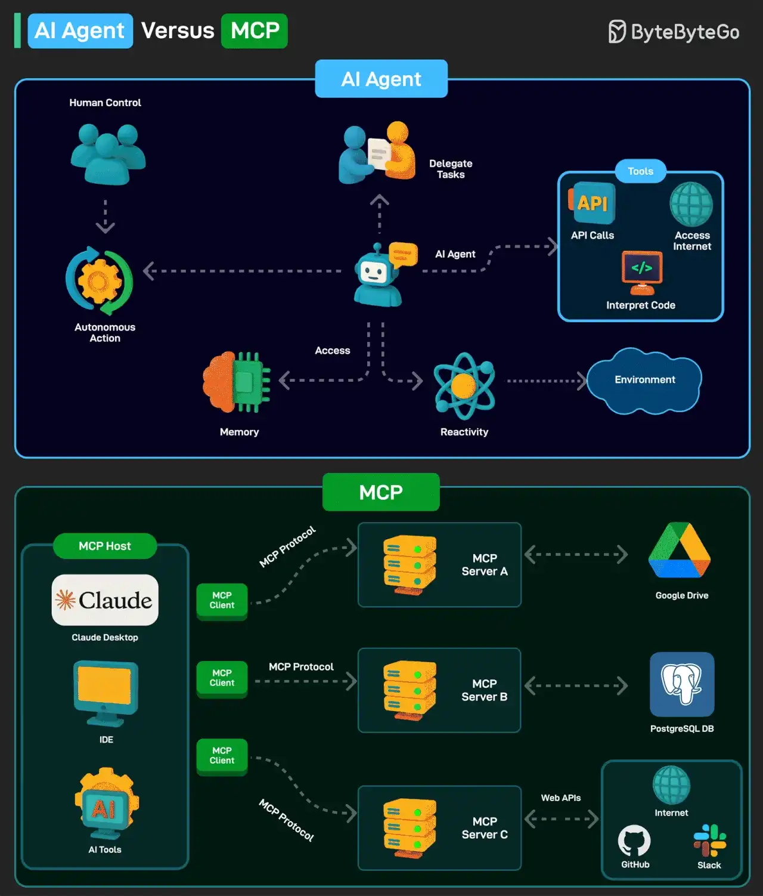

# 082 - AI Agent so với MCP

- Nguồn: ByteByteGo Big Archive System Design 2025
- Trang PDF: 174-175
- Ảnh minh họa: `../assets/082/figure-01.png`

## Hình minh họa

## Dịch sát

AI agent là một software program có thể tương tác với environment, thu thập data và dùng data đó để đạt các goal đã xác định trước. AI agent có thể chọn action tốt nhất cần thực hiện để đạt các goal đó.

Các đặc điểm chính của AI agent như sau:

1. Agent có thể thực hiện autonomous action mà không cần human intervention liên tục. Đồng thời, chúng cũng có thể có human in the loop để duy trì kiểm soát.

2. Agent có memory để lưu preference cá nhân và cho phép personalization. Nó cũng có thể lưu knowledge. Một LLM có thể đảm nhiệm các function xử lý thông tin và ra quyết định.

3. Agent phải có khả năng perceive và process thông tin có sẵn từ environment.

Model Context Protocol (MCP) là một system mới do Anthropic giới thiệu để làm AI model mạnh hơn.

Nó là một open standard cho phép AI model như Claude kết nối tới database, API, file system và các tool khác mà không cần custom code cho từng integration mới.

MCP đi theo client-server model với 3 component chính:

1. Host: AI application như Claude.

2. MCP Client: component bên trong AI model như Claude, cho phép nó giao tiếp với MCP server.

3. MCP Server: middleman kết nối AI model với external system.

Câu hỏi dành cho bạn: Bạn đã dùng AI Agent hoặc MCP chưa?

## Dịch nội dung trong hình

- Phần `AI Agent`: human control có thể delegate task cho AI agent; agent có autonomous action, memory, reactivity, access tool/API/internet/code interpreter và tương tác với environment.
- Phần `MCP`: MCP host như Claude Desktop, IDE hoặc AI tool kết nối qua MCP client tới nhiều MCP server; MCP server giao tiếp với external source như Google Drive, PostgreSQL DB, GitHub, Slack hoặc internet.
- MCP protocol đóng vai trò chuẩn giao tiếp giữa MCP client và MCP server; MCP server có thể dùng API riêng của từng hệ thống bên ngoài.

## Tóm tắt & giải thích dễ hiểu

AI Agent là “người làm việc tự động”: nhận mục tiêu, quan sát môi trường, chọn hành động, dùng tool và lặp lại cho tới khi đạt kết quả. MCP là “chuẩn ổ cắm tool”: giúp agent/model kết nối tới external system theo một interface thống nhất.

Nói ngắn gọn: agent là mô hình hành vi, MCP là giao thức tích hợp. Một agent có thể dùng MCP để truy cập file, database, GitHub hoặc Slack một cách có kiểm soát.

## Ví dụ thực tế - không nằm trong tài liệu gốc

Một agent sửa bug có thể đọc repo qua file system, tìm issue trên GitHub, chạy test trong terminal và đọc schema database qua PostgreSQL MCP. Agent quyết định bước tiếp theo; MCP server chỉ cung cấp cổng kết nối an toàn tới từng tool.

## Thuật ngữ chính

- `AI Agent`: chương trình AI có thể hành động theo mục tiêu.
- `Autonomous action`: hành động tự động không cần chỉ dẫn từng bước.
- `Human in the loop`: con người vẫn tham gia kiểm soát/duyệt.
- `Memory`: bộ nhớ lưu preference, context hoặc knowledge.
- `MCP`: Model Context Protocol.
- `Host`: ứng dụng chạy trải nghiệm AI.
- `External system`: hệ thống bên ngoài như database, API, file system.

## Câu hỏi ôn tập + trả lời + thinking học tập + liên hệ

> Đây là phần học tập thêm ở cuối file. Câu hỏi ưu tiên lấy từ tài liệu gốc và được trả lời trực tiếp; nếu bài không có câu hỏi riêng thì dùng tiêu đề/nội dung chính để tạo câu hỏi tự kiểm tra.

### Câu hỏi 1

**Nguồn câu hỏi:** Câu hỏi trong tài liệu gốc.

**Câu hỏi:** Bạn đã dùng AI Agent hoặc MCP chưa?

**Trả lời:** Với `AI Agent so với MCP`, cách liên hệ tốt nhất là chọn một workload nhỏ rồi kiểm chứng bằng số liệu thay vì chọn theo cảm tính. Nên kiểm bằng workload nhỏ trước: latency, độ ổn định, khả năng debug, cost và rủi ro vận hành. Phần cốt lõi cần đem theo từ bài là: AI Agent là “người làm việc tự động”: nhận mục tiêu, quan sát môi trường, chọn hành động, dùng tool và lặp lại cho tới khi đạt kết quả. MCP là “chuẩn ổ cắm tool”: giúp agent/model kết nối tới external system theo một interface thống nhất. Nói ngắn gọn: agent là mô hình hành vi, MCP là giao thức tích hợp. Một agent có thể dùng MCP để truy cập file, database, GitHub hoặc Slack một cách có kiểm soát.

**Thinking học tập + liên hệ:** Khi tự liên hệ `AI Agent so với MCP`, hãy viết ra một project cụ thể, lý do chọn công nghệ và lỗi vận hành có thể xảy ra. Lens chính là quality, latency, cost/token, privacy, cập nhật tri thức và rủi ro hallucination. Khi build AI app, hãy nối model với pipeline thật: data vào đâu, context lấy từ đâu, output được kiểm thế nào và chi phí tăng theo traffic ra sao. Khi ghi chú lại, hãy giải thích được các keyword: `AI Agent`, `Autonomous action`, `Human in the loop`, `Memory`, `MCP`.
