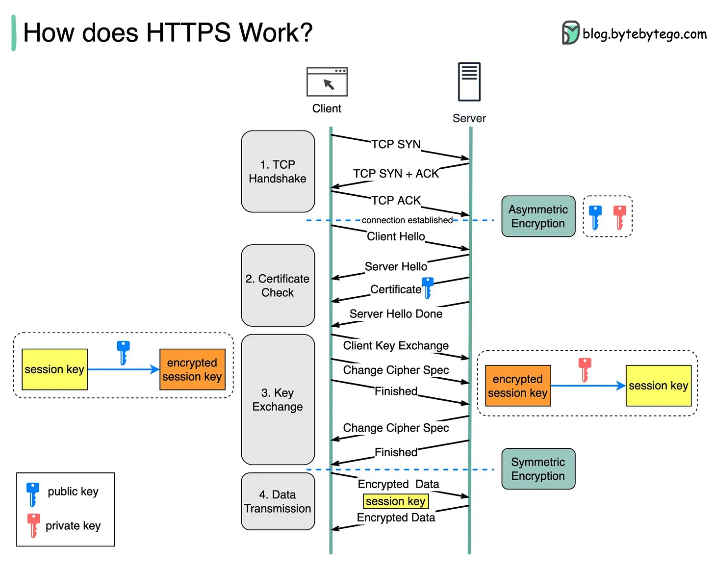

# 083 - HTTPS hoạt động như thế nào?

- Nguồn: ByteByteGo Big Archive System Design 2025
- Trang PDF: 176-177
- Ảnh minh họa: `../assets/083/figure-01.png`

## Hình minh họa

## Dịch sát

Hypertext Transfer Protocol Secure (HTTPS) là một extension của Hypertext Transfer Protocol (HTTP). HTTPS truyền dữ liệu đã được encrypt bằng Transport Layer Security (TLS). Nếu dữ liệu bị hijack trên mạng, tất cả những gì kẻ hijacker nhận được chỉ là binary code.

Dữ liệu được encrypt và decrypt như thế nào?

Step 1 - Client (browser) và server thiết lập TCP connection.

Step 2 - Client gửi “client hello” tới server. Message này chứa một tập các encryption algorithm cần thiết (cipher suites) và TLS version mới nhất mà client hỗ trợ. Server phản hồi bằng “server hello” để browser biết server có hỗ trợ các algorithm và TLS version đó hay không.

Sau đó server gửi SSL certificate tới client. Certificate chứa public key, host name, expiry date, v.v. Client validate certificate.

Step 3 - Sau khi validate SSL certificate, client generate session key và encrypt nó bằng public key. Server nhận encrypted session key và decrypt bằng private key.

Step 4 - Bây giờ cả client và server đều giữ cùng một session key (symmetric encryption), dữ liệu được encrypt và truyền qua một secure bi-directional channel.

Vì sao HTTPS chuyển sang symmetric encryption trong quá trình truyền dữ liệu? Có hai lý do chính:

1. Security: Asymmetric encryption chỉ đi một chiều. Điều này nghĩa là nếu server cố gửi encrypted data ngược lại client, bất kỳ ai cũng có thể decrypt data bằng public key.

2. Server resources: Asymmetric encryption thêm khá nhiều overhead toán học. Nó không phù hợp cho truyền dữ liệu trong long session.

Câu hỏi dành cho bạn: HTTPS thêm bao nhiêu performance overhead so với HTTP?

## Dịch nội dung trong hình

- Bước 1: `TCP Handshake` gồm SYN, SYN+ACK, ACK giữa client và server.
- Bước 2: `Certificate Check`: client hello, server hello, certificate, server hello done; client kiểm tra certificate.
- Bước 3: `Key Exchange`: client tạo session key, encrypt session key bằng public key, server decrypt bằng private key.
- Bước 4: `Data Transmission`: hai bên dùng session key để encrypt/decrypt data bằng symmetric encryption.
- Hình cũng phân biệt public key, private key, session key, encrypted session key và encrypted data.

## Tóm tắt & giải thích dễ hiểu

HTTPS dùng TLS để bảo vệ dữ liệu trên đường truyền. Giai đoạn đầu dùng asymmetric cryptography để xác thực server và trao đổi bí mật an toàn. Sau đó hai bên dùng session key đối xứng vì symmetric encryption nhanh hơn nhiều cho dữ liệu lớn và kết nối dài.

Trong TLS hiện đại, chi tiết key exchange có thể dùng cơ chế như ECDHE để cung cấp forward secrecy, nhưng ý tưởng cốt lõi vẫn là: xác thực server, thỏa thuận key chung, rồi truyền dữ liệu đã mã hóa.

## Ví dụ thực tế - không nằm trong tài liệu gốc

Khi bạn gọi API thanh toán qua `https://api.example.com`, attacker trên cùng Wi-Fi có thể thấy bạn kết nối tới domain/IP nào, nhưng không đọc được body chứa order/payment data nếu TLS được cấu hình đúng. Nếu certificate không hợp lệ, browser hoặc client HTTP library nên chặn kết nối.

## Thuật ngữ chính

- `HTTPS`: HTTP chạy trên TLS.
- `TLS`: Transport Layer Security.
- `Certificate`: chứng chỉ xác thực danh tính server và public key.
- `Cipher suite`: bộ thuật toán mã hóa/trao đổi key.
- `Asymmetric encryption`: mã hóa bất đối xứng dùng public/private key.
- `Symmetric encryption`: mã hóa đối xứng dùng cùng session key.
- `Session key`: key dùng cho phiên truyền dữ liệu.

## Ghi chú kỹ thuật - không nằm trong tài liệu gốc

Mô tả trong bài dùng cách giải thích đơn giản kiểu TLS/RSA key exchange. TLS hiện đại thường dùng ephemeral key exchange như ECDHE, nơi session key không đơn giản là client tạo rồi mã hóa trực tiếp bằng public key của certificate. Ý chính về việc dùng asymmetric phase để thiết lập kênh an toàn rồi dùng symmetric encryption cho data transmission vẫn đúng.

