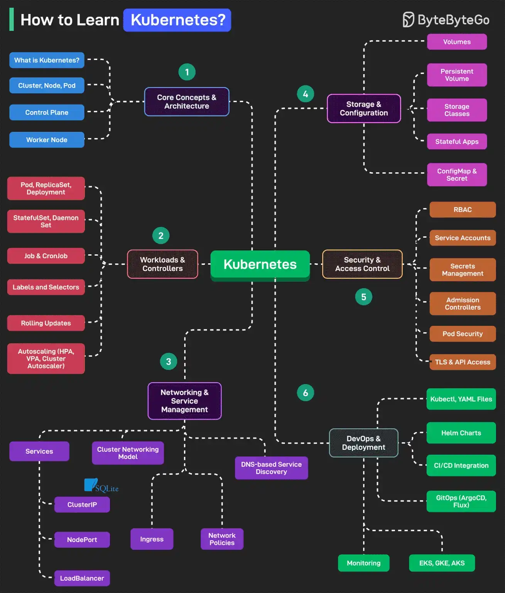

# 084 - Học Kubernetes như thế nào?

- Nguồn: ByteByteGo Big Archive System Design 2025
- Trang PDF: 178-179
- Ảnh minh họa: `../assets/084/figure-01.png`

## Hình minh họa

## Dịch sát

Kubernetes là một open-source container orchestration platform tự động hóa việc deployment, scaling và management của containerized application.

1. Core Concepts and Architecture
   Bao gồm các chủ đề như Kubernetes là gì, Cluster, Node, Pod, Control Plane và Worker Node.

2. Workloads and Controllers
   Bao gồm các chủ đề như Pod, ReplicaSet, Deployment, StatefulSet, Job, CronJob, Labels, Selectors và Autoscalers (HPA, VPA và Cluster Autoscaler).

3. Networking and Service Management
   Liên quan tới các chủ đề như Cluster Networking Model, Services (ClusterIP, NodePort, LoadBalancer), Ingress và Network Policies.

4. Storage and Configuration
   Bao gồm các chủ đề như Volumes, PersistentVolume, PersistentVolumeClaim, Storage Classes, ConfigMap, Secret và Stateful Applications.

5. Security & Access Control
   Liên quan tới các chủ đề như RBAC, Service Accounts, Secrets Management, Admission Controllers, Pod Security, TLS và API Access.

6. Tools, Observability & Ecosystem
   Bao gồm các chủ đề như kubectl, YAML files, Helm Charts, CI/CD Integration, GitOps, Logging, Monitoring và EKS.

Câu hỏi dành cho bạn: Bạn sẽ thêm gì khác vào danh sách học Kubernetes?

## Dịch nội dung trong hình

Hình là roadmap học Kubernetes với 6 nhánh chính:

- `Core Concepts & Architecture`: Kubernetes là gì, Cluster/Node/Pod, Control Plane, Worker Node.
- `Workloads & Controllers`: Pod, ReplicaSet, Deployment, StatefulSet, DaemonSet, Job, CronJob, Labels/Selectors, Rolling Updates, Autoscaling gồm HPA, VPA, Cluster Autoscaler.
- `Networking & Service Management`: Services, ClusterIP, NodePort, LoadBalancer, Cluster Networking Model, Ingress, Network Policies, DNS-based Service Discovery.
- `Storage & Configuration`: Volumes, Persistent Volumes, Storage Classes, Stateful Apps, ConfigMap & Secret.
- `Security & Access Control`: RBAC, Service Accounts, Secrets Management, Admission Controllers, Pod Security, TLS & API Access.
- `DevOps & Deployment`: kubectl/YAML files, Helm Charts, CI/CD Integration, GitOps bằng ArgoCD/FluxCD, Monitoring, EKS/GKE/AKS.

## Tóm tắt & giải thích dễ hiểu

Học Kubernetes nên đi theo thứ tự từ mental model tới vận hành. Trước hết cần hiểu cluster gồm control plane và worker node, pod là đơn vị chạy workload, deployment quản lý rollout, service/ingress đưa traffic vào app, volume/config/secret quản lý state và cấu hình.

Sau đó mới đi sâu vào autoscaling, security, observability, Helm, GitOps và managed Kubernetes như EKS/GKE/AKS. Kubernetes mạnh nhưng phức tạp; học theo use case deploy một app thật sẽ dễ hiểu hơn học từng khái niệm rời rạc.

## Ví dụ thực tế - không nằm trong tài liệu gốc

Một lộ trình thực hành tốt: viết Dockerfile cho API nhỏ, tạo Deployment 2 replica, expose bằng Service, thêm Ingress, cấu hình env bằng ConfigMap/Secret, gắn HPA, xem log/metrics, rồi deploy qua Helm hoặc GitOps. Khi làm được luồng này, các khái niệm Kubernetes sẽ nối với nhau tự nhiên hơn.

## Thuật ngữ chính

- `Cluster`: tập node chạy Kubernetes.
- `Control Plane`: thành phần điều phối cluster.
- `Pod`: đơn vị workload nhỏ nhất trong Kubernetes.
- `Deployment`: controller quản lý replica và rollout.
- `Service`: abstraction ổn định để truy cập pod.
- `Ingress`: rule đưa HTTP/HTTPS traffic vào cluster.
- `Helm`: package manager cho Kubernetes manifest.
- `GitOps`: dùng Git làm nguồn sự thật cho deployment.

