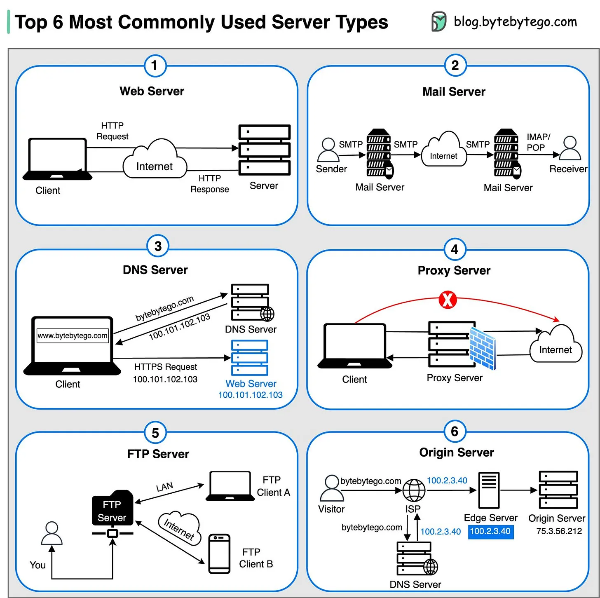

# 085 - 6 loại server được dùng phổ biến nhất

- Nguồn: ByteByteGo Big Archive System Design 2025
- Trang PDF: 180-181
- Ảnh minh họa: `../assets/085/figure-01.png`

## Hình minh họa

## Dịch sát

1. Web Server:
   Host website và phân phối web content tới client qua internet.

2. Mail Server:
   Xử lý việc gửi, nhận và route email qua network.

3. DNS Server:
   Dịch domain name như `bytebytego.com` thành IP address, giúp user truy cập website bằng tên dễ đọc với con người.

4. Proxy Server:
   Một intermediary server đóng vai trò gateway giữa client và các server khác, cung cấp thêm security, performance optimization và anonymity.

5. FTP Server:
   Hỗ trợ việc transfer file giữa client và server qua network.

6. Origin Server:
   Host nguồn content trung tâm, content này được cache và phân phối tới edge server để delivery nhanh hơn tới end user.

Câu hỏi dành cho bạn: Loại server nào bạn thấy quan trọng nhất trong trải nghiệm online của mình?

## Dịch nội dung trong hình

- `Web Server`: client gửi HTTP request qua internet, server trả HTTP response.
- `Mail Server`: sender gửi email qua SMTP tới mail server, email đi qua internet rồi tới receiver.
- `DNS Server`: client hỏi DNS để đổi domain thành IP, sau đó dùng IP để gửi HTTPS request.
- `Proxy Server`: client đi qua proxy server trước khi ra internet.
- `FTP Server`: client A/B trao đổi file với FTP server qua FTP.
- `Origin Server`: DNS/CDN hướng request tới edge/origin; origin server là nguồn dữ liệu gốc phía sau cache.

## Tóm tắt & giải thích dễ hiểu

Các server khác nhau tồn tại vì mỗi loại giải quyết một bài toán hạ tầng riêng. Web server phục vụ HTTP content. Mail server xử lý email. DNS server biến tên miền thành IP. Proxy server đứng giữa để cache, bảo vệ hoặc ẩn danh. FTP server truyền file. Origin server là nơi giữ nội dung gốc để CDN/edge cache phân phối nhanh hơn.

Trong system design, cần phân biệt vai trò của server với protocol mà nó dùng. Một máy vật lý hoặc VM có thể chạy nhiều loại server process cùng lúc, nhưng ở production thường tách theo trách nhiệm để dễ scale, monitor và bảo mật.

## Ví dụ thực tế - không nằm trong tài liệu gốc

Khi bạn mở một website, browser có thể hỏi DNS trước, kết nối tới CDN edge, CDN nếu miss cache sẽ gọi origin server, rồi web server/backend trả HTML/API response. Nếu công ty dùng outbound proxy, request của nhân viên có thể đi qua proxy để kiểm soát truy cập và log bảo mật.

## Thuật ngữ chính

- `Web server`: server phục vụ HTTP/HTTPS content.
- `Mail server`: server gửi/nhận email.
- `DNS server`: server phân giải domain sang IP.
- `Proxy server`: server trung gian giữa client và server đích.
- `FTP`: File Transfer Protocol.
- `Origin server`: server chứa content gốc.
- `Edge server`: server gần user, thường dùng cho cache/CDN.

## Câu hỏi ôn tập + trả lời + thinking học tập + liên hệ

> Đây là phần học tập thêm ở cuối file. Câu hỏi ưu tiên lấy từ tài liệu gốc và được trả lời trực tiếp; nếu bài không có câu hỏi riêng thì dùng tiêu đề/nội dung chính để tạo câu hỏi tự kiểm tra.

### Câu hỏi 1

**Nguồn câu hỏi:** Câu hỏi trong tài liệu gốc.

**Câu hỏi:** Loại server nào bạn thấy quan trọng nhất trong trải nghiệm online của mình?

**Trả lời:** Nếu rút thành checklist thiết kế thì ý chính là: Các server khác nhau tồn tại vì mỗi loại giải quyết một bài toán hạ tầng riêng. Web server phục vụ HTTP content. Mail server xử lý email. DNS server biến tên miền thành IP. Proxy server đứng giữa để cache, bảo vệ hoặc ẩn danh. FTP server truyền file. Origin server là nơi giữ nội dung gốc để CDN/edge cache phân phối nhanh hơn. Khi áp dụng vào hệ thống thật, hãy kiểm thêm DNS, transport, TLS, HTTP, proxy/CDN, application timeout và observability theo từng layer.

**Thinking học tập + liên hệ:** Khi học `6 loại server được dùng phổ biến nhất`, hãy thử viết một checklist áp dụng vào project: input, output, owner, rủi ro và metric kiểm chứng. Lens chính là DNS, transport, TLS, HTTP, proxy/CDN, application timeout và observability theo từng layer. Khi debug production, hãy tách latency theo DNS lookup, TCP connect, TLS handshake, TTFB và download để không đoán mò. Khi ghi chú lại, hãy giải thích được các keyword: `Web server`, `Mail server`, `DNS server`, `Proxy server`, `FTP`.
