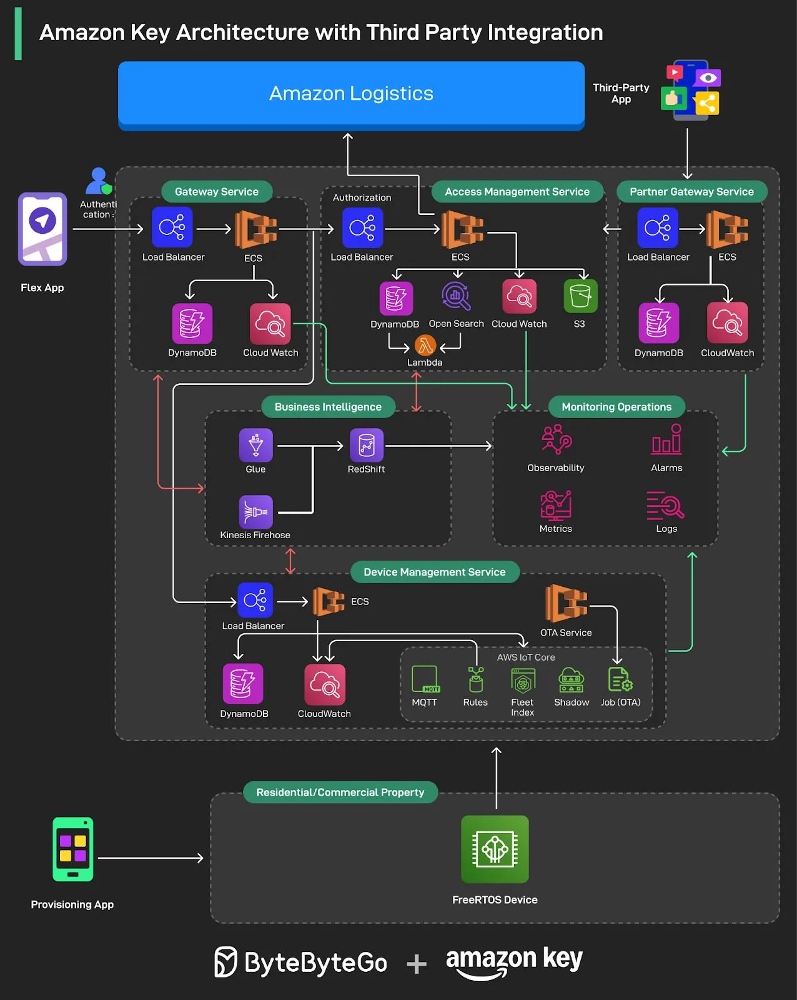

# 086 - Kiến trúc Amazon Key với tích hợp bên thứ ba

- Nguồn: ByteByteGo Big Archive System Design 2025
- Trang PDF: 182-183
- Ảnh minh họa: `../assets/086/figure-01.png`

## Hình minh họa

## Dịch sát

Amazon Key là một cách THỰC SỰ tiện lợi để package của bạn được giao an toàn ngay bên trong garage hoặc khu nhà nhiều hộ gia đình.

Chúng tôi đã ngồi lại với Kaushik Mani và Vijayakrishnan Nagarajan để tìm hiểu cách một side project nhỏ phát triển thành một global platform: hiện powering hơn 100 triệu lượt mở khóa cửa an toàn mỗi năm.

Câu chuyện này chứa nhiều bài học giá trị về:

- Scale IoT infrastructure trên hàng nghìn location.
- Xây dựng hardware bền bỉ, sẵn sàng cho môi trường thực tế.
- Vượt qua cold start và connectivity challenge.
- Thiết kế microservices architecture cho global expansion.
- Tạo một secure, partner-ready platform để hỗ trợ third-party integration.
- Và nhiều nội dung khác.

## Dịch nội dung trong hình

Hình mô tả kiến trúc Amazon Key với third-party integration:

- `Flex App` xác thực qua `Gateway Service`, phía sau có load balancer, ECS, DynamoDB và CloudWatch.
- `Amazon Logistics` kết nối vào lớp authorization và `Access Management Service`.
- `Access Management Service` chạy trên load balancer/ECS, dùng DynamoDB, OpenSearch, CloudWatch, S3 và Lambda.
- `Partner Gateway Service` cho third-party app đi vào hệ thống, có load balancer, ECS, DynamoDB và CloudWatch.
- `Business Intelligence` dùng Glue, Kinesis Firehose và Redshift để xử lý dữ liệu phân tích.
- `Device Management Service` quản lý thiết bị qua load balancer/ECS, DynamoDB, CloudWatch, OTA service và AWS IoT Core.
- `AWS IoT Core` gồm MQTT, Rules, Fleet Index, Shadow và Job (OTA).
- `Monitoring Operations` gồm observability, alarms, metrics và logs.
- `Residential/Commercial Property` chứa FreeRTOS device; provisioning app dùng để setup/provision thiết bị.

## Tóm tắt & giải thích dễ hiểu

Amazon Key là bài toán IoT + logistics + security. Hệ thống phải cho phép mở khóa đúng thời điểm, đúng người/đối tác, đúng thiết bị, trong môi trường mạng không ổn định và với yêu cầu bảo mật rất cao. Vì vậy kiến trúc cần nhiều lớp: authentication/authorization, access management, partner gateway, device management, telemetry/monitoring và data analytics.

Điểm system design đáng học là tách rõ control plane và device plane. Cloud service quyết định quyền truy cập, còn thiết bị ở garage/property phải nhận lệnh an toàn, có khả năng cập nhật OTA, báo trạng thái và chịu được lỗi kết nối.

## Ví dụ thực tế - không nằm trong tài liệu gốc

Khi tài xế giao hàng tới garage, logistics system cần xác minh đơn hàng, thời gian giao, quyền mở khóa và trạng thái thiết bị. Nếu hợp lệ, access management cấp quyền ngắn hạn; device management gửi lệnh qua IoT channel; monitoring ghi nhận event để audit. Nếu mạng chập chờn, hệ thống phải retry an toàn và không được mở khóa sai ngữ cảnh.

## Thuật ngữ chính

- `IoT`: Internet of Things, thiết bị kết nối internet.
- `ECS`: Amazon Elastic Container Service.
- `DynamoDB`: NoSQL database managed của AWS.
- `CloudWatch`: monitoring/logging service của AWS.
- `OTA`: over-the-air update cho thiết bị.
- `MQTT`: protocol nhẹ thường dùng cho IoT.
- `Device shadow`: trạng thái ảo của thiết bị trong cloud.
- `Provisioning`: đăng ký/cấu hình thiết bị ban đầu.

## Câu hỏi ôn tập + trả lời + thinking học tập + liên hệ

> Đây là phần học tập thêm ở cuối file. Câu hỏi ưu tiên lấy từ tài liệu gốc và được trả lời trực tiếp; nếu bài không có câu hỏi riêng thì dùng tiêu đề/nội dung chính để tạo câu hỏi tự kiểm tra.

### Câu hỏi 1

**Nguồn câu hỏi:** Suy ra từ tiêu đề/nội dung chính vì bài gốc không có câu hỏi riêng.

**Câu hỏi:** Sau khi đọc bài “Amazon Key Architecture with Third Party Integration”, ý chính cần trả lời và áp dụng vào system design là gì?

**Trả lời:** Sau bài này, phần đáng nhớ nhất là: Amazon Key là bài toán IoT + logistics + security. Hệ thống phải cho phép mở khóa đúng thời điểm, đúng người/đối tác, đúng thiết bị, trong môi trường mạng không ổn định và với yêu cầu bảo mật rất cao. Vì vậy kiến trúc cần nhiều lớp: authentication/authorization, access management, partner gateway, device management, telemetry/monitoring và data analytics. Khi áp dụng vào hệ thống thật, hãy kiểm thêm requirement, constraint, traffic, dữ liệu, failure mode và khả năng vận hành của team.

**Thinking học tập + liên hệ:** Ôn tập `Kiến trúc Amazon Key với tích hợp bên thứ ba` bằng cách biến khái niệm thành quyết định thiết kế cụ thể: chọn gì, bỏ gì, đo gì và ai chịu trách nhiệm. Lens chính là requirement, constraint, traffic, dữ liệu, failure mode và khả năng vận hành của team. Khi gặp system design thật, hãy biến khái niệm thành quyết định: boundary ở đâu, data flow thế nào, bottleneck nào đến trước và rollback ra sao. Khi ghi chú lại, hãy giải thích được các keyword: `IoT`, `ECS`, `DynamoDB`, `CloudWatch`, `OTA`.
