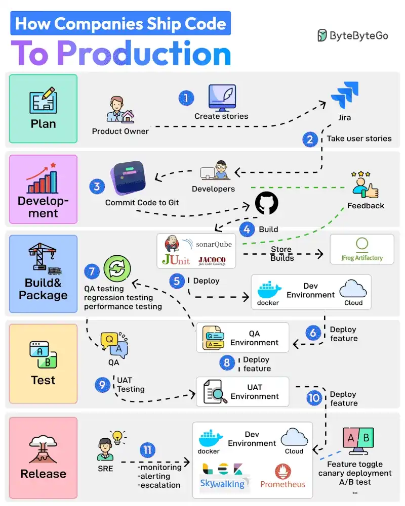

# 087 - Các công ty ship code lên production như thế nào?

- Nguồn: ByteByteGo Big Archive System Design 2025
- Trang PDF: 184-185
- Ảnh minh họa: `../assets/087/figure-01.png`

## Hình minh họa

## Dịch sát

Dưới đây là 11 bước từ planning tới production:

1. Product Owner bắt đầu toàn bộ process bằng cách tạo user story trong một tool như Jira.

2. Developer Team thực hiện Sprint Planning activity và thêm user story vào sprint.

3. Developer làm các story được giao. Khi một story hoàn thành, họ commit code vào Git và push lên GitHub.

4. Jenkins build và chạy code qua các testing và quality check tool như JUnit, Jacoco và SonarQube.

5. Nếu build thành công, nó được lưu trong artifactory như JFrog. Jenkins cũng deploy build tới Dev Environment thông qua Docker.

6. Tiếp theo, feature được deploy tới QA environment. Vì nhiều team có thể đang làm việc trên cùng code base, nhiều QA environment sẽ được tạo.

7. QA team dùng một QA environment cụ thể và chạy nhiều loại test như QA, regression và performance.

8. Khi QA verification hoàn tất, feature được deploy tới UAT (User Acceptance Testing) environment.

9. UAT testing xác minh feature có thỏa mãn requirement của user hay không.

10. Khi UAT testing thành công, các build trở thành release candidate. Chúng được deploy tới production environment dựa trên một schedule cụ thể.

11. SRE team dùng các tool như ELK và Prometheus để monitor production environment và xử lý alert khi có issue.

Câu hỏi dành cho bạn: Bạn sẽ thêm bước nào khác vào process?

## Dịch nội dung trong hình

- `Plan`: Product Owner tạo story trong Jira và nhận feedback.
- `Development`: developer lấy story, code rồi commit vào Git/GitHub.
- `Build & Package`: Jenkins build, chạy JUnit, JaCoCo, SonarQube; artifact được lưu vào JFrog Artifactory và deploy tới dev environment bằng Docker/cloud.
- `Test`: deploy feature tới QA environment, QA chạy testing; sau đó deploy tới UAT environment.
- `Release`: SRE monitor production bằng ELK/Prometheus, xử lý escalation; feature có thể được bật bằng feature toggle, canary deployment hoặc A/B test.

## Tóm tắt & giải thích dễ hiểu

Ship code lên production là một pipeline kiểm soát rủi ro. Ý tưởng chính là biến yêu cầu thành story, code thành artifact, artifact đi qua test/quality gate, sau đó release theo lịch hoặc rollout strategy. Mỗi stage giảm một loại rủi ro: sai requirement, lỗi code, regression, performance issue hoặc production incident.

Điểm quan trọng là cùng một artifact nên được promote qua các environment. Nếu mỗi environment build lại từ source theo cách khác nhau, rất dễ xảy ra lỗi “dev chạy được nhưng prod hỏng”.

## Ví dụ thực tế - không nằm trong tài liệu gốc

Một team có thể dùng GitHub Actions thay Jenkins, Docker image push lên registry, deploy vào dev bằng Helm, chạy integration test ở QA, UAT cho business owner duyệt, rồi production rollout bằng canary 5% traffic. SRE theo dõi error rate, latency và business metric trước khi mở 100%.

## Thuật ngữ chính

- `User story`: mô tả requirement theo góc nhìn user.
- `Sprint planning`: lập kế hoạch công việc trong sprint.
- `Artifact`: build output như Docker image/JAR/package.
- `Artifactory`: nơi lưu artifact versioned.
- `QA`: quality assurance.
- `UAT`: user acceptance testing.
- `SRE`: Site Reliability Engineering.

## Câu hỏi ôn tập + trả lời + thinking học tập + liên hệ

> Đây là phần học tập thêm ở cuối file. Câu hỏi ưu tiên lấy từ tài liệu gốc và được trả lời trực tiếp; nếu bài không có câu hỏi riêng thì dùng tiêu đề/nội dung chính để tạo câu hỏi tự kiểm tra.

### Câu hỏi 1

**Nguồn câu hỏi:** Câu hỏi trong tài liệu gốc.

**Câu hỏi:** Bạn sẽ thêm bước nào khác vào process?

**Trả lời:** Danh sách sẽ đầy đủ hơn nếu thêm pre-commit hook/lint để chặn lỗi sớm; trunk-based development khi team cần release nhanh; branch protection và required checks; và reflog/revert strategy để cứu lỗi Git. Các mục này giúp bức tranh đầy đủ hơn vì chúng chạm vào phần triển khai/vận hành mà bài gốc chưa đi sâu. Ý chính đang có của bài là: Ship code lên production là một pipeline kiểm soát rủi ro. Ý tưởng chính là biến yêu cầu thành story, code thành artifact, artifact đi qua test/quality gate, sau đó release theo lịch hoặc rollout strategy. Mỗi stage giảm một loại rủi ro: sai requirement, lỗi code, regression, performance issue hoặc production incident.

**Thinking học tập + liên hệ:** Khi bài hỏi còn thiếu gì trong `Các công ty ship code lên production như thế nào?`, hãy so danh sách hiện tại với nhu cầu production: scale, debug, security, cost và vận hành. Lens chính là feedback loop, rollback, collaboration, code review và mức tự động hóa phù hợp team. Khi áp dụng vào team thật, hãy nhìn developer workflow như một hệ thống: commit, review, test, deploy và rollback đều phải giảm rủi ro production. Khi ghi chú lại, hãy giải thích được các keyword: `User story`, `Sprint planning`, `Artifact`, `Artifactory`, `QA`.
