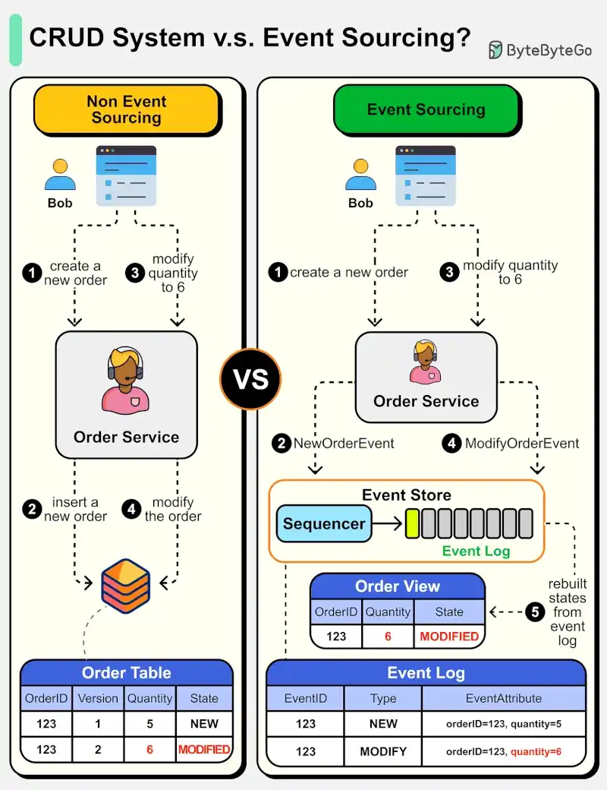

# 088 - Event Sourcing là gì? Khác gì với CRUD design thông thường?

- Nguồn: ByteByteGo Big Archive System Design 2025
- Trang PDF: 186-187
- Ảnh minh họa: `../assets/088/figure-01.png`

## Hình minh họa

## Dịch sát

Sơ đồ bên dưới cho thấy so sánh giữa normal CRUD system design và event sourcing system design. Chúng ta dùng order service làm ví dụ.

Event sourcing paradigm được dùng để thiết kế một system có determinism. Điều này thay đổi triết lý của system design thông thường.

Cách này hoạt động như thế nào? Thay vì ghi lại order state trong database, event sourcing design persist các event dẫn tới state change trong event store. Event store là append-only log. Các event phải được sequence bằng incremental number để bảo đảm ordering. Order state có thể được rebuild từ các event và maintained trong OrderView. Nếu OrderView bị down, chúng ta luôn có thể dựa vào event store, tức source of truth, để recover order state.

Hãy xem các bước chi tiết.

- Non-Event Sourcing
  - Step 1 và 2: Bob muốn mua một product. Order được tạo và insert vào database.
  - Step 3 và 4: Bob muốn đổi quantity từ 5 thành 6. Order được modify với state mới.

- Event Sourcing
  - Step 1 và 2: Bob muốn mua một product. Một `NewOrderEvent` được tạo, sequence và lưu trong event store với `eventID=321`.
  - Step 3 và 4: Bob muốn đổi quantity từ 5 thành 6. Một `ModifyOrderEvent` được tạo, sequence và persist trong event store với `eventID=322`.
  - Step 5: Order view được rebuild từ order event, hiển thị latest state của một order.

Câu hỏi dành cho bạn: Loại system nào phù hợp với event sourcing design? Bạn đã dùng paradigm này trong công việc chưa?

## Dịch nội dung trong hình

- `Non Event Sourcing`: Bob tạo order mới, Order Service insert row mới vào Order Table; khi Bob đổi quantity thành 6, Order Service update row hiện có.
- `Event Sourcing`: Bob tạo order mới, Order Service tạo `NewOrderEvent`; khi Bob đổi quantity thành 6, tạo `ModifyOrderEvent`; các event đi qua `Sequencer` rồi lưu vào `Event Log`.
- `Order View`: projection/read model được rebuild từ event log, ví dụ orderID 123, quantity 6, state modified.
- `Event Log`: lưu event theo eventID, type và event attribute; đây là nguồn sự thật để rebuild state.

## Tóm tắt & giải thích dễ hiểu

CRUD lưu trạng thái hiện tại. Event sourcing lưu lịch sử các sự kiện đã xảy ra. Với CRUD, nếu order quantity từ 5 thành 6, database thường chỉ còn state mới. Với event sourcing, hệ thống lưu cả event “tạo order quantity 5” và event “sửa quantity thành 6”, rồi tính state hiện tại từ chuỗi event.

Event sourcing phù hợp khi audit trail, replay, debugging lịch sử, determinism và khả năng rebuild projection rất quan trọng. Đổi lại, hệ thống phức tạp hơn: phải quản lý ordering, idempotency, schema evolution của event, projection lag và eventual consistency.

## Ví dụ thực tế - không nằm trong tài liệu gốc

Hệ thống ngân hàng hoặc ví điện tử thường cần biết toàn bộ lịch sử giao dịch, không chỉ balance hiện tại. Balance có thể là projection từ event log: nạp tiền, chuyển tiền, hoàn tiền, phí giao dịch. Nếu projection lỗi, có thể replay event để rebuild balance.

## Thuật ngữ chính

- `Event sourcing`: lưu event thay vì chỉ lưu state hiện tại.
- `Event store`: kho lưu event append-only.
- `Append-only log`: log chỉ thêm mới, không sửa/xóa event cũ.
- `Projection`: view/read model được xây từ event.
- `Source of truth`: nguồn dữ liệu đáng tin cậy nhất.
- `Determinism`: cùng input/event sẽ tạo cùng state.
- `Eventual consistency`: dữ liệu cuối cùng sẽ đồng bộ sau một độ trễ.

