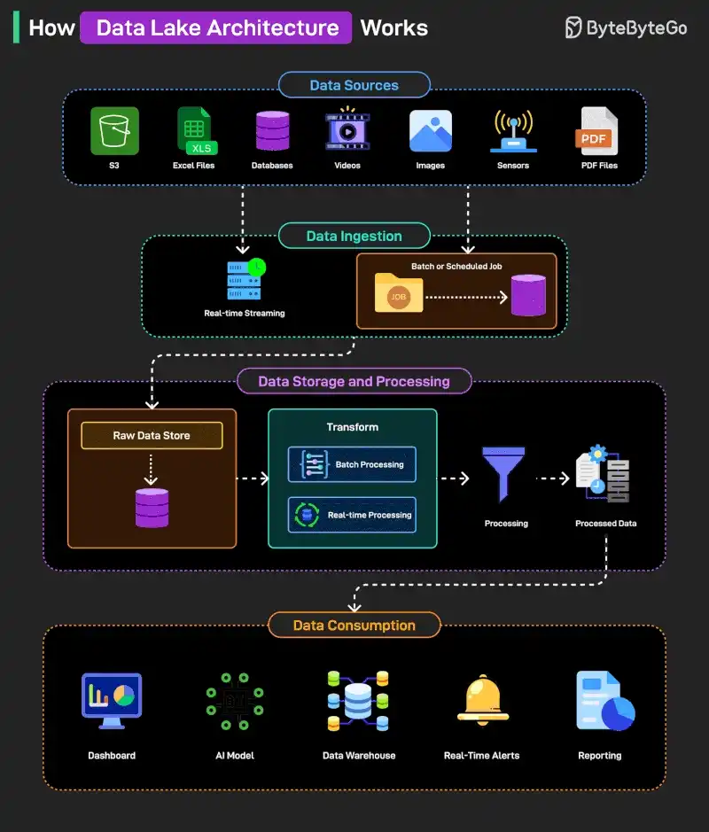

# 089 - Data Lake Architecture hoạt động như thế nào?

- Nguồn: ByteByteGo Big Archive System Design 2025
- Trang PDF: 188-189
- Ảnh minh họa: `../assets/089/figure-01.png`

## Hình minh họa

## Dịch sát

Data lake là một centralized storage system chứa khối lượng lớn structured, semi-structured và unstructured data ở dạng raw. Nó cho phép organization lưu data ở quy mô lớn và process data sau đó cho nhiều requirement khác nhau.

Dưới đây là cách nó hoạt động ở high level:

1. Data từ nhiều source khác nhau như S3, Excel file, database, video, image, sensor và PDF được collect để ingestion.

2. Ingestion diễn ra qua real-time streaming hoặc batch/scheduled job, tùy data type và source.

3. Data đã ingest trước tiên được lưu trong raw data store trước khi bất kỳ transformation hoặc processing nào xảy ra.

4. Data sau đó được process qua batch hoặc real-time processing system để clean, transform và chuẩn bị cho việc sử dụng.

5. Processed data được lưu và sẵn sàng cho downstream consumption bởi nhiều tool và platform.

6. Data consumption cuối cùng diễn ra qua dashboard, AI model, data warehouse, real-time alert và reporting system.

Câu hỏi dành cho bạn: Bạn sẽ thêm gì khác để hiểu Data Lake Architecture tốt hơn?

## Dịch nội dung trong hình

- `Data Sources`: S3, Excel files, databases, videos, images, sensors, PDF files.
- `Data Ingestion`: real-time streaming hoặc batch/scheduled job đưa data vào hệ thống.
- `Data Storage and Processing`: raw data store chứa dữ liệu thô; transform bằng batch processing hoặc real-time processing; dữ liệu xử lý xong được lưu ở processed data.
- `Data Consumption`: dashboard, AI model, data warehouse, real-time alerts và reporting.

## Tóm tắt & giải thích dễ hiểu

Data lake là nơi gom dữ liệu thô từ nhiều nguồn trước khi biết chính xác sẽ dùng thế nào. Khác với data warehouse thường yêu cầu schema rõ trước khi load, data lake ưu tiên lưu trữ linh hoạt và xử lý sau. Vì vậy data lake rất hợp cho analytics, machine learning, log processing và lưu dữ liệu phi cấu trúc.

Rủi ro lớn của data lake là biến thành “data swamp”: dữ liệu nhiều nhưng thiếu catalog, quality check, ownership, lineage và governance khiến không ai tin hoặc tìm được dữ liệu.

## Ví dụ thực tế - không nằm trong tài liệu gốc

Một e-commerce có thể đẩy clickstream, order, payment log, ảnh sản phẩm và ticket support vào data lake. Batch job làm sạch dữ liệu mỗi đêm để tạo report doanh thu; streaming job phát hiện fraud gần real-time; AI model dùng dữ liệu lịch sử để gợi ý sản phẩm.

## Thuật ngữ chính

- `Data lake`: kho lưu dữ liệu thô quy mô lớn.
- `Structured data`: dữ liệu có schema rõ như table.
- `Semi-structured data`: JSON, XML, log có cấu trúc lỏng.
- `Unstructured data`: ảnh, video, text tự do.
- `Ingestion`: nạp dữ liệu vào hệ thống.
- `Batch processing`: xử lý theo lô.
- `Streaming`: xử lý dữ liệu gần real-time.
- `Data governance`: quản trị chất lượng, quyền truy cập và lineage dữ liệu.

