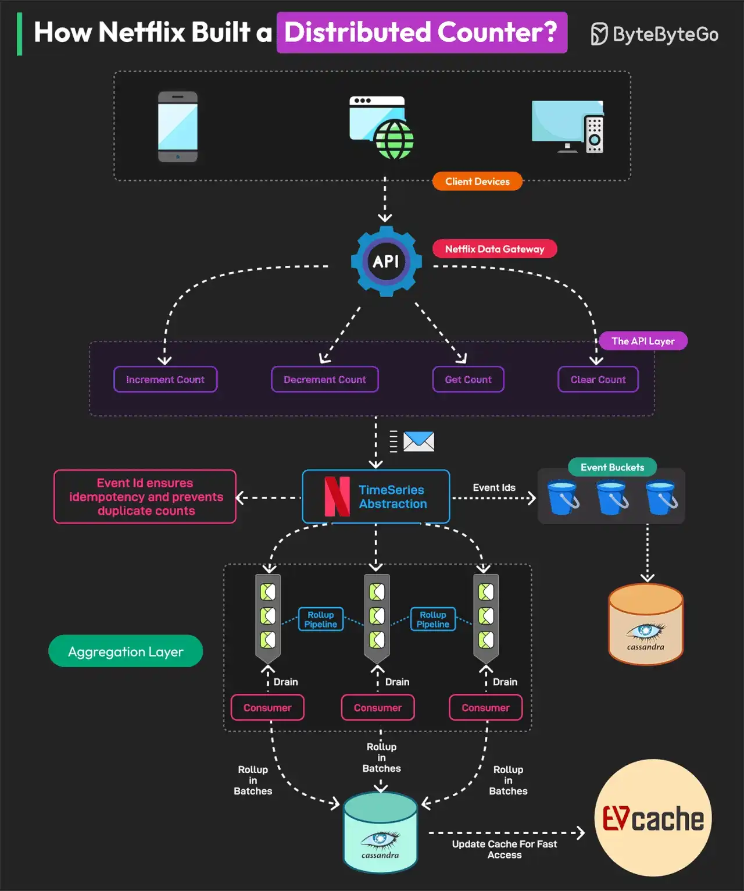
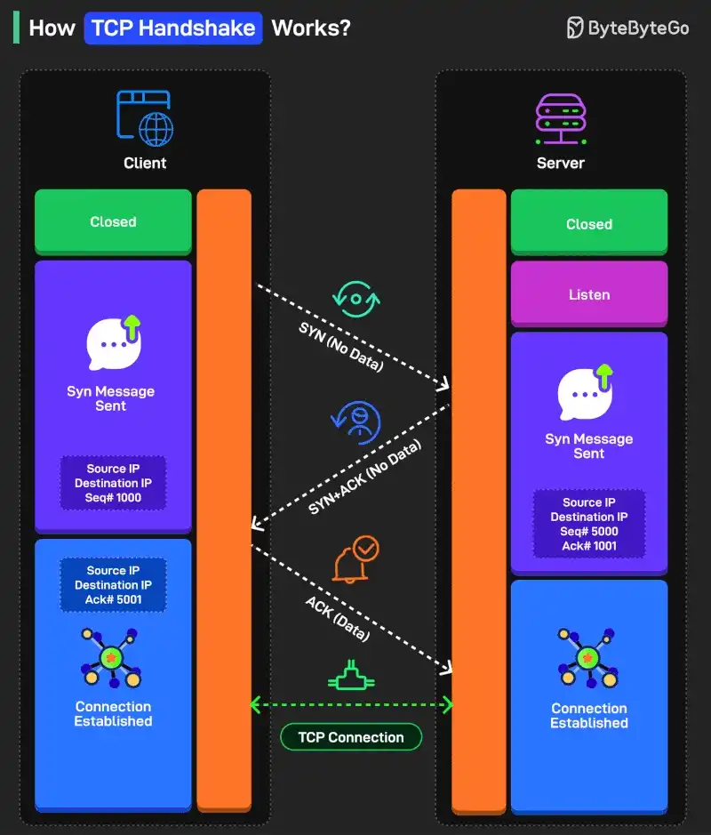

# 090 - Netflix xây dựng Distributed Counter như thế nào?

- Nguồn: ByteByteGo Big Archive System Design 2025
- Trang PDF: 190-193
- Ảnh minh họa: `../assets/090/figure-01.png`, `../assets/090/figure-02.png`

## Hình minh họa

## Dịch sát

Netflix distributed counter là một masterclass để học system design.

Distributed Counter là một system trong đó trách nhiệm count event được phân tán trên nhiều server hoặc node trong network. Netflix cần track và measure nhiều user interaction để đưa ra real-time decision và optimize infrastructure.

Vì lý do này, họ xây dựng Distributed Counter Abstraction.

Netflix Distributed Counter Abstraction hoạt động qua bốn layer chính, bảo đảm high performance, scalability và eventual consistency.

1. Client API Layer
   User tương tác với system bằng cách gửi request `AddCount`, `GetCount` hoặc `ClearCount`. Netflix Data Gateway process và route các request này một cách hiệu quả.

2. Event Logging and TimeSeries Storage
   Event được lưu trong Netflix TimeSeries Abstraction để có scalability. Mỗi event được tag bằng Event ID để bảo đảm idempotency. Để tránh database contention, event được group vào time partition gọi là bucket. Data được lưu trong Cassandra.

3. Rollup Pipeline or Aggregation
   Rollup Queue collect event change và process theo batch. Aggregation diễn ra trong immutable time window, bảo đảm rollup calculation chính xác. Data được lưu trong Cassandra Rollup Store để đạt eventual consistency.

4. Read Optimization (Cache & Query Handling)
   Aggregated counter value được cache trong EVCache để đọc cực nhanh. Nếu cache value stale, một background rollup refresh sẽ update nó. Model này cho phép Netflix xử lý 75K request mỗi giây với latency single-digit millisecond.

Reference: Netflix's Distributed Counter Abstraction

TCP Handshake hoạt động như thế nào?

Có ba bước trong handshake process:

1. SYN (Synchronize)
   Hãy nghĩ nó như việc một bên đưa tay ra để bắt tay. Process bắt đầu khi client gửi một TCP segment tới server với SYN flag. Đồng thời, initial sequence number (ISN) cũng được gửi cùng message.

2. SYN-ACK
   Đây giống như bên thứ hai đồng ý bắt tay. Server nhận SYN segment và phản hồi bằng cách gửi một TCP segment tới client. Nó set SYN flag và ACK flag trong segment. ACK flag dùng để acknowledge việc nhận SYN segment của client bằng cách tăng ISN.

3. ACK
   Đây là lúc hai bên bắt tay. Client nhận SYN-ACK segment và acknowledge response của server bằng cách gửi một TCP segment khác có ACK flag được set. Sequence number được set thành ISN của server sau khi increment.

Một vài điểm khác đáng cân nhắc:

1. SYN và ACK là control flag dùng để quản lý các khía cạnh khác nhau của communication process.

2. Sequence number (ISN) giúp client và server theo dõi thứ tự message để không bỏ sót gì.

Câu hỏi dành cho bạn: Bạn sẽ thêm gì khác để hiểu TCP Handshake process tốt hơn?

## Dịch nội dung trong hình

- Hình 1 - Distributed Counter: client device gọi Netflix Data Gateway qua API layer với các operation `Increment Count`, `Decrement Count`, `Get Count`, `Clear Count`.
- Event ID bảo đảm idempotency và ngăn duplicate count; event đi vào Netflix TimeSeries Abstraction, được đưa vào event bucket và lưu Cassandra.
- Aggregation layer dùng consumer drain queue, rollup pipeline và rollup theo batch; kết quả rollup lưu vào Cassandra rollup store rồi update EVCache để đọc nhanh.
- Hình 2 - TCP Handshake: client/server đi từ `Closed`/`Listen` tới `SYN`, `SYN-ACK`, `ACK`; sau đó connection established và hình thành TCP connection.

## Tóm tắt & giải thích dễ hiểu

Distributed counter nghe đơn giản nhưng khó ở quy mô lớn vì nhiều request có thể tăng/giảm cùng một counter đồng thời. Nếu mọi request cùng update một row, database contention sẽ rất cao. Netflix giải quyết bằng cách log event trước, chia theo bucket/time partition, aggregate bất đồng bộ và cache kết quả đọc.

Phần TCP handshake trong cùng file giải thích cách TCP tạo kết nối tin cậy trước khi truyền dữ liệu. SYN/SYN-ACK/ACK giúp hai bên đồng bộ sequence number và xác nhận sẵn sàng giao tiếp.

## Ví dụ thực tế - không nằm trong tài liệu gốc

Một hệ thống video streaming có thể cần đếm số lần play, pause, like hoặc impression theo từng title gần real-time. Nếu dùng event log + rollup, hệ thống chịu tải tốt hơn update trực tiếp một counter duy nhất. Với số liệu hiển thị cho user, có thể chấp nhận eventual consistency vài giây để đổi lấy throughput cao.

## Thuật ngữ chính

- `Distributed counter`: bộ đếm phân tán trên nhiều node.
- `Idempotency`: chống xử lý trùng khi retry.
- `Time partition/bucket`: chia dữ liệu theo khoảng thời gian.
- `Rollup`: gom/aggregate dữ liệu chi tiết thành số liệu tổng hợp.
- `EVCache`: caching system của Netflix dựa trên Memcached.
- `TCP handshake`: quy trình thiết lập TCP connection.
- `SYN/ACK`: control flag trong TCP.

## Câu hỏi ôn tập + trả lời + thinking học tập + liên hệ

> Đây là phần học tập thêm ở cuối file. Câu hỏi ưu tiên lấy từ tài liệu gốc và được trả lời trực tiếp; nếu bài không có câu hỏi riêng thì dùng tiêu đề/nội dung chính để tạo câu hỏi tự kiểm tra.

### Câu hỏi 1

**Nguồn câu hỏi:** Câu hỏi trong tài liệu gốc.

**Câu hỏi:** Bạn sẽ thêm gì khác để hiểu TCP Handshake process tốt hơn?

**Trả lời:** Danh sách sẽ đầy đủ hơn nếu thêm query plan/EXPLAIN để biết bottleneck thật; transaction isolation để tránh race condition và dirty read; connection pooling/backpressure để database không bị quá tải; và cache invalidation strategy rõ ràng. Các mục này giúp bức tranh đầy đủ hơn vì chúng chạm vào phần triển khai/vận hành mà bài gốc chưa đi sâu. Ý chính đang có của bài là: Distributed counter nghe đơn giản nhưng khó ở quy mô lớn vì nhiều request có thể tăng/giảm cùng một counter đồng thời. Nếu mọi request cùng update một row, database contention sẽ rất cao. Netflix giải quyết bằng cách log event trước, chia theo bucket/time partition, aggregate bất đồng bộ và cache kết quả đọc.

**Thinking học tập + liên hệ:** Danh sách trong `Netflix xây dựng Distributed Counter như thế nào?` nên được kiểm theo coverage: nó đã nói phần nào, thiếu phần nào và phần thiếu có làm thay đổi quyết định thiết kế không. Lens chính là read/write ratio, consistency, cardinality, query pattern, growth rate và recovery requirement. Khi gặp bài toán dữ liệu, hãy nối bài học với truy vấn nóng nhất, index thật sự được dùng, cache nào có thể stale và thời gian restore sau sự cố. Khi ghi chú lại, hãy giải thích được các keyword: `Distributed counter`, `Idempotency`, `Time partition/bucket`, `Rollup`, `EVCache`.
