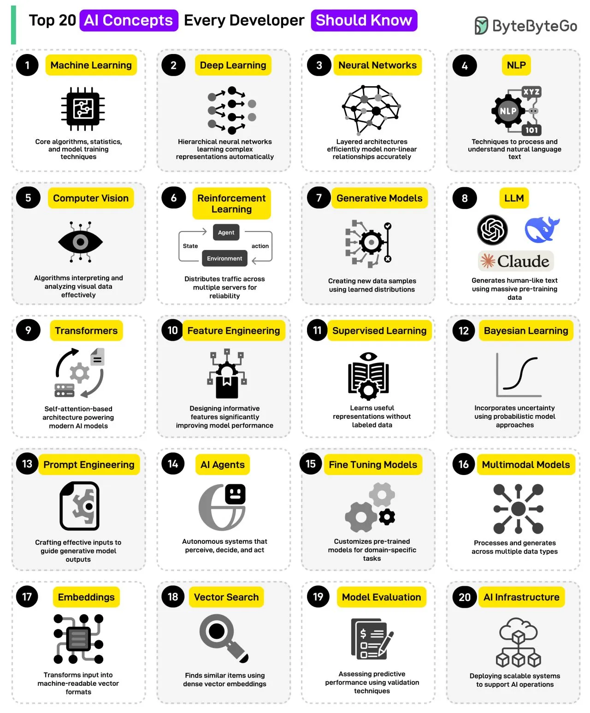

# 091 - 20 khái niệm AI bạn nên biết

- Nguồn: ByteByteGo Big Archive System Design 2025
- Trang PDF: 194-195
- Ảnh minh họa: `../assets/091/figure-01.png`

## Hình minh họa

## Dịch sát

1. Machine Learning: Core algorithm, statistics và model training technique.

2. Deep Learning: Hierarchical neural network tự động học representation phức tạp.

3. Neural Networks: Layered architecture model hóa nonlinear relationship một cách hiệu quả và chính xác.

4. NLP: Technique để process và understand natural language text.

5. Computer Vision: Algorithm interpret và analyze visual data hiệu quả.

6. Reinforcement Learning: Phân phối traffic qua nhiều server để tăng reliability.

7. Generative Models: Tạo data sample mới bằng learned data.

8. LLM: Generate human-like text bằng massive pre-trained data.

9. Transformers: Self-attention-based architecture powering modern AI model.

10. Feature Engineering: Thiết kế informative feature để cải thiện đáng kể model performance.

11. Supervised Learning: Học representation hữu ích mà không cần labeled data.

12. Bayesian Learning: Kết hợp uncertainty bằng probabilistic model approach.

13. Prompt Engineering: Craft input hiệu quả để guide output của generative model.

14. AI Agents: Autonomous system có thể perceive, decide và act.

15. Fine-Tuning Models: Customize pre-trained model cho domain-specific task.

16. Multimodal Models: Process và generate qua nhiều data type như image, video và text.

17. Embeddings: Transform input thành machine-readable vector format.

18. Vector Search: Tìm item tương tự bằng dense vector embedding.

19. Model Evaluation: Đánh giá predictive performance bằng validation technique.

20. AI Infrastructure: Deploy scalable system để hỗ trợ AI operation.

Câu hỏi dành cho bạn: Bạn sẽ thêm khái niệm AI nào khác vào danh sách?

## Dịch nội dung trong hình

Hình liệt kê 20 khái niệm: Machine Learning, Deep Learning, Neural Networks, NLP, Computer Vision, Reinforcement Learning, Generative Models, LLM, Transformers, Feature Engineering, Supervised Learning, Bayesian Learning, Prompt Engineering, AI Agents, Fine Tuning Models, Multimodal Models, Embeddings, Vector Search, Model Evaluation và AI Infrastructure.

## Tóm tắt & giải thích dễ hiểu

Danh sách này là bản đồ nhập môn cho AI hiện đại. Phần nền tảng gồm ML, statistics, neural networks, deep learning. Phần language/vision gồm NLP, computer vision, LLM, transformers và multimodal model. Phần ứng dụng production gồm prompt engineering, fine-tuning, embeddings, vector search, evaluation, agents và AI infrastructure.

Khi học theo tư duy lập trình, nên nối các khái niệm thành pipeline: dữ liệu -> feature/embedding -> model -> inference -> evaluation -> deployment -> monitoring/feedback loop.

## Ví dụ thực tế - không nằm trong tài liệu gốc

Một chatbot hỗ trợ khách hàng có thể dùng LLM để generate câu trả lời, embeddings + vector search để tìm tài liệu liên quan, prompt engineering để kiểm soát format, model evaluation để đo chất lượng và AI infrastructure để scale inference, logging, rate limit và cost control.

## Thuật ngữ chính

- `ML`: Machine Learning.
- `NLP`: Natural Language Processing.
- `LLM`: Large Language Model.
- `Transformer`: kiến trúc dùng self-attention.
- `Embedding`: vector biểu diễn dữ liệu.
- `Vector search`: tìm kiếm theo độ tương tự vector.
- `Fine-tuning`: tinh chỉnh model đã train trước.
- `Evaluation`: đo chất lượng model/system.

## Ghi chú kỹ thuật - không nằm trong tài liệu gốc

- Mục `Reinforcement Learning` trong nguồn/hình có mô tả “distributed traffic across multiple servers for reliability”, đây giống định nghĩa của load balancing hơn là reinforcement learning. Reinforcement Learning đúng hơn là học hành động qua reward/penalty khi agent tương tác với environment.
- Mục `Supervised Learning` trong nguồn/hình ghi “without labeled data”, nhưng supervised learning đúng là học từ labeled data. “Without labeled data” phù hợp hơn với unsupervised learning hoặc self-supervised learning.

