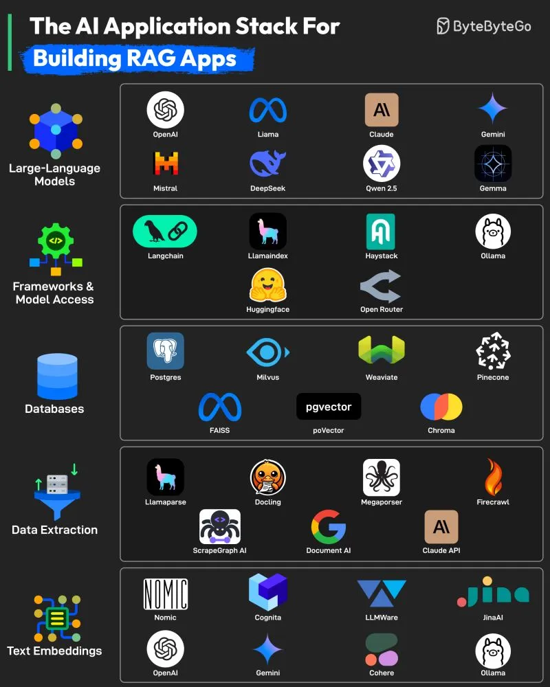

# 092 - AI Application Stack để xây dựng RAG app

- Nguồn: ByteByteGo Big Archive System Design 2025
- Trang PDF: 196-197
- Ảnh minh họa: `../assets/092/figure-01.png`

## Hình minh họa

## Dịch sát

1. Large Language Models
   Đây là core engine phía sau Retrieval-Augmented Generation (RAG), chịu trách nhiệm hiểu query và generate response mạch lạc, đúng context. Một số lựa chọn LLM phổ biến là OpenAI GPT models, Llama, Claude, Gemini, Mistral, DeepSeek, Qwen 2.5, Gemma, v.v.

2. Frameworks and Model Access
   Các tool này đơn giản hóa việc tích hợp LLM vào application bằng cách xử lý prompt orchestration, model switching, memory, chaining và routing. Tool phổ biến gồm Langchain, LlamaIndex, Haystack, Ollama, Hugging Face và OpenRouter.

3. Databases
   RAG application dựa vào việc lưu và retrieve thông tin liên quan. Các vector database này được optimize cho similarity search, trong khi lựa chọn relational như Postgres cung cấp structured storage. Tool gồm Postgres, FAISS, Milvus, pgVector, Weaviate, Pinecone, Chroma, v.v.

4. Data Extraction
   Để populate knowledge base, các tool này giúp extract structured information từ unstructured source như PDF, website và API. Một số tool phổ biến là Llamaparse, Docking, Megaparser, Firecrawl, ScrapeGraph AI, Document AI và Claude API.

5. Text Embeddings
   Embedding chuyển text thành high-dimensional vector cho phép semantic similarity search, đây là bước critical để kết nối query với relevant context trong RAG. Tool phổ biến gồm Nomic, OpenAI, Cognita, Gemini, LLMWare, Cohere, JinaAI và Ollama.

Câu hỏi dành cho bạn: Bạn sẽ thêm gì khác vào danh sách để build RAG app?

## Dịch nội dung trong hình

- `Large-Language Models`: OpenAI, Llama, Claude, Gemini, Mistral, DeepSeek, Qwen 2.5, Gemma.
- `Frameworks & Model Access`: LangChain, LlamaIndex, Haystack, Ollama, Hugging Face, OpenRouter.
- `Databases`: Postgres, Milvus, Weaviate, Pinecone, FAISS, pgvector, Chroma.
- `Data Extraction`: LlamaParse, Docling, Megaparser, Firecrawl, ScrapeGraph AI, Document AI, Claude API.
- `Text Embeddings`: Nomic, Cognita, LLMWare, JinaAI, OpenAI, Gemini, Cohere, Ollama.

## Tóm tắt & giải thích dễ hiểu

Một RAG app thường có 5 phần: LLM để hiểu/sinh câu trả lời, framework để điều phối prompt/tool/model, database/vector store để lưu tri thức, data extraction để đưa dữ liệu thô vào knowledge base, và embedding model để biến text thành vector tìm kiếm ngữ nghĩa.

Điểm quan trọng là RAG không chỉ là “gắn vector database vào LLM”. RAG production còn cần chunking, metadata, reranking, evaluation, access control, freshness, caching, observability và guardrails.

## Ví dụ thực tế - không nằm trong tài liệu gốc

Một RAG app hỏi đáp tài liệu nội bộ có thể dùng LlamaParse để extract PDF, chunk tài liệu theo section, tạo embedding bằng OpenAI/Cohere, lưu vector vào pgvector hoặc Pinecone, retrieve top-k đoạn liên quan, rồi đưa vào prompt cho LLM trả lời kèm citation.

## Thuật ngữ chính

- `RAG`: Retrieval-Augmented Generation.
- `Embedding`: vector biểu diễn semantic meaning.
- `Vector database`: database tối ưu similarity search.
- `Chunking`: chia tài liệu thành đoạn nhỏ để index.
- `Reranking`: xếp hạng lại kết quả retrieve.
- `Knowledge base`: kho tri thức dùng cho truy xuất.
- `Prompt orchestration`: điều phối prompt/context/tool/model.

## Ghi chú kỹ thuật - không nằm trong tài liệu gốc

Trong phần text nguồn ghi `Docking`, còn hình hiển thị `Docling`. Khả năng cao đây là typo/OCR nhầm; mình giữ `Docking` trong phần dịch sát và ghi `Docling` theo hình.

## Câu hỏi ôn tập + trả lời + thinking học tập + liên hệ

> Đây là phần học tập thêm ở cuối file. Câu hỏi ưu tiên lấy từ tài liệu gốc và được trả lời trực tiếp; nếu bài không có câu hỏi riêng thì dùng tiêu đề/nội dung chính để tạo câu hỏi tự kiểm tra.

### Câu hỏi 1

**Nguồn câu hỏi:** Câu hỏi trong tài liệu gốc.

**Câu hỏi:** Bạn sẽ thêm gì khác vào danh sách để build RAG app?

**Trả lời:** Phần còn thiếu đáng cân nhắc là evaluation harness để đo chất lượng thay vì cảm tính; guardrails/policy để giảm prompt injection và output nguy hiểm; observability cho prompt, context, latency, cost và hallucination; và model routing theo độ khó/cost của request. Các mục này giúp bức tranh đầy đủ hơn vì chúng chạm vào phần triển khai/vận hành mà bài gốc chưa đi sâu. Ý chính đang có của bài là: Một RAG app thường có 5 phần: LLM để hiểu/sinh câu trả lời, framework để điều phối prompt/tool/model, database/vector store để lưu tri thức, data extraction để đưa dữ liệu thô vào knowledge base, và embedding model để biến text thành vector tìm kiếm ngữ nghĩa.

**Thinking học tập + liên hệ:** Đừng thêm mục cho dài danh sách; với `AI Application Stack để xây dựng RAG app`, chỉ thêm thứ mở ra một nhóm vấn đề mới hoặc giúp ra quyết định thiết kế tốt hơn. Lens chính là quality, latency, cost/token, privacy, cập nhật tri thức và rủi ro hallucination. Khi build AI app, hãy nối model với pipeline thật: data vào đâu, context lấy từ đâu, output được kiểm thế nào và chi phí tăng theo traffic ra sao. Khi ghi chú lại, hãy giải thích được các keyword: `RAG`, `Embedding`, `Vector database`, `Chunking`, `Reranking`.
