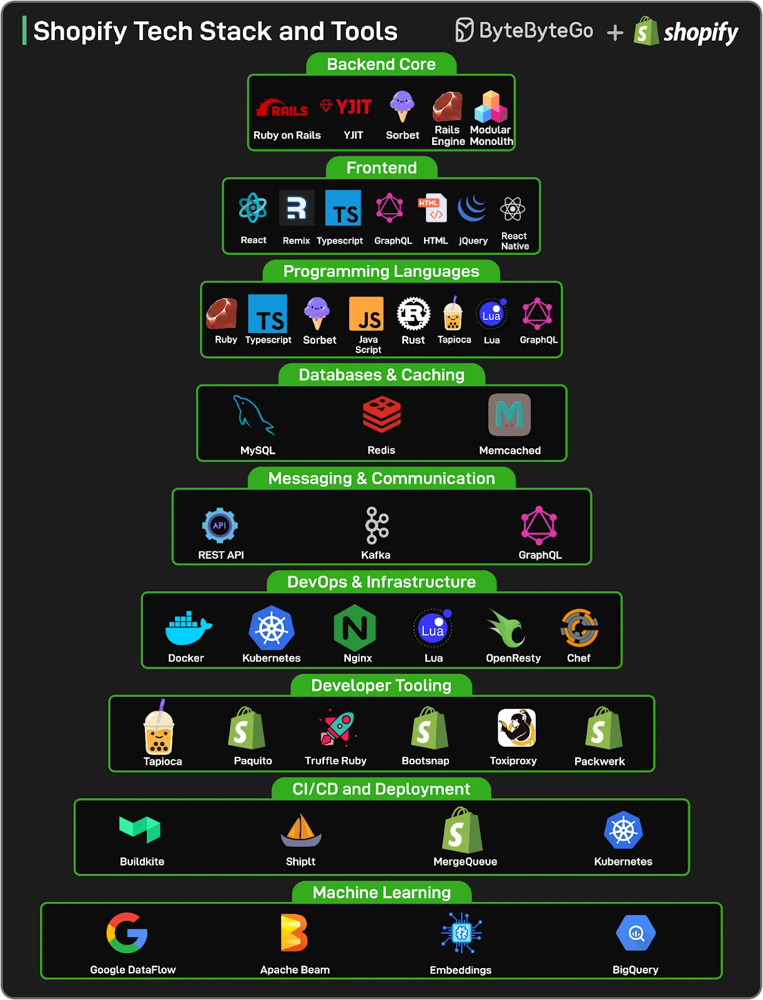

# 093 - Tech stack và tool của Shopify

- Nguồn: ByteByteGo Big Archive System Design 2025
- Trang PDF: 198-199
- Ảnh minh họa: `../assets/093/figure-01.png`, `../assets/093/figure-02.png`

## Hình minh họa

## Dịch sát

Shopify xử lý quy mô có thể làm hỏng hầu hết system.

Trong một ngày duy nhất (Black Friday 2024), platform xử lý 173 tỷ request, peak ở 284 triệu request mỗi phút, và đẩy 12 terabyte traffic mỗi phút qua edge của họ.

Những con số này không phải anomaly. Chúng là target bền vững mà Shopify cố gắng đạt được. Phía sau quy mô này là một stack nhìn từ bên ngoài có vẻ đơn giản một cách đánh lừa: Ruby on Rails, React, MySQL và Kafka.

Nhưng sự đơn giản đó che giấu các quyết định architecture sắc bén, nhiều năm refactoring và hàng nghìn trade-off có chủ đích.

Trong newsletter này, chúng tôi map tech stack powering Shopify từ:

- modular monolith vẫn đang chạy business,
- tới các pod cô lập failure domain,
- tới deployment pipeline ship hàng trăm change mỗi ngày.
- Nó bao phủ tool, programming language và pattern mà Shopify dùng để duy trì tốc độ, resilience và developer-friendliness ở quy mô đáng kinh ngạc.

Xin cảm ơn rất nhiều engineering team world-class của Shopify vì đã chia sẻ insight và cộng tác với chúng tôi trong bài khám phá kỹ thuật sâu này.

🔗 Dive into the full newsletter here.

## Dịch nội dung trong hình

- `Backend Core`: Ruby on Rails, YJIT, Sorbet, Rails Engine, Modular Monolith.
- `Frontend`: React, Remix, TypeScript, GraphQL, HTML, jQuery, React Native.
- `Programming Languages`: Ruby, TypeScript, Sorbet, JavaScript, Rust, Tapioca, Lua, GraphQL.
- `Databases & Caching`: MySQL, Redis, Memcached.
- `Messaging & Communication`: REST API, Kafka, GraphQL.
- `DevOps & Infrastructure`: Docker, Kubernetes, Nginx, Lua, OpenResty, Chef.
- `Developer Tooling`: Tapioca, Paquito, TruffleRuby, Bootsnap, Toxiproxy, Packwerk.
- `CI/CD and Deployment`: Buildkite, ShipIt, MergeQueue, Kubernetes.
- `Machine Learning`: Google DataFlow, Apache Beam, Embeddings, BigQuery.

## Tóm tắt & giải thích dễ hiểu

Điểm đáng học ở Shopify không phải chỉ là dùng Rails hay MySQL, mà là cách họ giữ một kiến trúc đơn giản đủ lâu trong khi liên tục thêm boundary, tooling và quy trình để scale. Modular monolith giúp tránh microservices hóa quá sớm, còn pod/failure domain/deployment pipeline giúp cô lập rủi ro khi quy mô tăng.

Một stack “đơn giản” ở quy mô lớn vẫn cần rất nhiều kỹ thuật phụ trợ: type checking, caching, queue/messaging, CI/CD mạnh, observability, chaos/testing tool và tooling để giữ codebase lớn có tổ chức.

## Ví dụ thực tế - không nằm trong tài liệu gốc

Một SaaS đang tăng trưởng có thể bắt đầu bằng monolith Rails/Laravel/NestJS, nhưng chia module rõ theo domain, thêm queue, cache, typed boundary, CI/CD, feature flag và observability. Khi một domain có scaling/failure profile khác hẳn, lúc đó mới tách service thay vì tách mọi thứ ngay từ đầu.

## Thuật ngữ chính

- `Modular monolith`: monolith có boundary module rõ.
- `Failure domain`: vùng lỗi được cô lập để tránh lan rộng.
- `YJIT`: Ruby just-in-time compiler.
- `Sorbet`: type checker cho Ruby.
- `Packwerk`: tool quản lý boundary trong Rails monolith.
- `MergeQueue`: hàng đợi merge giúp bảo vệ main branch.
- `Edge traffic`: traffic đi qua lớp edge/CDN/proxy gần user.

## Ghi chú kỹ thuật - không nằm trong tài liệu gốc

Asset `figure-02.png` của bài này được tách ra gần như là trang trắng. Mình vẫn giữ link ảnh để khớp bản gốc và tiện audit pipeline.

## Câu hỏi ôn tập + trả lời + thinking học tập + liên hệ

> Đây là phần học tập thêm ở cuối file. Câu hỏi ưu tiên lấy từ tài liệu gốc và được trả lời trực tiếp; nếu bài không có câu hỏi riêng thì dùng tiêu đề/nội dung chính để tạo câu hỏi tự kiểm tra.

### Câu hỏi 1

**Nguồn câu hỏi:** Suy ra từ tiêu đề/nội dung chính vì bài gốc không có câu hỏi riêng.

**Câu hỏi:** Sau khi đọc bài “Shopify Tech Stacks and Tools”, ý chính cần trả lời và áp dụng vào system design là gì?

**Trả lời:** Trọng tâm cần đem vào thực tế là: Điểm đáng học ở Shopify không phải chỉ là dùng Rails hay MySQL, mà là cách họ giữ một kiến trúc đơn giản đủ lâu trong khi liên tục thêm boundary, tooling và quy trình để scale. Modular monolith giúp tránh microservices hóa quá sớm, còn pod/failure domain/deployment pipeline giúp cô lập rủi ro khi quy mô tăng. Khi áp dụng vào hệ thống thật, hãy kiểm thêm requirement, constraint, traffic, dữ liệu, failure mode và khả năng vận hành của team.

**Thinking học tập + liên hệ:** Khi học `Tech stack và tool của Shopify`, hãy thử viết một checklist áp dụng vào project: input, output, owner, rủi ro và metric kiểm chứng. Lens chính là requirement, constraint, traffic, dữ liệu, failure mode và khả năng vận hành của team. Khi gặp system design thật, hãy biến khái niệm thành quyết định: boundary ở đâu, data flow thế nào, bottleneck nào đến trước và rollback ra sao. Khi ghi chú lại, hãy giải thích được các keyword: `Modular monolith`, `Failure domain`, `YJIT`, `Sorbet`, `Packwerk`.
