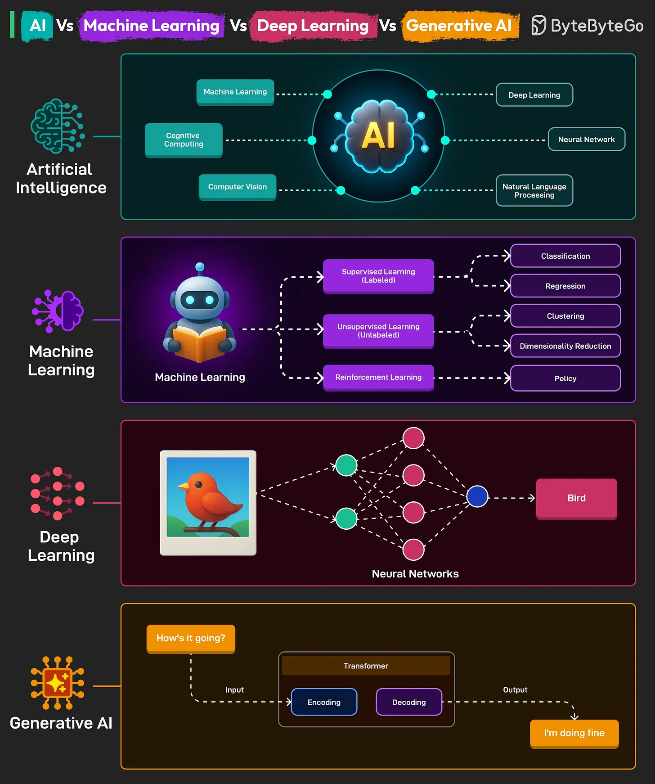

# 094 - AI vs Machine Learning vs Deep Learning vs Generative AI

- Nguồn: ByteByteGo Big Archive System Design 2025
- Trang PDF: 200-201
- Ảnh minh họa: `../assets/094/figure-01.png`

## Hình minh họa

## Dịch sát

1. Artificial Intelligence (AI)
   Đây là lĩnh vực bao trùm, tập trung vào việc tạo ra machine hoặc system có thể thực hiện các task thường cần human intelligence, chẳng hạn reasoning, learning, problem-solving và language understanding. AI gồm nhiều subfield khác nhau, bao gồm ML, NLP, Robotics và Computer Vision.

2. Machine Learning (ML)
   Đây là một subset của AI, tập trung vào việc phát triển algorithm cho phép computer học từ data và đưa ra decision dựa trên data.

   Thay vì được explicitly programmed cho mọi task, ML system cải thiện performance khi được tiếp xúc với nhiều data hơn. Application phổ biến gồm spam detection, recommendation system và predictive analytics.

3. Deep Learning
   Đây là một subset chuyên biệt của ML, dùng artificial neural network với nhiều layer để model các pattern phức tạp trong data.
   Neural network là computational model lấy cảm hứng từ mạng neuron trong brain con người. Deep neural network có thể tự động discover representation cần thiết cho future detection. Use case gồm image and speech recognition, NLP và autonomous vehicles.

4. Generative AI
   Chỉ các AI system có khả năng generate content mới, chẳng hạn text, image, music hoặc code, giống với data mà chúng được train trên đó. Chúng dựa vào Transformer Architecture.
   Các generative AI model đáng chú ý gồm GPT cho text generation và DALL-E cho image creation.

Câu hỏi dành cho bạn: Bạn sẽ thêm gì khác để hiểu các khái niệm này tốt hơn?

## Dịch nội dung trong hình

- `Artificial Intelligence`: bao trùm Machine Learning, Expert System, Computer Vision, NLP, Deep Learning, Neural Networks, Robot Language Processing.
- `Machine Learning`: gồm supervised learning, labeled data, unsupervised learning, clustering, dimensionality reduction và policy.
- `Deep Learning`: neural network nhiều layer học từ dữ liệu như hình chim để phân loại output.
- `Generative AI`: input đi qua Transformer gồm encoding/decoding để tạo output như “I’m doing fine”.

## Tóm tắt & giải thích dễ hiểu

AI là ô lớn nhất: làm máy có hành vi thông minh. Machine Learning là một cách làm AI bằng cách học từ dữ liệu. Deep Learning là một nhánh của ML dùng neural network nhiều tầng. Generative AI là nhóm hệ thống tạo nội dung mới như text, ảnh, nhạc hoặc code.

Quan hệ dễ nhớ: không phải AI nào cũng là ML, không phải ML nào cũng là deep learning, và không phải deep learning nào cũng là generative AI. Nhưng nhiều generative AI hiện đại dùng deep learning, đặc biệt là transformer hoặc diffusion model.

## Ví dụ thực tế - không nằm trong tài liệu gốc

Rule-based chatbot cũ có thể là AI nhưng không phải ML. Model dự đoán khách hàng rời bỏ dịch vụ là ML. Model nhận diện ảnh lỗi sản phẩm bằng CNN là deep learning. ChatGPT tạo câu trả lời hoặc DALL-E tạo ảnh là generative AI.

## Thuật ngữ chính

- `AI`: Artificial Intelligence.
- `ML`: Machine Learning.
- `Deep Learning`: ML dùng neural network nhiều tầng.
- `Neural network`: mô hình tính toán gồm nhiều node/layer.
- `Generative AI`: AI tạo nội dung mới.
- `Transformer`: kiến trúc attention mạnh cho sequence/text.
- `Diffusion model`: nhóm model sinh ảnh phổ biến.

## Ghi chú kỹ thuật - không nằm trong tài liệu gốc

Bản gốc nói Generative AI “rely on Transformer Architecture”. Câu này đúng với nhiều text/code LLM, nhưng chưa bao quát toàn bộ Generative AI; nhiều image/video generation system dựa trên diffusion hoặc kiến trúc khác.

