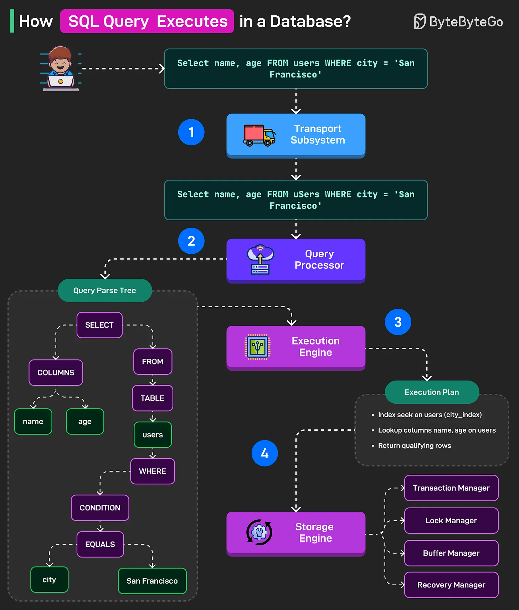

# 095 - SQL query được execute trong database như thế nào?

- Nguồn: ByteByteGo Big Archive System Design 2025
- Trang PDF: 202-203
- Ảnh minh họa: `../assets/095/figure-01.png`

## Hình minh họa

## Dịch sát

STEP 1

Query string trước tiên tới Transport Subsystem của database. Subsystem này quản lý connection với client. Nó cũng thực hiện authentication và authorization check, và nếu mọi thứ có vẻ ổn, nó cho query đi tới bước tiếp theo.

STEP 2

Query bây giờ tới Query Processor subsystem, gồm hai phần: Query Parser và Query Optimizer.

Query Parser chia query thành các sub-part như SELECT, FROM, WHERE. Nó kiểm tra syntax error và tạo parse tree.

Sau đó, Query Optimizer đi qua parse tree, kiểm tra semantic error, ví dụ table `users` có tồn tại hay không, và tìm cách execute query hiệu quả nhất.

Output của bước này là execution plan.

STEP 3

Execution plan đi tới Execution Engine. Plan này gồm tất cả step cần thiết để execute query.

Execution Engine lấy plan này và điều phối việc execute từng step bằng cách gọi Storage Engine. Nó cũng collect result từ từng step và trả response kết hợp hoặc thống nhất cho upper layer.

STEP 4

Execution Engine gửi low-level read và write request tới Storage Engine dựa trên execution plan.

Việc này được xử lý bởi nhiều component của Storage Engine, chẳng hạn transaction manager cho transaction management, lock manager để acquire lock cần thiết, buffer manager để kiểm tra data page có trong memory hay không, và recovery manager cho rollback hoặc recovery.

Câu hỏi dành cho bạn: Bạn sẽ thêm gì khác để hiểu execution của SQL Query?

## Dịch nội dung trong hình

- Client gửi query ví dụ `Select name, age FROM users WHERE city = 'San Francisco'`.
- Bước 1: `Transport Subsystem` nhận query và quản lý kết nối.
- Bước 2: `Query Processor` tạo `Query Parse Tree`, gồm các phần `SELECT`, `COLUMNS`, `FROM`, `TABLE users`, `WHERE`, `CONDITION city = San Francisco`.
- Bước 3: `Execution Engine` nhận execution plan, ví dụ dùng index trên `users.city`, lookup username/name/age và return qualifying rows.
- Bước 4: `Storage Engine` làm việc với `Transaction Manager`, `Lock Manager`, `Buffer Manager`, `Recovery Manager` để đọc/ghi dữ liệu an toàn.

## Tóm tắt & giải thích dễ hiểu

Một SQL query không chạy trực tiếp theo chuỗi text bạn viết. Database phải nhận request qua connection layer, parse cú pháp, kiểm tra ý nghĩa, optimize thành execution plan, rồi execution engine phối hợp storage engine để đọc/ghi page dữ liệu, lock, transaction và recovery.

Đây là lý do cùng một câu SQL có thể chạy rất nhanh hoặc rất chậm tùy index, statistics, join order, buffer cache và execution plan. Khi tối ưu SQL, cần xem `EXPLAIN`/`EXPLAIN ANALYZE` thay vì chỉ đoán từ câu query.

## Ví dụ thực tế - không nằm trong tài liệu gốc

Với query `SELECT name FROM users WHERE city = 'San Francisco'`, nếu có index trên `city`, optimizer có thể chọn index scan. Nếu không có index hoặc filter không selective, database có thể phải sequential scan toàn bảng. Nếu data page đã nằm trong buffer cache, query nhanh hơn nhiều so với phải đọc từ disk.

## Thuật ngữ chính

- `Transport subsystem`: lớp nhận kết nối/query từ client.
- `Query parser`: phân tích cú pháp query.
- `Parse tree`: cây biểu diễn cấu trúc câu SQL.
- `Query optimizer`: chọn cách chạy hiệu quả.
- `Execution plan`: kế hoạch thực thi.
- `Storage engine`: lớp đọc/ghi dữ liệu vật lý.
- `Buffer manager`: quản lý page trong memory.

## Câu hỏi ôn tập + trả lời + thinking học tập + liên hệ

> Đây là phần học tập thêm ở cuối file. Câu hỏi ưu tiên lấy từ tài liệu gốc và được trả lời trực tiếp; nếu bài không có câu hỏi riêng thì dùng tiêu đề/nội dung chính để tạo câu hỏi tự kiểm tra.

### Câu hỏi 1

**Nguồn câu hỏi:** Câu hỏi trong tài liệu gốc.

**Câu hỏi:** Bạn sẽ thêm gì khác để hiểu execution của SQL Query?

**Trả lời:** Phần còn thiếu đáng cân nhắc là query plan/EXPLAIN để biết bottleneck thật; transaction isolation để tránh race condition và dirty read; connection pooling/backpressure để database không bị quá tải; và cache invalidation strategy rõ ràng. Các mục này giúp bức tranh đầy đủ hơn vì chúng chạm vào phần triển khai/vận hành mà bài gốc chưa đi sâu. Ý chính đang có của bài là: Một SQL query không chạy trực tiếp theo chuỗi text bạn viết. Database phải nhận request qua connection layer, parse cú pháp, kiểm tra ý nghĩa, optimize thành execution plan, rồi execution engine phối hợp storage engine để đọc/ghi page dữ liệu, lock, transaction và recovery.

**Thinking học tập + liên hệ:** Khi bài hỏi còn thiếu gì trong `SQL query được execute trong database như thế nào?`, hãy so danh sách hiện tại với nhu cầu production: scale, debug, security, cost và vận hành. Lens chính là read/write ratio, consistency, cardinality, query pattern, growth rate và recovery requirement. Khi gặp bài toán dữ liệu, hãy nối bài học với truy vấn nóng nhất, index thật sự được dùng, cache nào có thể stale và thời gian restore sau sự cố. Khi ghi chú lại, hãy giải thích được các keyword: `Transport subsystem`, `Query parser`, `Parse tree`, `Query optimizer`, `Execution plan`.
