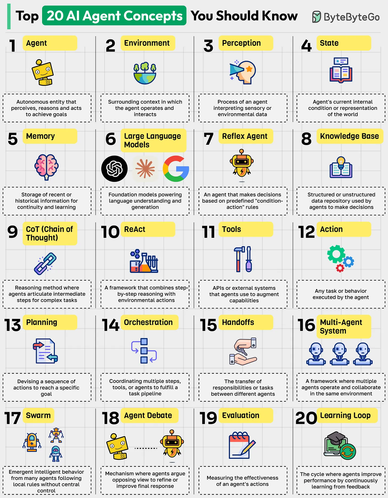

# 096 - 20 khái niệm AI Agent bạn nên biết

- Nguồn: ByteByteGo Big Archive System Design 2025
- Trang PDF: 204-205
- Ảnh minh họa: `../assets/096/figure-01.png`

## Hình minh họa

## Dịch sát

1. Agent: Một autonomous entity có thể perceive, reason và act trong một environment để đạt goal.

2. Environment: Context hoặc sandbox xung quanh nơi agent operate và interact.

3. Perception: Process interpret sensory hoặc environmental data để xây dựng situational awareness.

4. State: Current internal condition của agent hoặc representation của thế giới.

5. Memory: Storage của thông tin gần đây hoặc lịch sử để duy trì continuity và learning.

6. Large Language Models: Foundation model powering language understanding và generation.

7. Reflex Agent: Một loại agent đơn giản đưa ra decision dựa trên rule “condition-action” được định nghĩa trước.

8. Knowledge Base: Structured hoặc unstructured data repository được agent dùng để hỗ trợ decision.

9. CoT (Chain of Thought): Một reasoning method trong đó agent articulate intermediate step cho task phức tạp.

10. ReACT: Một framework kết hợp step-by-step reasoning với direct environmental action.

11. Tools: API hoặc external system mà agent dùng để mở rộng capability.

12. Action: Bất kỳ task hoặc behavior nào được agent execute như kết quả của reasoning.

13. Planning: Devising một sequence action để đạt một goal cụ thể.

14. Orchestration: Điều phối nhiều step, tool hoặc agent để hoàn thành một task pipeline.

15. Handoffs: Việc chuyển responsibility hoặc task giữa các agent khác nhau.

16. Multi-Agent System: Framework trong đó nhiều agent operate và collaborate trong cùng environment.

17. Swarm: Emergent intelligent behavior từ nhiều agent tuân theo local rule mà không có central control.

18. Agent Debate: Mechanism trong đó agent tranh luận các quan điểm đối lập để refine hoặc improve outcome.

19. Evaluation: Đo effectiveness hoặc success của action và outcome của agent.

20. Learning Loop: Cycle trong đó agent cải thiện performance bằng cách liên tục học từ feedback hoặc outcome.

Câu hỏi dành cho bạn: Bạn sẽ thêm khái niệm AI agent nào khác vào danh sách?

## Dịch nội dung trong hình

Hình liệt kê cùng 20 khái niệm AI Agent: Agent, Environment, Perception, State, Memory, Large Language Models, Reflex Agent, Knowledge Base, CoT, ReAct, Tools, Action, Planning, Orchestration, Handoffs, Multi-Agent System, Swarm, Agent Debate, Evaluation và Learning Loop.

## Tóm tắt & giải thích dễ hiểu

AI agent là hệ thống không chỉ trả lời text, mà còn có thể quan sát context, lập kế hoạch, gọi tool, hành động, ghi nhớ và tự cải thiện qua feedback. LLM thường là “bộ não ngôn ngữ”, nhưng agent hoàn chỉnh còn cần environment, state, tools, orchestration, evaluation và guardrails.

Trong production, khái niệm quan trọng nhất không phải là agent “tự động” đến đâu, mà là kiểm soát được hành vi: permission, audit log, rollback, human approval, timeout, cost limit và evaluation.

## Ví dụ thực tế - không nằm trong tài liệu gốc

Một support agent có thể nhận ticket, đọc knowledge base, hỏi thêm thông tin nếu thiếu, gọi CRM để kiểm tra subscription, đề xuất hướng xử lý và tạo draft reply. Với case nhạy cảm như refund lớn, agent nên handoff cho human hoặc cần approval trước khi gọi action thật.

## Thuật ngữ chính

- `Agent`: thực thể AI hành động theo mục tiêu.
- `Environment`: môi trường agent quan sát/tương tác.
- `State`: trạng thái hiện tại của agent hoặc thế giới.
- `Memory`: bộ nhớ context/lịch sử.
- `Tool use`: agent gọi API/tool bên ngoài.
- `Planning`: lập chuỗi hành động.
- `Orchestration`: điều phối nhiều bước/tool/agent.
- `Evaluation`: đánh giá chất lượng hành vi/kết quả.

