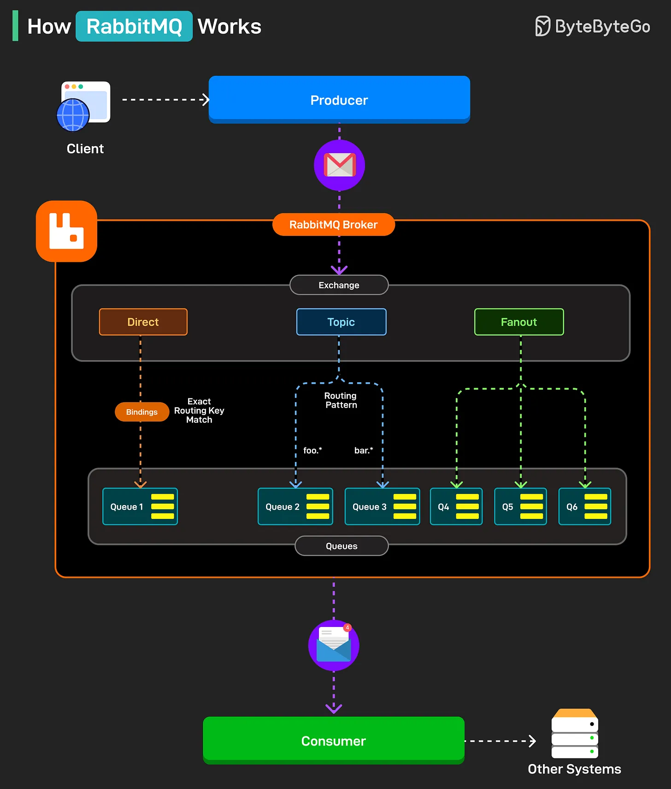

# 097 - RabbitMQ hoạt động như thế nào?

- Nguồn: ByteByteGo Big Archive System Design 2025
- Trang PDF: 206-207
- Ảnh minh họa: `../assets/097/figure-01.png`

## Hình minh họa

## Dịch sát

RabbitMQ là một message broker cho phép application giao tiếp bằng cách gửi và nhận message thông qua queue. Nó giúp decouple service, cải thiện scalability và xử lý asynchronous processing hiệu quả.

Dưới đây là cách nó hoạt động:

1. Producer, thường là application hoặc service, gửi message tới RabbitMQ broker. Broker quản lý message routing và delivery.

2. Bên trong broker, message được gửi tới exchange. Exchange quyết định message nên được route như thế nào dựa trên loại exchange: Direct, Topic hoặc Fanout.

3. Binding kết nối exchange với queue bằng binding key, định nghĩa rule để route message, ví dụ exact match hoặc pattern-based.

4. Direct exchange route message tới queue match chính xác với routing key, như minh họa với Queue 1.

5. Topic exchange dùng pattern để route message tới các queue phù hợp.

6. Fanout exchange broadcast message tới tất cả bound queue, bất kể routing key.

7. Cuối cùng, message được consumer pull từ queue, consumer process message và có thể chuyển kết quả tới system khác.

Câu hỏi dành cho bạn: Bạn sẽ thêm gì khác vào RabbitMQ process flow?

## Dịch nội dung trong hình

- `Client` gửi message tới `Producer`.
- Producer gửi message vào `RabbitMQ Broker`.
- Trong broker có `Exchange` với ba kiểu: `Direct`, `Topic`, `Fanout`.
- `Direct`: dùng exact routing key match để đưa message tới queue cụ thể.
- `Topic`: dùng routing pattern để match nhiều queue theo pattern.
- `Fanout`: broadcast tới tất cả queue được bind.
- `Consumer` lấy message từ queue và có thể gửi kết quả tới `Other Systems`.

## Tóm tắt & giải thích dễ hiểu

RabbitMQ đứng giữa producer và consumer để hai bên không cần gọi trực tiếp nhau. Producer chỉ cần publish message, còn consumer xử lý khi sẵn sàng. Exchange quyết định route message vào queue nào, còn queue giữ message cho tới khi consumer lấy ra.

Điểm quan trọng khi thiết kế là chọn đúng exchange type. Direct phù hợp routing chính xác, topic phù hợp event theo pattern như `order.created`, fanout phù hợp broadcast notification tới nhiều consumer.

## Ví dụ thực tế - không nằm trong tài liệu gốc

Trong e-commerce, Order Service publish event `order.created`. Inventory Service, Email Service và Analytics Service có thể consume theo nhu cầu. Nếu Email Service tạm down, message vẫn nằm trong queue và được xử lý sau, giúp Order Service không bị phụ thuộc trực tiếp.

## Thuật ngữ chính

- `Message broker`: hệ thống trung gian nhận và phân phối message.
- `Producer`: bên gửi message.
- `Consumer`: bên nhận/xử lý message.
- `Exchange`: thành phần route message trong RabbitMQ.
- `Queue`: hàng đợi lưu message.
- `Binding key`: rule nối exchange với queue.
- `Routing key`: key dùng để route message.

## Câu hỏi ôn tập + trả lời + thinking học tập + liên hệ

> Đây là phần học tập thêm ở cuối file. Câu hỏi ưu tiên lấy từ tài liệu gốc và được trả lời trực tiếp; nếu bài không có câu hỏi riêng thì dùng tiêu đề/nội dung chính để tạo câu hỏi tự kiểm tra.

### Câu hỏi 1

**Nguồn câu hỏi:** Câu hỏi trong tài liệu gốc.

**Câu hỏi:** Bạn sẽ thêm gì khác vào RabbitMQ process flow?

**Trả lời:** Có thể thêm capacity estimation trước khi chọn kiến trúc; SLO/NFR rõ cho latency, availability và durability; graceful degradation khi dependency hỏng; và data ownership và service boundary. Các mục này giúp bức tranh đầy đủ hơn vì chúng chạm vào phần triển khai/vận hành mà bài gốc chưa đi sâu. Ý chính đang có của bài là: RabbitMQ đứng giữa producer và consumer để hai bên không cần gọi trực tiếp nhau. Producer chỉ cần publish message, còn consumer xử lý khi sẵn sàng. Exchange quyết định route message vào queue nào, còn queue giữ message cho tới khi consumer lấy ra. Điểm quan trọng khi thiết kế là chọn đúng exchange type. Direct phù hợp routing chính xác, topic phù hợp event theo pattern như `order.created`, fanout phù hợp broadcast notification tới nhiều consumer.

**Thinking học tập + liên hệ:** Khi bài hỏi còn thiếu gì trong `RabbitMQ hoạt động như thế nào?`, hãy so danh sách hiện tại với nhu cầu production: scale, debug, security, cost và vận hành. Lens chính là requirement, constraint, traffic, dữ liệu, failure mode và khả năng vận hành của team. Khi gặp system design thật, hãy biến khái niệm thành quyết định: boundary ở đâu, data flow thế nào, bottleneck nào đến trước và rollback ra sao. Khi ghi chú lại, hãy giải thích được các keyword: `Message broker`, `Producer`, `Consumer`, `Exchange`, `Queue`.
